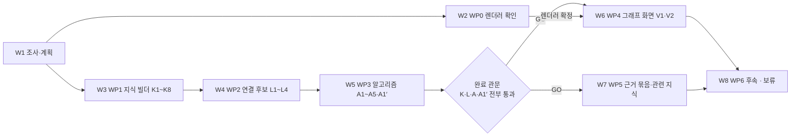

# 지식그래프 활용 구현 전체 그림 · 실행 로드맵

> **용도**: “지금 어디까지 왔고, 무엇을 어떤 순서로 진행하며, 나는 무엇을 하면 되는가”를 한 장으로 보여주는 브리핑.
> 상세 상태·완료 기준·증거는 [`PROGRESS.md`](PROGRESS.md)가 관리한다. 내용이 충돌하면 `PROGRESS.md`와 실제 저장소 상태를 우선한다.
> PROGRESS 기준일: 2026-11-05 19:40

## 1. 문제와 목표 — 30초

P&ID 그래프에 비P&ID 성분(문서·요건·설정치 등)을 통합하고, 그래프 알고리즘과 Obsidian식 ③ 그래프 화면을 그래프활용.md WP0~WP5에 따라 구현한다.

## 2. 지금 어디까지 왔나

| 구분 | 요약 |
|---|---|
| 완료 | `W1`~`W6`(계획, 렌더러 확인, 지식 빌더, 엔티티 연결, 알고리즘 MVP, ③ 지식그래프 화면) |
| 현재 단계 | `W7`(④ 근거 묶음·⑤ 관련 지식) 진행 중(구현) — 규격 승인(그래프활용 §6.4), 편집 범위 D11 |
| 막힌 것 | 없음 |
| 다음 게이트 | `W7`: 구현 후 C1~C10 |

## 3. 무엇을 어떤 순서로 진행하나

| 순서 | 단계 | 왜 이 순서인가 | 게이트 | 상태 |
|---|---|---|---|---|
| `W1` | 초기 조사와 실행 계획 구체화 | 범위와 근거를 먼저 고정해야 후속 작업을 안전하게 나눌 수 있다. | [`README.md`](README.md)의 범위 확인과 조사 증거 기록 | 완료 |
| `W2` | `WP0` 렌더러 오프라인 적재 확인 | 렌더러를 실제로 띄워 보지 않았으므로 화면 구현 전에 확인한다(그래프활용 §5.2). | 렌더러 확정(그래프활용 D8) | 완료 |
| `W3` | `WP1` 지식 입력 규격·빌더·샘플 | 연결·알고리즘·화면이 모두 지식 레이어를 입력으로 쓴다. | K1~K8 | 완료 |
| `W4` | `WP2` 엔티티 연결 후보와 확인 흐름 | 확인된 연결이 있어야 알고리즘이 지식 관계를 계산한다 [추론]. | L1~L4 | 완료 |
| `W5` | `WP3` 알고리즘 MVP | 화면·근거 묶음이 쓸 결과를 화면 없이 먼저 검증한다. | A1~A5·A1′·P1 | 완료 |
| `W6` | `WP4` 그래프 화면 | 완료 관문과 렌더러 확정 뒤에 화면을 만든다. | 완료 관문 + `W2` 결과, V1·V2 | 완료 |
| `W7` | `WP5` ④ 근거 묶음·⑤ 관련 지식 | 근거 묶음 변경은 단계 간 규격 변경이므로 MVP 검증 후 분리한다(그래프활용 D9). | 완료 관문, C1~C10 | 진행 중(구현) |
| `W8` | `WP6` 후속 알고리즘·여러 도면 통합 | 후속 범위. | 사용자 착수 결정 [추론] | 보류(후속) |

> `W2`는 `W3`~`W5`와 병행한다. `W3`→`W4`→`W5` 순서는 그래프활용 §8.1에 명시되지 않은 [추론]이며, §8.1은 세 묶음 모두의 완료만 관문으로 요구한다.

## 4. 나는 지금 무엇을 하면 되나

- 지금 할 일: `W7` 규격([그래프활용 §6.4](../../기획서/그래프활용.md#64-wp5-상세-규격))을 총괄이 확인하면 developer가 D11 범위에서 구현하고 C1~C10을 통과시킨다. ⑤ 관련 지식 배치·배지는 디자인 담당이 정한다. T6 W3은 `W7` 뒤에 순차 진행
- 확인할 범위: [`README.md`](README.md), [그래프활용 §2·§5.2·§7](../../기획서/그래프활용.md)
- 결과를 남길 곳: [`evidence/`](evidence/README.md)
- 상세 상태를 갱신할 곳: [`PROGRESS.md`](PROGRESS.md)

## 5. 공통 실행 규칙

1. 작업 전에 `README.md`에서 편집 범위와 작업 확장 규칙을 확인한다.
2. 조사·검증 결과는 `evidence/`에 먼저 남긴다.
3. 설계·정책 판단은 [`decisions.md`](decisions.md)에 기록한다.
4. 작업 ID별 상세 상태·완료 기준·다음 행동은 `PROGRESS.md`만 갱신한다.
5. `PROGRESS.md`의 단계·순서·게이트·현재 행동이 바뀌면 이 브리핑과 `PROGRESS 기준일`을 함께 맞춘다.
