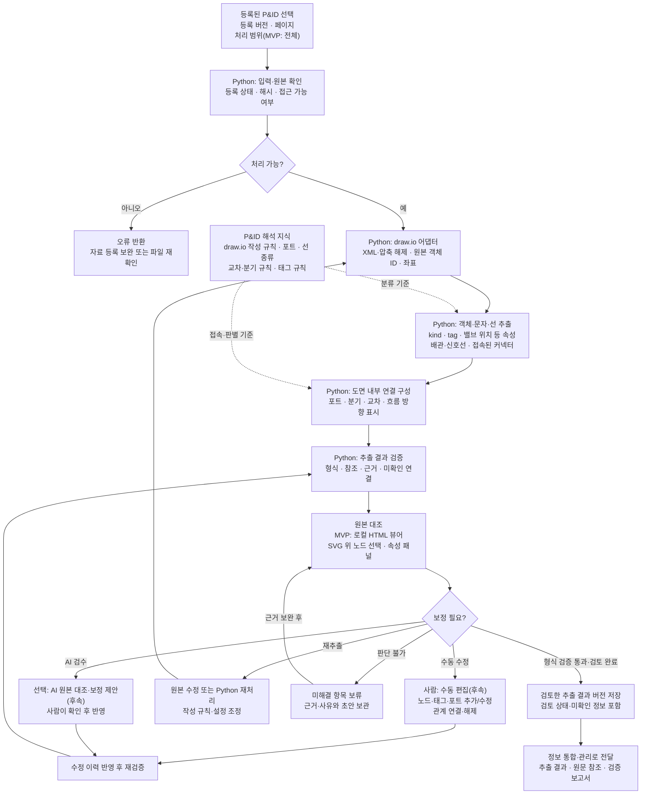

# 정보 추출 상세 플로우차트

[최상위 플로우차트](00-overview.md) · [정보 추출 기획서](../extraction.md)

| 구분 | 내용 |
| --- | --- |
| 원본 근거 | 설계자료 10종. MVP는 draw.io P&ID. 표·보고서와 다른 자료형은 후속 어댑터로 확장 |
| 직접 입력 | 등록 완료된 draw.io의 자료 ID·등록 버전·원본 참조·페이지 정보 |
| 처리 주체 | Python 자동 추출, 사람의 원본 대조·수정, 선택적인 AI 검수·보정 제안(후속) |
| 출력 | 도면 내부 임시 노드·포트·관계·문자·속성, 원본 좌표, 검토 상태, 검증 보고서 |

여러 도면·문서의 동일 대상을 합치는 작업은 정보 통합·관리 단계에서 수행합니다.

MVP 경로는 A→P와 "재추출" 되돌림입니다. 수동 편집과 AI 보정은 후속입니다. 다른 자료형은 D 위치에 형식별 어댑터를 추가하고 이후 흐름은 그대로 사용합니다.

유효하지 않은 참조나 확정할 수 없는 연결은 정상 관계로 전달하지 않으며, 구조 검증 통과와 원본 대조 결과는 별도로 기록합니다. 검증 범위와 기준은 [기획서](../extraction.md)에, 원본 참조와 전달 예시는 [단계 간 데이터 규격](../overview.md#data-contract)에 정의합니다.
