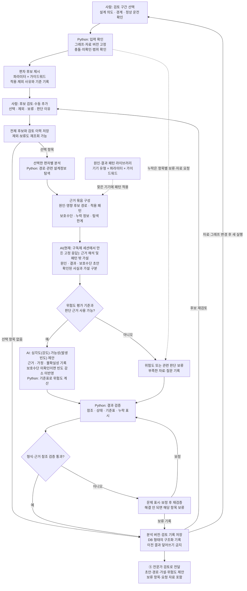

# HAZOP 분석 상세 플로우차트

[최상위 플로우차트](00-overview.md) · [HAZOP 분석 기획서](../hazop-analysis.md) · [공통 원칙](../overview.md#principles)

| 구분 | 내용 |
| --- | --- |
| 원본 근거 | P&ID·PFD·설계 의도·물질·운전조건·사양·제어·보호·절차·유틸리티 등 설계자료 10종 |
| 직접 입력 | 검증된 통합 그래프 버전, 연결된 설계정보와 원문 참조, 사람이 선택한 검토 구간과 정상 운전 조건 |
| 분석 기준 | 파라미터·가이드워드 후보 규칙([HAZOP 기법 지침](../hazop-method-guide.md)의 〈별표3〉 44개 후보, 적용 불가는 사유 기록), [원인·결과 패턴 라이브러리](../hazop-analysis.md#patterns), 경로 탐색 조건, 위험도 평가 기준(MVP: KOSHA P-86-2017 예시 임시 기준표). 적용 버전 기록 |
| 출력 | 전체 편차 후보와 선택·제외·보류 이력, 원인·결과·보호수단 초안, AI 추가 가설·위험도 제안, 보류 사유·필요 자료 |

첫 범위는 **사람이 선택한 검토 구간의 정상 운전**이며, MVP 구간은 SNP-M-102 가압기입니다(사용자 결정, 2026-11-04). ④에서 AI가 위험도를 제안하고, ⑤에서 사람이 확정합니다. 이 단계와 ⑤의 결과(HAZOP 결과)가 프로젝트의 최종 산출물입니다.

MVP에서는 구간과 후보 선택을 사람이 JSON으로 지정하고(A·D), 결과 JSON을 저장한 뒤 Excel로 출력합니다. 후보 판단 화면은 [데스크톱 인터페이스](../interface.md)로 앞당겨 구현하고, 재검토 되돌림은 후속입니다.

정보가 부족해도 확인 가능한 범위는 분석하고, 나머지는 항목별로 보류·자료 요청을 기록합니다. 그래프에서 연결된 경로는 확정된 인과관계와 구분합니다.

단계 간 ID·버전·상태와 전달 예시는 [전체 기획의 데이터 규격](../overview.md#data-contract)을 따릅니다. ③의 구조 검증 통과는 미확인 조건이 없다는 뜻이 아니며, 관련 분석 판단을 항목별로 보류할 수 있습니다.
