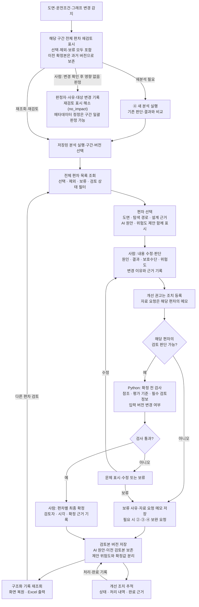

# 검토·결과 관리 상세 플로우차트

[최상위 플로우차트](00-overview.md) · [검토·결과 관리 기획서](../review-results.md) · [공통 원칙](../overview.md#principles)

| 구분 | 내용 |
| --- | --- |
| 원본 근거 | ④ 분석 결과에 연결된 원본 도면·설계자료와 당시 버전 |
| 직접 입력 | 전체 편차 후보, 선택·제외·보류 이력, 분석 경로·근거, AI 원안·가설·위험도 제안 |
| 처리 주체 | 사람이 편차별 수정·확정, Python이 참조·평가 기준·저장·출력·변경 상태 검증 |
| 출력 | 전문가 검토본, 확정 위험도, 개선 조치, 자료 요청 메모, 재검토 표시, 화면 재조회·Excel 워크시트 |

자료 요청은 메모로 기록하고 개선 권고만 조치로 관리합니다. 자료·그래프 변경 시 해당 검토 구간의 **모든 편차**를 재검토 대상으로 표시하며 이전 확정본은 보존합니다. 재검토 표시는 재검토 확정 또는 사람의 영향 없음 판정으로만 해소합니다.

MVP는 ④ 결과를 Excel로 출력(M)하고 사용자 평가 기준과 비교하는 데까지입니다. 검토 화면과 확정 기록은 [데스크톱 인터페이스](../interface.md)로 앞당겨 구현하고, 조치·재검토 운영은 후속입니다.

개선 조치 완료와 편차 검토 확정은 별도 상태입니다. 자료 요청 메모 작성만으로 보류를 자동 해제하거나 조치를 완료하지 않습니다. Excel은 선택한 버전과 검토 상태를 표시하여 초안·보류·과거 확정본을 현재 확정 결과로 오인하지 않게 합니다.

샘플 분석 기록·원문 참조·평가 기준·변경 이벤트만으로 독립 검증하며, 실제 AI나 다른 단계의 실행은 필요하지 않습니다. 검증 사례는 [기획서](../review-results.md)에 정리합니다.

변경 알림의 식별자·전후 버전·대상 구간 및 전체 후보 재검토 규칙은 [전체 기획의 데이터 규격](../overview.md#data-contract)을 따릅니다. 같은 알림의 재처리로 이력을 중복 생성하지 않고, 과거 검토본과 새 버전의 재검토 상태를 구분합니다.
