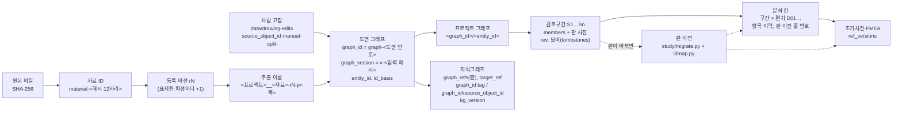
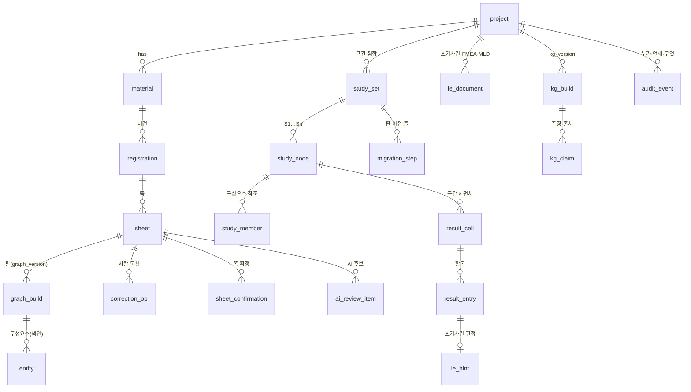

# 데이터베이스와 사내 NAS·GitLab 연결 검토 (2026-11-26)

이 앱에 데이터베이스를 붙여야 하는지, 붙인다면 무엇을 어떻게 붙일지, 그리고 나중에 사내 NAS의 GitLab·데이터베이스와 어떻게 이을지를 검토한 기록이다. 구현이나 설정 변경, 외부 연결은 하지 않았다. 기준 커밋은 `feat/drawing-knowledge` `117147a7`이다.

## 결론

1. **지금 당장 데이터베이스를 붙일 까닭은 없다.** 한 사람이 한 PC에서 쓰는 지금은 JSON 파일 저장(원자적 쓰기, 지문 확인, 백업, 판 이전)으로 충분하다. 표본 프로젝트 하나가 파일 84개, 약 9.1MB이고 프로젝트 그래프와 검토구간은 0.01초 안에 읽힌다(§1.3).
2. **여러 사람이 같은 프로젝트를 동시에 고치는 순간부터는 파일 구조로는 안 된다.** 다른 프로세스의 동시 쓰기를 막는 장치는 'PC 한 대에서 앱 하나만 실행'이라는 잠금뿐이다. 지금 작업 폴더를 NAS 공유 폴더에 두고 여럿이 열면, 경고 없이 한쪽 저장을 덮어쓸 수 있다(§1.4, §3).
3. **최종 목표는 사내 서버의 PostgreSQL(선택지 다)로 잡는다.** 다만 바로 옮기지 않는다. ① 저장소 층을 한 겹 두고 ② 파일에서 다시 만들 수 있는 읽기 전용 색인을 먼저 붙인 뒤 ③ 사람이 쓴 기록(고침·구간·분석 결과·초기사건)부터 DB로 옮긴다. 도면 그래프·지식그래프처럼 계산으로 다시 만들 수 있는 결과는 파일이나 캐시로 남긴다(§6).
4. **소스 코드는 사내 GitLab을 두 번째 원격으로 두는 것부터 시작한다.** GitLab CI의 시험은 NAS가 아니라 Windows PC나 가상 머신에 GitLab Runner를 따로 두고 돌려야 한다. 지금 CI가 Windows와 Qt 화면 없는 실행에 기대고 있기 때문이다(§4.1).
5. **지금 하지 말 것.** 작업 폴더를 NAS 공유 폴더에 두고 여럿이 함께 쓰기, SQLite 파일을 공유 폴더에 두기, 보안 등급이 있을 수 있는 설계자료를 승인 없이 GitHub나 사내 GitLab에 올리기, 저장소 층과 왕복 시험 없이 DB 쓰기로 바로 넘어가기(§7.2).

## 사용자에게 물을 것

정해져야 다음 단계가 열리는 것부터 적었다.

| # | 물을 것 | 왜 필요한가 | 답에 따라 갈리는 것 |
| --- | --- | --- | --- |
| Q1 | 같은 프로젝트를 **동시에** 고칠 사람이 몇 명인가. '같이 본다'와 '같이 고친다'는 다르다 | DB가 필요한 가장 큰 이유가 동시 편집이다 | 1명이면 DB 없이 공유 백업만으로 된다. 2명 이상이면 선택지 (다) |
| Q2 | NAS 기종과 운영체제(Synology DSM, QNAP QTS·QuTS hero 등), CPU 종류(x86·ARM), 메모리 | 컨테이너(PostgreSQL·GitLab)를 돌릴 수 있는지가 기종마다 다르다 | NAS 컨테이너, NAS 패키지, 별도 서버·가상 머신 |
| Q3 | 사내 GitLab의 판(Community·Enterprise, 무료·유료 등급)과 버전, 관리 주체 | 원격 미러의 방향과 CI 러너 등록 방법이 등급·버전마다 다르다 | 밀어 넣기 미러만 쓸지, 끌어오기 미러를 쓸지 |
| Q4 | 보안 등급이 있는 실제 원전 설계자료를 NAS·사내 GitLab·사내 DB에 둘 수 있는가. 둔다면 등급별로 어디까지인가 | 원본 PDF, 추출 결과, 분석 결과가 모두 설계 정보를 담는다 | 데이터 저장소 위치, 암호화, 접근 권한 설계 |
| Q5 | 사내망 조건: 앱을 쓰는 PC에서 NAS까지 같은 망인가, VPN을 거치는가, 사내망 밖(출장·재택)에서도 써야 하는가 | 오프라인 작업이 필요하면 DB 단독 구조가 어렵다 | 로컬 우선+동기화, 또는 사내망 전용 |
| Q6 | 서버를 누가 관리하는가(IT 부서 승인, 백업 정책, 계정 체계) | DB 백업·복구와 계정 발급을 앱이 대신할 수 없다 | 사내 계정(AD·LDAP) 연동, DB 계정을 따로 둘지 |
| Q7 | 이력과 감사 추적이 규정상 필요한가(누가 언제 무엇을 바꿨는지 몇 년 보관 등) | 지금도 이력을 남기지만 지울 수 없게 보관하지는 않는다 | 이력을 덧붙이기 전용 표로 둘지, 보관 기간 |
| Q8 | 공개 GitHub 저장소를 계속 둘 것인가, 사내 GitLab을 주 저장소로 바꿀 것인가 | 미러 방향과 CI 주인이 정해진다 | GitHub 주·GitLab 거울, 또는 그 반대 |
| Q9 | 사내망에서 Claude 구독 연결(AI 검토·분석)을 쓸 수 있는가 | DB를 사내에 두더라도 AI 호출은 밖으로 나간다 | 사내 배포본에서 AI 기능을 켤지 |

## 1. 지금 구조의 지도

### 1.1 무엇이 어디에 저장되나

작업 루트는 개발 환경에서 저장소의 `work/`, 배포본에서 `%LOCALAPPDATA%\HAZOP`이다(`hazop/paths.py`의 `work_root`, 환경변수 `HAZOP_WORK_ROOT`). 폴더는 `paths.FOLDERS`와 `paths.OUTPUT_FOLDERS` 두 표로만 연다. 아래 경로는 작업 루트 기준이다.

| 자료 | 자리 | 꼴 | 사람 입력인가, 계산 결과인가 | 쓰는 모듈 |
| --- | --- | --- | --- | --- |
| 등록 원본 | `store/<프로젝트>/originals/<자료 ID>/<등록 버전>/<원래 파일>` (+ `derived/` SVG) | 원본 파일 | 입력(바뀌지 않음) | `hazop/register/registry.py` |
| 등록정보 | `store/<프로젝트>/registry.json`, `registrations/<자료 ID>/<버전>.json` | JSON | 입력(표제란 확정은 사람) | `registry.py`, `titleblock.py` |
| 추출 결과 | `output/extract/<프로젝트>__<자료 ID>-r<버전>-p<쪽>/extraction.json`, `extraction_run.json`, 입력 연산이 있으면 `extraction.inputs.json` | JSON | 계산(원본+입력 연산에서 다시 만듦) | `hazop/extract/` |
| 도면 그래프 | `output/graph/<추출 이름>/graph.json`, `entity_mapping.json`, `path_expectations.json` | JSON | 계산 | `scripts/build_graph.py`, `hazop/graph/` |
| 프로젝트 그래프 | **파일 없음.** 도면 그래프를 읽어 메모리에서 잇는다. 사람이 정한 도면 연결만 `data/drawing-links/<프로젝트>.json` | 메모리(프로세스 안 pickle 캐시) | 계산 + 사람 지정 | `hazop/graph/project.py` |
| 도면 사람 고침 | `data/drawing-edits/<추출 이름>.json` (연산 목록, 단계 input·overlay) | JSON | **사람 입력** | `hazop/extract/corrections.py` |
| 쪽 확정 | `data/sheet-confirmations/<추출 이름>.json` | JSON | **사람 입력** | `hazop/extract/confirmation.py` |
| AI 검토 후보 | `data/ai-review/<추출 이름>.json`, 전송 정책 `data/ai-review/send-policy/<프로젝트>.json` | JSON | **AI 결과(다시 만들 수 없음)** + 사람 판단 | `hazop/extract/ai_review.py` |
| 원본 형식 선택 | `data/drawing-sources/` | JSON | 사람 입력 | `hazop/graph/sources.py` |
| 검토구간 | `data/study-nodes/<프로젝트>/project-<프로젝트>.json` (도면별 옛 저장본도 읽음) | JSON, 규격 0.3 | **사람 입력** + 판 사진 | `hazop/study/nodes.py` |
| 분석 결과 | `data/analysis-results/<프로젝트>/project-<프로젝트>.json`. AI 실행 기록은 `output/analysis/<구간>/<실행 ID>/analysis.json` | JSON, 규격 0.3 | **사람 판정 + AI 결과** | `hazop/study/results.py`, `hazop/analysis/run.py` |
| 지식그래프 | `output/knowledge-graph/kg-<프로젝트>/current.json`, `v-<판>/knowledge_graph.json`, `knowledge.json`. 사람 지식 CSV는 `data/knowledge-graph/<프로젝트>/` | JSON·CSV | 계산 + 사람 CSV | `hazop/kg/auto.py`, `build.py` |
| 잠재 후보 판단 | `data/latent-candidates/` | JSON | 사람 입력 | `hazop/kg/` |
| 문서 지식 | `output/document-knowledge/<이름>/document_knowledge.json` | JSON | 계산 | `hazop/kg/docextract.py` |
| 초기사건·FMEA·MLD | `data/initiating-events/<프로젝트>.json`, `.fmea.json`, `.mld.json` | JSON | **사람 입력 + AI 결과** | `hazop/ie/store.py` |
| 채팅 동작 기록 | `data/chat-actions/<프로젝트>/<날짜>.jsonl` | JSON 줄 | 기록(덧붙이기) | `hazop/chat/actions_log.py` |
| 백업 | `data/backup/<UTC 시각>-<사유>/` | 원래 파일 사본 | 기록 | `hazop/store_io.py` `backup` |
| 내보내기 | `output/worksheets/`, `output/initiating-events/`, `output/exports/`(DEXPI), `output/evidence-bundles/` | Excel·JSON·XML | 계산 | `hazop/export/`, `hazop/ie/bundle*.py` |
| 캐시 | `data/cache/`, `output/viewer/` | JSON·HTML | 지워도 됨 | `hazop/app/data.py` 등 |
| 설정 | `%APPDATA%\HAZOP\settings.json` (검토자 이름, 작업 루트, 최근 목록 등) | JSON | 사람 입력(사람마다) | `paths.load_settings` |
| API 키 | `%APPDATA%\HAZOP\api_keys.json` (Windows DPAPI, 현재 사용자 범위로 암호화) | JSON | 비밀값 | `hazop/study/apikey.py` |

굵게 쓴 것이 **다시 만들 수 없는 자료**다. 사람이 고친 것과 AI가 낸 답은 원본에서 다시 계산할 수 없다. 나머지(추출, 도면 그래프, 지식그래프, 뷰어, 내보내기)는 "같은 입력이면 같은 판"이라는 규칙(`graph_version`·`kg_version`이 입력 해시) 덕분에 다시 만들 수 있다. DB로 옮길 것을 고를 때 이 구분이 가장 중요하다.

### 1.2 판·ID·출처가 이어지는 길

- 구성요소의 정체는 `id_basis`로 갈린다. drawio·DEXPI처럼 파일에 id가 있으면(`source`) 그 id가 정체이고, 벡터 PDF·스캔처럼 순번이면(`sequence`) 종류·도면·기호·태그·상자로 짝을 찾는다(`hazop/study/idmap.py`).
- 검토구간 번호는 지운 번호까지 세어 다음 번호를 낸다(`store_io.next_id`). 묘비가 사라지면 같은 번호가 다른 구간에 다시 나간다.
- 추출 JSON에 적힌 원본 경로(`source.file` 등)는 0.1.x 폴더 이름으로 적히고 그래프 판 해시에 들어간다(`paths.rel_or_abs`). 경로 문자열 하나가 바뀌면 모든 판이 바뀌고 판 이전이 연쇄로 일어난다. DB로 옮길 때 가장 조심할 자리다.

### 1.3 표본 프로젝트로 잰 크기

조건: 2026-11-26, 커밋 `117147a7`, 시험용 venv의 Python 3.12. 세션 임시 폴더에 새 작업 루트를 만들고(`HAZOP_WORK_ROOT`, `APPDATA`, `LOCALAPPDATA`를 모두 임시 폴더로 돌림) `scripts/run_samples.py`로 가상 drawio 도면 6장을 등록·추출·그래프·뷰어까지 돌렸다. 이어서 `scripts/seed_samples.py`로 표본을 채우고, 프로젝트 그래프에서 검토구간을 제안해 저장하고(`nodes.propose`·`save_fp`), 빈 분석 결과를 저장하고(`results.empty_results`·`save`), 지식그래프를 만들었다(`kg.auto.build_project`). 사람 고침·AI 결과·초기사건은 이 표본에 없다. 사용자 작업 폴더는 쓰지 않았고, 잰 뒤 임시 폴더를 지웠다.

| 폴더 | 파일 수 | 크기(바이트) | 비고 |
| --- | ---: | ---: | --- |
| `store/` | 19 | 2,179,911 | 원본 drawio·등록정보 |
| `output/extract/` | 18 | 513,810 | `extraction.json` 한 장에 67~118KB |
| `output/graph/` | 24 | 2,968,803 | `graph.json` 48~94KB, `path_expectations.json` 133~881KB가 대부분 |
| `output/viewer/` | 7 | 2,866,659 | 지워도 되는 HTML |
| `output/knowledge-graph/` | 3 | 377,057 | 주장(claims) 542개, `knowledge_graph.json` 376KB |
| `data/study-nodes/` | 1 | 127,199 | 구간 29개. 대부분 247개 구성요소의 판 사진 |
| `data/analysis-results/` | 1 | 7,260 | 빈 결과(편차 목록만) |
| `data/` 나머지(표본) | 11 | 55,471 | 구간 입력·고정 응답·평가 기준·지식 CSV |
| **합계** | **84** | **9,096,170** | 약 9.1MB |

- 프로젝트 그래프: 노드 247개, 관계 248개. 읽는 데 처음 0.009초, 두 번째부터 0.003~0.004초. 검토구간 읽기 처음 0.014초, 그 뒤 0.002초(같은 실행, 같은 프로세스에서 세 번).
- 실제 APR1400 벡터 PDF 도면은 한 쪽에 구성요소가 훨씬 많다. 이번에는 APR1400 자료를 건드리지 않기로 해서 재지 않았다. 큰 프로젝트에서의 크기와 속도는 **확인하지 못했다.**
- 다시 만들 수 없는 자료(사람 입력)의 크기는 이 표본에서 구간 127KB와 결과 7KB 정도다. 파일 전체에서 차지하는 몫이 작다. 사람이 쓴 기록은 작고, 크기는 대부분 계산 결과에서 나온다.

### 1.4 '한 사람이 한 PC에서'라는 전제가 박힌 자리

| # | 자리 | 무엇을 전제하나 | 여럿이 쓰면 |
| --- | --- | --- | --- |
| A1 | `hazop/app/startup.py` `single_instance` | 작업 루트마다 잠금 파일(QLockFile) 하나로 실행을 하나만 허용 | 잠금은 PC 이름과 프로세스 번호로 주인을 가린다. 다른 PC가 쥔 잠금이 살아 있는지는 알 수 없고, 공유 폴더 위의 잠금이 믿을 만한지는 §4.4 출처 참고 |
| A2 | `hazop/store_io.py` `write_bytes` | 지문 확인과 교체를 **같은 프로세스 안의 스레드 잠금**으로만 묶음. 다른 프로세스는 A1이 막는다고 적혀 있음 | 두 PC가 같은 판을 읽고 둘 다 확인을 통과한 뒤 바꾸면 한쪽 저장이 경고 없이 사라질 수 있다 |
| A3 | `DEC-0127`(결정로그) | "두 창 동시 편집 덮어쓰기는 단일 사용자 앱이라 경미" | 여럿이 쓰면 이 판정은 차단 결함이 된다 |
| A4 | 파일 단위 저장 | 프로젝트 전체 검토구간과 분석 결과가 각각 **한 파일**이다 | 두 사람이 다른 구간을 고쳐도 같은 파일이라 충돌한다 |
| A5 | `store_io.next_id`, 구간 번호 S1…Sn, 묶음 B1… | 번호를 한 곳에서 차례로 낸다 | 두 사람이 같은 번호를 낼 수 있다 |
| A6 | 검토자 이름 | `%APPDATA%\HAZOP\settings.json`의 `reviewer_name`, 일부는 Windows 로그인 이름(`getpass.getuser`) | 신원 확인이 없다. 누구나 아무 이름을 적을 수 있다 |
| A7 | 설정·API 키 | `%APPDATA%`, DPAPI 현재 사용자 범위 | 다른 PC나 다른 계정에서는 풀 수 없다(의도된 동작) |
| A8 | 기록 경로 | `paths.rel_or_abs`가 작업 루트 밖 파일은 절대 경로로 적음 | 다른 PC에서는 그 경로가 없다 |
| A9 | 프로젝트 그래프 캐시 | 프로세스 안 캐시를 파일 시각(stamp)으로 무효화 | 다른 PC가 바꾼 파일을 시각 정밀도에 따라 늦게 볼 수 있다 |
| A10 | 백업 | 같은 작업 루트 아래 `data/backup/` | PC가 망가지면 백업도 같이 잃는다 |
| A11 | 채팅 동작 기록 | 프로젝트 폴더의 `.lock`(`msvcrt.locking`)으로 프로세스 간 잠금을 건다. 이 파일만 다른 프로세스를 직접 막는다 | 공유 폴더에서 바이트 범위 잠금이 지켜지는지는 서버 설정에 달렸다 |

## 2. 데이터베이스가 필요한 까닭과 아닌 까닭

| 필요 | 지금 파일로 되나 | 판단 |
| --- | --- | --- |
| 여러 사람이 같은 프로젝트를 **보기만** | 된다. 작업 루트를 복사하거나 읽기 전용 공유로 열면 된다. 다만 A1 잠금 때문에 같은 폴더를 두 앱이 동시에 열지 못한다 | 읽기 전용으로 여는 방식을 따로 만들면 DB 없이 된다 |
| **동시 편집** | 안 된다(A2·A4·A5) | DB의 트랜잭션과 행 단위 판(낙관적 잠금)이 필요하다. 가장 확실한 DB의 이유 |
| 이력·감사 추적 | 반쯤 된다. 구간·결과·고침에 이력 줄(`history_row`, 묶음 before·after)이 있다. 하지만 파일을 통째로 바꾸므로 이력도 지울 수 있고, 누가 했는지는 A6처럼 확인되지 않는다 | 규정상 필요하면(Q7) DB의 덧붙이기 전용 표와 계정 연동이 낫다. Git도 대안(선택지 마) |
| 검색·질의 | 작은 프로젝트는 된다. 메모리에서 다 읽고 찾는다(0.01초) | 여러 프로젝트를 가로지르는 질의("이 태그가 나온 모든 구간")는 색인이 있어야 편하다. 읽기 전용 색인으로 충분하다 |
| 지식그래프 질의 | 된다. networkx로 메모리에서 돈다(`hazop/kg/algo.py`, `hazop/graph/query.py`) | 지금 규모에서는 그래프 DB가 필요 없다. 프로젝트를 여럿 묶을 때 다시 본다 |
| 큰 프로젝트의 속도 | 확인 못 함(§1.3). 파일 하나에 프로젝트 전체를 담는 구조라 구간 하나만 고쳐도 파일 전체를 다시 쓴다 | 실제 크기로 재 보고 정한다. DB 없이 파일을 나누는 길도 있다 |
| 백업 | 된다. 저장 전 백업과 원자적 쓰기가 있다. 다만 같은 PC 안이다(A10) | 작업 루트를 NAS로 정기 복사하면 DB 없이 해결된다 |

정리하면 DB가 꼭 필요한 이유는 **동시 편집** 하나이고, **감사 추적**은 규정에 따라 이유가 될 수 있다. 나머지는 파일 구조를 조금 손보거나 색인을 덧붙이면 된다.

## 3. 선택지 비교

| | (가) 파일 그대로 NAS 공유 폴더에 | (나) 로컬 SQLite + 동기화 | (다) NAS·사내 서버에 PostgreSQL | (라) 파일 그대로 + 색인·질의 DB | (마) 자료를 Git 저장소로 |
| --- | --- | --- | --- | --- | --- |
| 얻는 것 | 코드를 거의 안 고침. 한곳에 모임 | 오프라인 작업, 빠른 로컬 질의, 트랜잭션 | 진짜 동시 편집, 트랜잭션, 행 단위 판, 계정·권한, 서버 쪽 백업 | 검색·교차 질의. 지울 수 있고 다시 만들 수 있어 자료를 잃을 위험이 없음 | 이력·차이 보기·검토(머지 요청)를 Git으로. 오프라인 작업 |
| 잃는 것 | 동시 쓰기 안전(A2). 공유 폴더 위의 잠금·교체 동작을 앱이 통제하지 못함 | 동기화 충돌 해결을 직접 만들어야 함. 이 부분이 가장 어렵다 | 오프라인 작업. 서버 관리 부담 | 동시 편집은 그대로 안 됨 | 같은 줄을 둘이 고치면 JSON 병합 충돌. 큰 계산 결과 파일이 저장소를 키움. 원본 PDF는 LFS가 필요 |
| 옮기는 비용 | 작음 | 큼(저장 15곳 + 동기화) | 큼(저장 15곳, 판 이전을 DB 안에서) | 작음~중간 | 중간(저장 자리를 저장소 안으로, 커밋·병합 흐름을 화면에) |
| 오프라인 | 안 됨 | 됨 | 안 됨(로컬 캐시를 두면 읽기만) | 됨(로컬 색인) | 됨 |
| 보안 등급 자료 | 사내에 머묾. 공유 폴더 권한에 맡김 | 각 PC에 사본이 생김 | 사내에 머묾. DB 계정·TLS로 통제 | 각 PC에 색인 사본 | 사내 GitLab이면 사내에 머묾. 모든 사본(클론)이 전체 이력을 가짐 |
| 지금 판 이전·ID 규칙과 맞나 | 그대로 | 맞추기 어려움. 두 곳에서 따로 판 이전이 돌면 결과가 갈림 | 맞출 수 있음. 판 이전을 한 트랜잭션으로. 번호 발급을 DB 시퀀스로 | 그대로(읽기만) | 맞음. 저장이 이미 결정적(키 정렬, LF, 들여쓰기 2)이라 차이가 깔끔하다. 다만 `next_id`가 두 갈래에서 같은 번호를 낸다 |
| 판단 | **여럿이 쓰는 데는 쓰지 않는다.** 한 사람이 쓰는 작업 루트의 정기 백업 자리로만 | 권하지 않는다 | **최종 목표** | **먼저 할 것** | 계산 결과가 아닌 **사람 입력과 내보내기 묶음**에 한해 보조로 검토할 만함 |

선택지 (다)에 그래프 확장(Apache AGE)이나 따로 된 그래프 DB(Neo4j 등)를 더하는 것은 지금은 권하지 않는다. 지식그래프는 결정적으로 다시 만드는 계산 결과이고, 규모가 작아 메모리 그래프로 충분하다. PostgreSQL의 재귀 질의(`WITH RECURSIVE`)로도 경로 질의는 할 수 있다.

## 4. 사내 NAS와 GitLab

출처는 §4.6에 모았다. 각 줄 끝의 [S번호]가 출처이고, 출처 페이지가 직접 말하는 것은 '확인', 출처에서 미루어 본 것은 '추정'으로 적었다.

### 4.1 소스 저장소를 사내 GitLab으로

GitLab 미러는 방향마다 등급이 다르다. 다른 곳으로 **밀어 넣는** 미러는 Free 등급에서도 되고, 다른 곳에서 **끌어오는** 미러와 양방향 미러는 Premium 이상이다[S8 확인]. 그래서 사내 GitLab의 등급(Q3)과 주 저장소를 어디에 둘지(Q8)에 따라 길이 갈린다.

| 갈래 | 방법 | 조건 | 조심할 점 |
| --- | --- | --- | --- |
| A. GitHub가 주, GitLab은 거울 | 총괄이 로컬 저장소에 원격을 하나 더 두고 두 곳에 모두 푸시한다. GitLab이 Premium 이상이면 GitLab 쪽에서 GitHub를 끌어오는 미러를 켤 수도 있다 | 사내 PC에서 GitHub와 사내 GitLab에 모두 닿아야 한다. 끌어오기 미러는 사내 GitLab이 밖의 GitHub에 닿아야 한다 | GitHub Actions에서 사내 GitLab으로 푸시하는 방식은 사내망이 밖에서 오는 접속을 막으면 안 된다(추정) |
| B. GitLab이 주, GitHub는 공개 거울 | GitLab 프로젝트에서 GitHub로 밀어 넣는 미러를 켠다(Free 가능) | 사내 GitLab에서 GitHub로 나가는 접속과 GitHub 토큰을 GitLab에 보관 | GitLab에 올린 것은 모두 공개된다. 실제 설계자료는 이 저장소와 다른 비공개 프로젝트에 둔다 |
| C. GitLab만 | GitHub 저장소를 보관(archive) 상태로 둔다 | 사용자 결정 | 공개 저장소를 유지한다는 지금의 결정(2026-11-10)과 어긋난다 |

**CI를 GitLab CI로 옮길 때.** 지금 CI(`.github/workflows/tests.yml`)는 GitHub가 빌려주는 Windows 2025 가상 머신에서 Python 3.12.10을 깔고 `scripts/preflight.py --profile test`와 `scripts/run_ci.py`를 돈다. 자체 관리 GitLab에는 빌려 쓰는 Windows 러너가 없으므로 러너를 직접 마련해야 한다(추정).

| 지금(GitHub Actions) | GitLab CI에서 | 근거 |
| --- | --- | --- |
| `runs-on: windows-2025` | Windows 러너를 등록하고 `tags:`로 고른다 | [S9 확인] |
| `actions/setup-python` + pip 캐시 | 대응하는 공식 동작을 찾지 못했다. 러너 PC에 Python 3.12.10과 venv를 미리 깔고 `cache:`로 pip 캐시를 둔다 | 추정 |
| `concurrency` + `cancel-in-progress` | `workflow:auto_cancel:on_new_commit`과 잡의 `interruptible: true` | [S11 확인] |
| `timeout-minutes: 45` | `timeout:` | 일반 지식 |
| `fetch-depth: 0` | 변수 `GIT_DEPTH: 0` | 일반 지식 |
| `shell: pwsh` | Windows shell 실행기의 기본은 Batch이고 PowerShell로 바꿀 수 있다. PowerShell에서는 `exit 1`이어야 잡이 실패한다 | [S9 확인] |
| `HAZOP_WORK_ROOT=$RUNNER_TEMP\hazop-work` | 빌드 폴더 아래 임시 폴더로. 잡이 끝나면 지운다(규칙 14) | 추정 |

**러너를 둘 곳.** NAS가 아니라 Windows PC나 Windows 가상 머신이다. 시험이 Windows와 Qt(화면 없는 `offscreen` 실행)에 기대고 있어서다. 러너를 Windows 서비스로 깔면 비대화형 세션에서 돌기 때문에 화면이 필요한 시험은 실패한다. 화면 시험은 로그인한 세션에서 `gitlab-runner run`으로 돌려야 한다[S9 확인]. 지금 CI도 화면 없는 시험만 돌므로 서비스 방식으로 충분하다. 실제 창을 움직이는 시험(`check_user_scenarios.py`)은 CI에 넣지 않는다(규칙 13). 러너 등록은 `glrt-`로 시작하는 러너 인증 토큰을 쓰는 새 방식으로 한다. 옛 등록 토큰은 없어질 예정이다[S10 확인].

### 4.2 NAS에서 데이터베이스를 돌리는 길

| 가정 | 길 | 근거 |
| --- | --- | --- |
| Synology, DSM 7.2 이상, Container Manager를 지원하는 기종 | Container Manager에서 공식 `postgres` 이미지를 메이저 버전으로 고정해 돌린다. 패키지 센터에서 PostgreSQL 패키지는 찾지 못했다(MariaDB 10 패키지는 있다) | Container Manager는 DSM 7.2 이상, 일부 ARM 기종도 지원[S3 확인]. MariaDB 10 패키지[S4 확인]. PostgreSQL 패키지 없음은 '찾지 못함' |
| QNAP, Container Station을 지원하는 기종 | Container Station 위에 `postgres` 컨테이너 | Container Station 최소 판 QTS 4.5.3·QuTS hero h4.5.3[S6 확인]. QNAP의 PostgreSQL 앱은 확인하지 못함 |
| 메모리가 작은 보급형 NAS, 또는 IT 부서가 NAS에 컨테이너를 허용하지 않음 | NAS는 파일·백업 자리로만 쓰고, DB는 사내 서버나 가상 머신에 둔다 | 추정 |
| GitLab도 NAS에 올리려는 경우 | 권하지 않는다. GitLab은 한 대 기준 8 vCPU·16GB RAM(줄이면 8GB)을 요구하고 NFS 같은 네트워크 파일 시스템을 피하고 로컬 SSD를 쓰라고 한다 | [S12 확인]. Synology의 GitLab 패키지는 단종 공지와 2024년 판 기록이 엇갈려 현재 상태를 확인하지 못함[S5] |

조심할 점:

- **성능.** NAS는 CPU와 메모리가 작고 하드디스크인 경우가 많다. 이 앱의 사람 입력은 작아서(§1.3) PostgreSQL에는 부담이 작지만, 같은 NAS가 파일 공유와 백업을 함께 하면 느려질 수 있다(추정).
- **백업·스냅숏.** Synology 스냅숏은 Btrfs 볼륨의 공유 폴더가 대상이고 기종마다 한도가 있다[S7 확인]. QNAP은 여유 공간이 16GB 아래로 내려가면 보호 모드로 들어가 쓰기를 막는다[S6 확인]. 돌고 있는 DB 볼륨의 스냅숏은 전원이 갑자기 꺼진 상태와 같아서, `pg_dump` 같은 DB 백업을 정해진 시각에 받고 그 결과를 스냅숏·외부 백업으로 지키는 것이 안전하다(일반 지식, 추정).
- **접속 권한.** `pg_hba.conf`에서 `hostssl`(TLS 접속만)과 `scram-sha-256`을 쓴다. `md5`는 폐기 예정이다[S16 확인]. 사람마다 DB 역할을 따로 주고, NAS 방화벽에서 사무실 대역만 열어 둔다.
- **사내망 밖 접속.** DB 포트를 인터넷에 열지 않는다. 밖에서 써야 하면(Q5) 사내 VPN을 거친다.
- **SQLite를 NAS에 두는 길은 막혀 있다.** SQLite 공식 문서는 여러 기계가 함께 쓰려면 PostgreSQL 같은 서버형 DB를 쓰라고 하고, WAL 모드는 네트워크 파일 시스템에서 동작하지 않는다[S1·S2 확인].

### 4.3 앱이 접속 정보를 받는 법

- 설정 화면에서 서버 주소, 포트, DB 이름, 계정을 한 번 적는다. 이 값은 지금처럼 `%APPDATA%\HAZOP\settings.json`에 두고, **비밀번호는 넣지 않는다.**
- 비밀번호는 API 키와 같은 방식으로 지킨다. 지금 `hazop/study/apikey.py`가 새 패키지 없이 Windows DPAPI(현재 사용자 범위)로 암호화해 저장한다. DPAPI로 암호화한 값은 같은 사용자만, 보통 같은 PC에서만 풀 수 있다[S17 확인]. `keyring` 라이브러리(Windows Credential Locker)도 쓸 수 있지만 새 패키지가 하나 는다[S18 확인].
- TLS는 `sslmode=verify-full`과 사내 루트 인증서로 건다. 기본값 `prefer`는 중간자 공격을 막지 못한다[S15 확인].
- 드라이버는 `psycopg` 3(`psycopg[binary]`, LGPL-3.0)이 흔한 선택이다[S19 확인]. 배포본에 넣으려면 라이선스 검토와 `licenses/` 반영, 패키지 고정(`packaging/requirements*.txt`)이 필요하다. 새 패키지는 사용자 승인 대상이다.
- DB에 닿지 못하면 쓰기를 막고 마지막으로 받은 사본을 읽기 전용으로 보여 준다. 쓰기 대기열을 만들어 나중에 밀어 넣는 방식은 동기화 충돌 문제를 다시 불러오므로 처음에는 하지 않는다.

### 4.4 공유 폴더 위에 지금 파일을 둘 때의 위험(선택지 가)

- Qt 문서는 네트워크 파일 시스템에서 QLockFile이 쓰는 기본 잠금이 지원되는지 정해져 있지 않다고 한다. 지원되지 않으면 잠금 파일의 존재·시각·내용만 본다. 다른 호스트가 쥔 잠금은 살아 있는지 알 수 없어 `staleLockTime`이 지나야 버린다. 가능하면 잠금 파일을 로컬 파일 시스템에 두라고 권한다[S13 확인].
- 이 앱은 `setStaleLockTime(0)`으로 시간이 지나도 잠금을 버리지 않게 해 두었다(`hazop/app/startup.py`). 그래서 다른 PC에서 앱이 비정상 종료되면 그 잠금이 저절로 풀리지 않고, 다른 사람이 앱을 열지 못하게 될 수 있다(코드와 [S13]을 맞대어 본 추정. 시험하지 않음).
- SMB 2 이상은 임대(lease) 방식으로 파일과 폴더 속성을 클라이언트에 캐시한다[S14 확인]. Samba 버그 기록에는 Windows 클라이언트가 임대를 쥔 채로 서버 쪽에서 이름을 바꾸면 낡은 핸들이 남는 사례가 있다[S20, 그 기록의 주장].
- `os.replace`가 SMB 위에서 원자적이라고 보장하는 Microsoft 문서는 **찾지 못했다.** 파일 하나가 반쯤 쓰이는 일은 임시 파일 방식 덕에 드물겠지만, 두 PC 사이의 '읽고 확인하고 바꾸기'(A2)는 어떤 경우에도 보호되지 않는다.

### 4.5 사용자에게 물어야 정해지는 것

맨 위 Q2(NAS 기종·운영체제·메모리), Q3(GitLab 등급·버전), Q5(망 구성과 밖에서 쓰는지), Q6(관리 주체·백업 정책), Q8(주 저장소)이 이 절의 갈래를 정한다.

### 4.6 출처

2026-11-26에 웹에서 찾아 읽었다. '확인'은 출처 페이지가 직접 말하는 것이다.

| 번호 | 출처 | 쓴 내용 | 상태 |
| --- | --- | --- | --- |
| S1 | SQLite, "SQLite Over a Network" https://www.sqlite.org/useovernet.html | 네트워크 위 사용은 시험하지 않음, 손상 위험, 여러 기계면 서버형 DB 권함 | 확인 |
| S2 | SQLite, "Write-Ahead Logging" https://www.sqlite.org/wal.html | WAL은 네트워크 파일 시스템에서 동작하지 않음 | 확인 |
| S3 | Synology Container Manager 릴리스 노트 https://www.synology.com/releaseNote/ContainerManager | DSM 7.2 이상, 일부 ARMv8 기종 추가 | 확인. 기종별 전체 목록은 못 읽음 |
| S4 | Synology MariaDB 10 릴리스 노트 https://www.synology.com/releaseNote/MariaDB10 | DSM 7.2용 MariaDB 패키지 | 확인 |
| S5 | Synology Docker-GitLab 릴리스 노트 https://www.synology.com/releaseNote/Docker-GitLab | 단종 공지와 2024년 판 기록이 엇갈림 | 확인 못 함 |
| S6 | QNAP Container Station https://www.qnap.com/en-us/software/container-station , QNAP Snapshots https://www.qnap.com/en-us/software/snapshots | 최소 OS 판, 스냅숏 지원, 16GB 보호 모드 | 확인 |
| S7 | Synology Snapshot Replication 사양 https://www.synology.com/en-us/dsm/7.3/software_spec/snapshot_replication | Btrfs 공유 폴더 대상, 기종별 한도 | 확인 |
| S8 | GitLab 문서, 미러 https://docs.gitlab.com/user/project/repository/mirror/pull , https://docs.gitlab.com/user/project/repository/mirror/push/ | 밀어 넣기 미러는 모든 등급, 끌어오기·양방향은 Premium 이상 | 확인 |
| S9 | GitLab Runner Windows 설치 https://docs.gitlab.com/runner/install/windows/ | 서비스 설치, Batch·PowerShell, `exit 1`, 서비스는 비대화형이라 화면 시험 실패 | 확인 |
| S10 | GitLab Runner 등록 https://docs.gitlab.com/runner/register/ | `glrt-` 러너 인증 토큰, 옛 등록 토큰 제거 예정 | 확인 |
| S11 | GitLab CI YAML https://docs.gitlab.com/ci/yaml/ | `auto_cancel:on_new_commit`, `interruptible` | 확인. `resource_group` 세부는 못 읽음 |
| S12 | GitLab 설치 요건 https://docs.gitlab.com/install/requirements/ | 8 vCPU·16GB(최소 8GB), 네트워크 파일 시스템 피함 | 확인. NAS 위 Docker 운영 지원 여부는 없음 |
| S13 | Qt 6 QLockFile https://doc.qt.io/qt-6/qlockfile.html | 네트워크 위 잠금은 정해지지 않음, 다른 호스트 잠금은 시간으로만 회수, 로컬에 두라고 권함 | 확인 |
| S14 | Microsoft, SMB 판 확인·설정 https://learn.microsoft.com/en-us/windows-server/storage/file-server/troubleshoot/detect-enable-and-disable-smbv1-v2-v3 | SMB 2 이상의 임대·속성 캐시 | 확인 |
| S15 | PostgreSQL 문서, libpq SSL https://www.postgresql.org/docs/current/libpq-ssl.html | `verify-full`, `prefer`의 한계 | 확인 |
| S16 | PostgreSQL 문서, pg_hba.conf https://www.postgresql.org/docs/current/auth-pg-hba-conf.html | `hostssl`, `scram-sha-256`, `md5` 폐기 예정 | 확인 |
| S17 | Microsoft, CryptProtectData https://learn.microsoft.com/en-us/windows/win32/api/dpapi/nf-dpapi-cryptprotectdata | 같은 사용자·같은 PC에서만 풀림 | 확인 |
| S18 | PyPI keyring https://pypi.org/project/keyring/ | Windows Credential Locker 백엔드, MIT | 확인 |
| S19 | psycopg 3 설치 안내 https://psycopg.org/psycopg3/docs/basic/install.html | `psycopg[binary]`, LGPL-3.0 | 확인. 최신 판의 Windows wheel 목록은 못 봄 |
| S20 | Samba 버그 15485 https://bugzilla.samba.org/show_bug.cgi?id=15485 | 임대 중 이름 바꾸기 뒤 낡은 핸들 | 그 기록의 주장 |
| S21 | Apache AGE 릴리스 노트 https://age.apache.org/release-notes , Neo4j 라이선스 https://neo4j.com/licensing/ | AGE 1.7.0부터 PostgreSQL 18 빌드. Neo4j Community는 GPLv3, 단일 서버 | 확인 |

확인하지 못한 것: SMB 위 `os.replace` 원자성의 공식 근거, Synology·QNAP의 기종별 컨테이너 지원 목록과 PostgreSQL 패키지 유무, Synology GitLab 패키지의 현재 상태, NAS 위 Docker로 GitLab을 돌리는 것의 공식 지원 여부, GitLab에서 `setup-python`에 대응하는 기능.

## 5. 데이터 모델 초안

DB로 간다면 **사람 입력(원천)** 을 표로 두고, **계산 결과(파생)** 는 판 번호와 내용 해시로만 가리킨다. 계산 결과는 지금처럼 원본과 사람 입력에서 다시 만들거나 파일·캐시로 둔다. 판단에 쓸 만큼만 적었다.

| 표(또는 노드·관계) | 주요 칸 | 지금 JSON의 어디서 오나 | 원천인가 |
| --- | --- | --- | --- |
| `project` | `project_id`, 이름, 만든 이 | `store/<프로젝트>/registry.json` 머리 | 원천 |
| `material`, `registration` | `material_id`, `sha256`, 원래 이름, 상태 / 등록 버전, 도면 번호·개정·제목(확정값), 자동 후보, 이력 | `registry.json` `materials`, `registrations/<자료>/<버전>.json` | 원천. 원본 파일은 DB가 아니라 파일 보관소(NAS 공유 폴더나 객체 저장소)에 두고 해시로 가리킨다 |
| `sheet` | 추출 이름, 쪽, `graph_id` | 추출 폴더 이름, `graph.json` `graph_id` | 원천(이름 규칙) |
| `graph_build` | `graph_id`, `graph_version`, `base_version`, 만든 시각, 파일 위치나 내용 해시 | `graph.json` 머리 | 파생. 다시 만들 수 있다 |
| `entity` | `graph_id`, `graph_version`, `entity_id`, 종류, 태그, `id_basis`, `source_object_id`, 속성(jsonb), 상자 | `graph.json` `nodes`·`edges` | 파생. 검색 색인으로만 둔다 |
| `correction_op` | 추출 이름, 순서, `op_id`, 단계(input·overlay), 연산(jsonb), 누가·언제 | `data/drawing-edits/<이름>.json` 연산 목록 | **원천** |
| `sheet_confirmation`, `ai_review_item` | 쪽 확정 기록 / AI 후보와 판단 | `data/sheet-confirmations/`, `data/ai-review/` | **원천** |
| `study_set` | 프로젝트, `set_rev`, `graph_version`, 판 사진(jsonb: `graph_member_refs`·`marks`·`basis`·`bases`…), 묘비 | `data/study-nodes/.../project-<프로젝트>.json` 머리 | **원천** |
| `study_node`, `study_member` | `node_id`(S번호), `rev`, 상태(applied·confirmed·locked), 이름, 근거, 설계 의도, 확정·잠금 누가·언제 / 구성요소 참조(`<graph_id>/<entity_id>`) | 같은 파일의 `nodes[]`, `members` | **원천** |
| `study_batch`, `migration_step` | 묶음 B번호와 op before·after / 판 이전 줄 번호와 대응표 | `batches`, `history`, migrate가 남기는 줄 | **원천**(이력) |
| `result_cell`, `result_entry` | 구간·편차·구간 rev / 항목 ID, 원인·결과·보호수단·권고, 원인 종류, 위험도, 상태(수용·수정·기각·보류), 사유, AI 근거, 항목 이력 | `data/analysis-results/.../project-<프로젝트>.json` `cells`, `archived_cells`, `ai_log` | **원천** |
| `ie_hint` | 후보 여부, 교란 대상, 안전기능, 범주, 상태 | 결과 항목의 `ie_hint` | **원천** |
| `ie_document`, `fmea_row`, `mld` | 초기사건 그룹·후보, FMEA 행, 가져온 MLD, `ref_versions` | `data/initiating-events/<프로젝트>*.json` | **원천** |
| `kg_build`, `kg_claim`, `kg_link` | `kg_version`, 입력 해시 / 대상(`target_ref`), 속성, 값, 출처 문서·위치, 상태, 생성 주체(`origin`), 확인한 사람 | `output/knowledge-graph/.../knowledge_graph.json` | 파생. 다만 사람이 쓴 지식 CSV와 잠재 후보 판단은 원천 |
| `audit_event` | 누가(계정), 언제, 무엇(표·열쇠), 연산, 전·후 | 지금은 파일마다 흩어진 `history` | 새로 둠(덧붙이기 전용) |
| `settings` | 사람별 설정 | `%APPDATA%\HAZOP\settings.json` | DB에 두지 않고 지금처럼 PC에 둔다 |

설계 원칙 몇 가지:

- **지문 대신 행 판.** 지금의 "읽을 때 지문을 기억했다가 다르면 Conflict" 규칙은 DB에서 행마다 `row_version`을 두고 `UPDATE … WHERE row_version = ?`로 같은 뜻을 낸다. 화면이 보는 Conflict 안내는 그대로 쓸 수 있다.
- **번호 발급은 DB에서 한곳만.** S번호·B번호·항목 ID는 프로젝트마다 DB가 차례로 낸다. 지운 번호를 다시 내지 않는 규칙(묘비)을 그대로 지킨다.
- **판 사진과 연산은 처음에는 jsonb로.** 규격 0.3의 칸을 처음부터 모두 정규화하면 옮기는 비용이 커진다. 질의가 필요한 칸만 뽑아 열로 둔다.
- **경로 문자열은 바꾸지 않는다.** 추출 JSON 안의 기록 경로는 판 해시의 입력이다. 원본을 파일 보관소로 옮겨도 기록 경로 문자열은 그대로 두고, 푸는 쪽(`resolve_rel`)만 바꾼다.

## 6. 옮기는 길과 위험

| 단계 | 하는 일 | 되돌릴 수 있나 | 틀리면 자료를 잃는 자리 | 시험으로 지킬 것 |
| --- | --- | --- | --- | --- |
| 0. 저장소 층 | 저장 15곳(등록, 고침, 쪽 확정, AI 후보, 원본 선택, 도면 연결, 구간, 제외 목록, 결과, 초기사건·FMEA·MLD, 잠재 후보, 채팅 기록, 지식 CSV)의 읽기·쓰기를 한 인터페이스(읽기+판, 판을 대고 쓰기, Conflict)로 모은다. 뒤쪽은 지금 파일 그대로 | 된다. 코드만 바뀌고 파일 모양은 그대로 | 없음. 파일 바이트가 그대로인지가 기준 | 지금의 `test_study_*`·`test_results_*`, 판 이전 검사(`check_version_migration.py`), 저장 결함 재현 시험이 그대로 통과. 표본 작업 루트를 저장소 층으로 읽고 다시 써도 바이트가 같다 |
| 1. 읽기 전용 색인 | 파일에서 만드는 로컬 SQLite 색인(태그, 구성요소, 구간, 결과 상태, 지식 주장). 원천은 여전히 파일 | 된다. 색인 파일을 지우면 끝 | 없음(색인은 다시 만듦). 다만 색인을 원천처럼 쓰는 코드가 생기면 위험 | 색인을 새로 만든 결과와 파일을 직접 훑은 결과가 같다. 파일 지문이 바뀌면 색인이 낡았다고 알아챈다 |
| 2. 공유 준비 | 작업 루트의 NAS 정기 백업, 프로젝트 단위 '편집 중' 표시(누가 언제 열었나), 검토자 이름을 사내 계정에 묶기 | 된다 | 정기 복사가 쓰는 중인 파일을 반쯤 복사할 수 있다. 원자적 쓰기 덕에 파일 하나는 온전하지만 파일 사이 일관성은 보장되지 않는다 | 복사본으로 앱을 열어 `scripts/check_work_root_counts.py`의 수가 원본과 같다 |
| 3. 사람 입력을 DB로 | 원천 표부터 DB 쪽 저장소 층으로. 덧붙이기만 하는 기록(채팅 기록, 이력)을 먼저, 구간·결과·초기사건은 그다음. 옮길 때는 `hazop/workroot.py`처럼 복사 → 해시 확인 → 바꾸기 → 옛 것은 지우지 않고 보관 | DB → 파일 내보내기 도구가 있고 그 왕복이 바이트까지 같을 때만 된다. 이 도구를 먼저 만든다 | 묘비를 빠뜨리면 번호가 다시 나감. 판 이전 줄 번호(결과에 마지막으로 적용한 줄)를 잃으면 옛 참조가 되살아남. 0.1·0.2 옛 파일을 읽을 때 바꾸는 코드가 DB 쪽에 없으면 옛 자료를 못 읽음. 시각대·한글 인코딩 | 모든 저장의 파일 → DB → 파일 왕복 바이트 일치(표본과 `tests/` 고정 자료). 두 연결이 같은 행을 고치면 한쪽만 Conflict. 쓰는 중에 끊어도 앞 판이 남음. 같은 판 이전을 파일 쪽과 DB 쪽에서 돌려 결과가 같음. 복원 연습(백업에서 새 DB로) |
| 4. 계산 결과 정리 | 도면 그래프·지식그래프는 파일·캐시로 두되 DB에는 판과 해시만. 필요하면 객체 저장소로 | 된다(다시 만들 수 있음) | 판 해시 입력(기록 경로)이 바뀌면 판이 모두 바뀌어 판 이전이 연쇄로 돈다 | 같은 입력에서 `graph_version`·`kg_version`이 옮기기 전과 같다(`check_snp_baseline.py`·`check_apr1400.py` 기준값 그대로) |

틀리면 자료를 잃는 자리는 모두 이 저장소의 규칙 3이 말하는 '저장·불러오기·ID·출처 경로'다. 단계 3과 4는 재현 스크립트로 확인하기 전에는 경미로 낮추지 않는다.

## 7. 결론

### 7.1 권장안

**저장소 층 → 읽기 전용 색인 → (동시 편집이 실제로 필요해지면) 사람 입력을 사내 PostgreSQL로** 순서로 간다. 소스는 지금 GitHub를 주 저장소로 두고 사내 GitLab을 두 번째 원격(거울)으로 붙인다.

근거:

1. 다시 만들 수 없는 자료(사람 입력과 AI 결과)는 작다(표본에서 수백 KB). 옮길 대상이 작으니 DB로 가는 비용은 저장 자리 수(15곳)에서 나오고, 자료 양에서 나오지 않는다. 그 비용을 줄이는 것이 저장소 층이다.
2. 저장소 층은 DB로 가지 않더라도 쓸모가 있다. 파일 쪽 동시성 결함(A2·A5)을 한 곳에서 고칠 수 있다.
3. PostgreSQL은 행 단위 판, 트랜잭션, 계정·권한, 서버 쪽 백업을 함께 준다. 동시 편집과 감사 추적을 모두 풀 수 있는 것은 선택지 가운데 (다)뿐이다.
4. 그래프 DB를 따로 두지 않는 것은 지식그래프가 계산 결과이고 지금 크기에서는 메모리 그래프가 충분해서다.
5. NAS에 직접 DB를 올릴지, 사내 서버나 가상 머신에 둘지는 Q2·Q6의 답에 따른다. NAS 컨테이너는 백업·스냅숏이 편하지만, 기종에 따라 메모리가 모자라고 관리 주체가 불분명해지기 쉽다(§4).

### 7.2 지금 하면 안 되는 것

- 작업 루트를 NAS 공유 폴더에 두고 여러 PC에서 함께 열기. A2 때문에 한쪽 저장이 조용히 사라질 수 있다.
- SQLite 파일을 공유 폴더에 두고 여럿이 쓰기. SQLite 공식 안내가 권하지 않는다(§4.6 출처).
- 보안 등급이 있을 수 있는 실제 설계자료(원본 PDF, 추출·분석 결과)를 사용자 승인 없이 GitHub·사내 GitLab·외부 서비스에 올리기. 지금 공개 저장소에는 공개본 자료만 있다는 전제(메모리 기록 2026-11-10)를 지킨다.
- 저장소 층과 왕복 시험 없이 DB 쓰기로 바로 넘어가기. 파일과 DB에 같이 쓰는 이중 쓰기도 하지 않는다. 두 곳이 어긋나면 어느 쪽이 원천인지 알 수 없게 된다.
- 기록 경로 문자열이나 `graph_version` 계산 입력을 DB 이전 김에 바꾸기.
- 지금 GitHub Actions를 끄기. GitLab CI가 같은 시험을 통과한 것을 확인하기 전에는 두 CI를 함께 둔다.

### 7.3 사용자가 정해야 할 것

맨 위의 '사용자에게 물을 것' Q1~Q9와 같다. 그 가운데 **Q1(동시 편집 인원)과 Q4(보안 등급 자료를 사내 저장소에 둘 수 있는지)** 가 정해지면 단계 3을 언제 할지가 정해지고, **Q2·Q3·Q6** 이 정해지면 어디에 둘지가 정해진다.

### 7.4 확인하지 못한 것

- 실제 APR1400 규모 프로젝트의 파일 수·크기·읽기 시간(이번에는 가상 표본만 쟀다).
- 사람 고침·AI 결과·초기사건이 쌓인 프로젝트의 크기(표본에 없다).
- 공유 폴더 위에서 이 앱의 원자적 쓰기와 잠금이 실제로 어떻게 동작하는지(접속하지 않기로 해서 시험하지 않았다).
- 사내 NAS·GitLab의 실제 기종·판·망 구성(아직 알려진 것이 없다).
