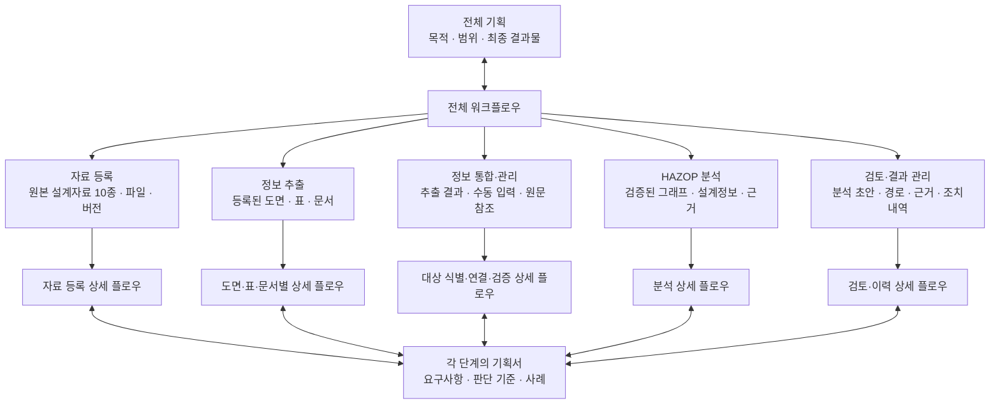

# 최상위 플로우차트

[프로젝트 소개](../README.md) · [전체 기획](../기획서/전체기획.md)

전체 기획 아래에 다섯 단계를 두고, 각 단계에서 상세 플로우차트와 기획서로 내려가는 구조입니다. 이 차트는 문서 구성과 업무 흐름을 함께 보여주며, 하위 문서의 작성 상태는 아래 목록에서 관리합니다.

## 업무의 진행 순서

**자료 등록 → 정보 추출 → 정보 통합·관리 → HAZOP 분석 → 검토·결과 관리**

검토에서 발견한 자료 누락, 추출 오류, 설계 변경은 해당 단계로 돌아가 보완합니다.

## 원본 자료와 단계별 입력

원본 설계자료 10종은 모두 자료 등록으로 들어옵니다. 자료를 특정 단계 하나에 배정하는 대신, 등록된 원본에서 정보를 추출하고 그 결과를 통합·분석합니다. 위 차트는 문서 구성도이며, 실제 데이터는 위 업무 순서로 전달됩니다.

| 단계 | 원본 근거 또는 직접 입력 |
| --- | --- |
| 자료 등록 | 원본 설계자료 10종의 파일과 식별·버전 정보 |
| 정보 추출 | 등록된 도면·표·문서와 자료 식별정보 |
| 정보 통합·관리 | 직접 입력은 추출 스크립트의 결과와 수동 입력. 설계자료 10종은 연결된 원본 근거 |
| HAZOP 분석 | 검증된 통합 그래프, 설계정보, 연결된 원문 근거 |
| 검토·결과 관리 | HAZOP 초안, 분석 경로, 원문 근거, 검토·조치 내역 |

정보 추출은 도면(P&ID·PFD), 표·사양(물질·열수지·설정값 등), 설명문(설계 의도·절차 등)의 처리 경로로 나눕니다. 자료 종류와 파일 형식은 별개이므로 인터록 자료처럼 도면·표·설명문을 함께 포함하는 자료는 여러 경로를 거칠 수 있습니다. 원본별 활용은 [전체 기획](../기획서/전체기획.md)에 정리합니다.

## 상세 기획 목록

| 단계 | 상세 플로우차트에서 정할 내용 | 상태 |
| --- | --- | --- |
| 자료 등록 | [상세 플로우차트](01-registration.md) · [자료 등록 기획서](../기획서/자료등록.md) | 초안 작성 |
| 정보 추출 | [상세 플로우차트](02-extraction.md) · [정보 추출 기획서](../기획서/정보추출.md) | P&ID 초안 작성 |
| 정보 통합·관리 | [상세 플로우차트](03-integration.md) · [상세 기획서](../기획서/정보통합관리.md) | 초안 작성 |
| HAZOP 분석 | 검토 구간·운전모드, 편차, 원인·영향, 보호수단 | 작성 예정 |
| 검토·결과 관리 | 전문가 검토, 결과 출력, 조치사항과 변경 이력 | 작성 예정 |

정보 통합·관리의 공통 구조는 초안을 작성했습니다. 이제 P&ID를 제공받는 실제 순서에 맞춰 **자료 등록 → 정보 추출 → 원본 대조·수정 → 정보 통합·관리** 순으로 상세 기획과 구현을 진행합니다. 첫 구현 단위는 FreeCAD·draw.io 도면 원본과 등록정보를 저장·검증하는 기능이며, 이를 P&ID 연결 그래프 편집기로 확장합니다.

모든 단계는 자체 입력·출력, 검증 사례, 통과/보류 기준을 갖도록 합니다. 자료 등록·추출·통합은 Python 자동 처리를 기본으로 하고, 사람의 수동 입력과 선택적인 AI 검수·보정 결과도 검증을 거칩니다. AI의 주 역할은 HAZOP 단계에서 그래프 알고리즘에 기반한 추론입니다.
