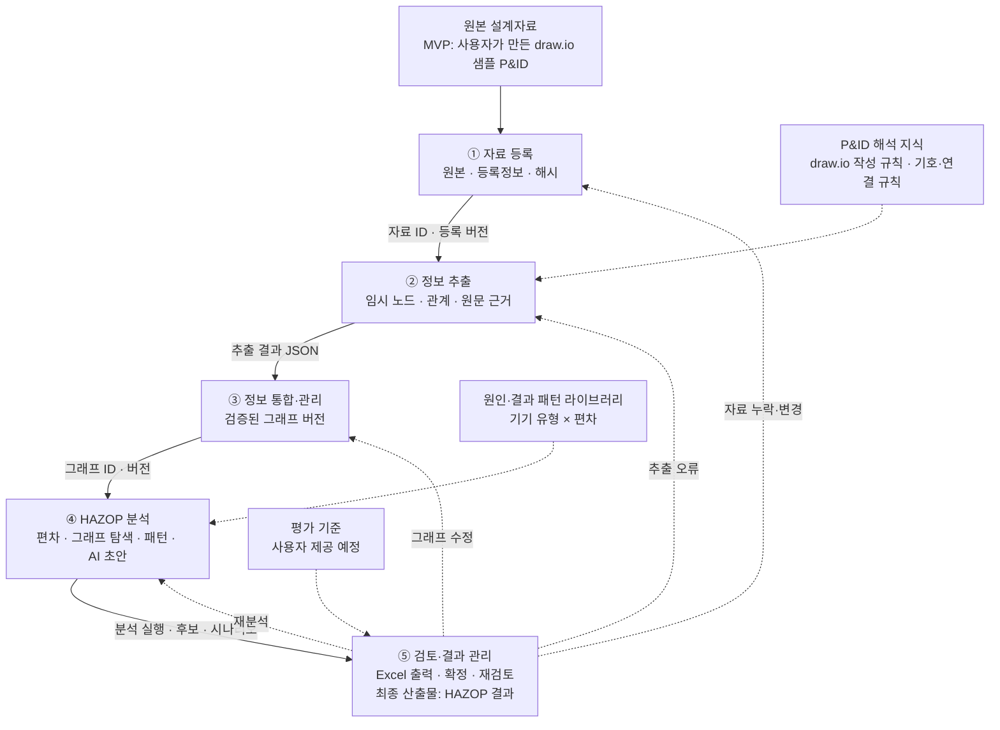

# 최상위 플로우차트

[프로젝트 소개](../README.md) · [전체 기획](../기획서/전체기획.md) · [공통 원칙](../기획서/전체기획.md#principles)

단계 사이에 전달되는 데이터와 되돌림 경로를 보여줍니다. 실선은 정상 전달, 점선은 기준 지식의 참조와 보완 요청입니다.

## 원본 자료와 단계별 입력

원본 설계자료 10종은 모두 자료 등록으로 들어오고, 등록된 원본에서 정보를 추출해 통합·분석합니다. MVP는 P&ID 한 장만 사용합니다.

| 단계 | 원본 근거 또는 직접 입력 |
| --- | --- |
| 자료 등록 | 원본 설계자료의 파일과 식별·버전 정보 |
| 정보 추출 | 등록된 도면·표·문서와 자료 식별정보 |
| 정보 통합·관리 | 추출 결과와 수동 입력. 설계자료는 연결된 원본 근거 |
| HAZOP 분석 | 검증된 통합 그래프, 설계정보, 원문 근거, 원인·결과 패턴 |
| 검토·결과 관리 | HAZOP 초안, 분석 경로, 원문 근거, 검토·조치 내역 |

정보 추출은 도면, 표·사양, 설명문의 처리 경로로 나눕니다. 자료 종류와 파일 형식은 별개이므로 한 자료가 여러 경로를 거칠 수 있습니다. 원본별 활용은 [전체 기획](../기획서/전체기획.md)에 정리합니다.

## 상세 기획 목록

| 단계 | 문서 | MVP 범위 |
| --- | --- | --- |
| ① 자료 등록 | [상세 플로우차트](01-registration.md) · [기획서](../기획서/자료등록.md) | 폴더·스크립트로 draw.io 1개 등록 |
| ② 정보 추출 | [상세 플로우차트](02-extraction.md) · [기획서](../기획서/정보추출.md) | draw.io XML 전체 추출 |
| ③ 정보 통합·관리 | [상세 플로우차트](03-integration.md) · [기획서](../기획서/정보통합관리.md) | 도면 1장의 그래프 변환·구조 검증 |
| ④ HAZOP 분석 | [상세 플로우차트](04-hazop-analysis.md) · [기획서](../기획서/HAZOP분석.md) | 구간 1개·정상 운전, 패턴·탐색·Claude API 해석 |
| ⑤ 검토·결과 관리 | [상세 플로우차트](05-review-results.md) · [기획서](../기획서/검토결과관리.md) | Excel 출력과 평가 기준 비교 |

첫 구현은 위 MVP 범위를 끝까지 연결하는 [수직 슬라이스](../기획서/전체기획.md#mvp)입니다. 각 상세 플로우차트는 후속 기능까지 포함한 전체 흐름이며, 차트 아래에 MVP에서 사용하는 경로를 표시합니다.
