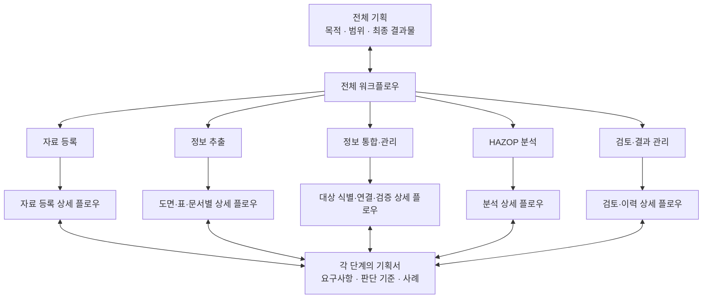

# 최상위 플로우차트

[프로젝트 소개](../README.md) · [전체 기획](../기획서/전체기획.md)

전체 기획 아래에 다섯 단계를 두고, 각 단계에서 상세 플로우차트와 기획서로 내려가는 구조입니다. 아래 하위 문서는 작성 예정이며, 이 차트는 문서 구성과 업무 흐름을 함께 보여줍니다.

## 업무의 진행 순서

**자료 등록 → 정보 추출 → 정보 통합·관리 → HAZOP 분석 → 검토·결과 관리**

검토에서 발견한 자료 누락, 추출 오류, 설계 변경은 해당 단계로 돌아가 보완합니다.

## 상세 기획 목록

| 단계 | 상세 플로우차트에서 정할 내용 | 상태 |
| --- | --- | --- |
| 자료 등록 | 입력 자료의 종류, 식별 정보, 버전과 원본 보관 | 작성 예정 |
| 정보 추출 | 도면·표·문서별 처리, 추출 결과와 근거, 사람의 수정 | 작성 예정 |
| 정보 통합·관리 | 공통 형식, 동일 대상 식별, 관계 연결, 충돌과 검증 | 작성 예정 |
| HAZOP 분석 | 검토 구간·운전모드, 편차, 원인·영향, 보호수단 | 작성 예정 |
| 검토·결과 관리 | 전문가 검토, 결과 출력, 조치사항과 변경 이력 | 작성 예정 |

상세 기획은 **정보 통합·관리의 공통 입출력**을 먼저 정한 뒤, 자료 등록과 정보 추출을 구체화하는 순서를 권장합니다. 첫 구현은 P&ID의 작은 구간을 연결 그래프로 변환하는 작업입니다.
