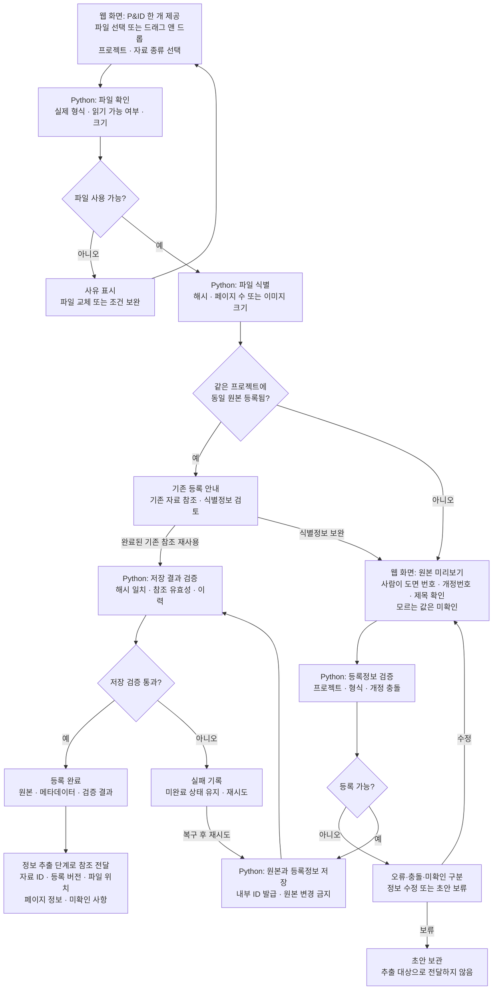

# 자료 등록 상세 플로우차트

[최상위 플로우차트](00-overview.md) · [자료 등록 기획서](../기획서/자료등록.md)

| 구분 | 내용 |
| --- | --- |
| 원본 소스 | 설계자료 10종. 첫 대상은 사용자가 제공하는 P&ID 파일 |
| 직접 입력 | 웹 화면의 파일 선택 또는 드래그 앤 드롭으로 받은 PDF·PNG·JPG, 프로젝트, 자료 종류, 사용자가 아는 도면 번호·개정번호 등 |
| 처리 주체 | Python 자동 처리와 사람의 식별정보 입력·수정. AI는 필수 아님 |
| 출력 | 보존된 원본, 등록정보, 검증 결과, 다음 단계가 사용할 자료 ID·버전 참조 |

파일 선택과 드래그 앤 드롭은 같은 Python 등록 처리로 연결합니다. 이 단계에서 도면 기호·태그·배관을 인식하거나 그래프를 만들지 않습니다.

동일 원본의 기존 참조를 재사용할 때도 원본의 존재와 해시를 확인합니다. 도면 번호·개정번호 미확인은 명시적으로 남길 수 있지만 원본을 읽을 수 없거나 개정 충돌이 해결되지 않은 입력은 완료로 처리하지 않습니다.

독립 검증은 샘플 파일과 등록 목록만으로 수행하며, 추출 코드·그래프 저장소·AI를 필요로 하지 않습니다. 검증 사례와 통과 기준은 [기획서](../기획서/자료등록.md)에 정의합니다.
