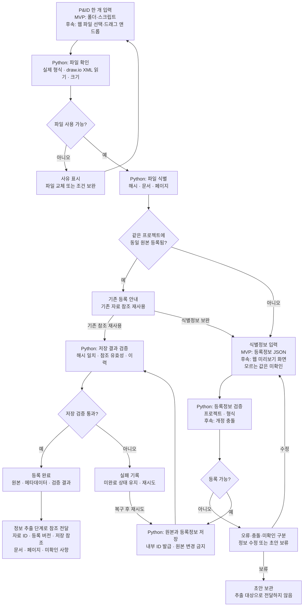

# 자료 등록 상세 플로우차트

[최상위 플로우차트](00-overview.md) · [자료 등록 기획서](../기획서/자료등록.md)

| 구분 | 내용 |
| --- | --- |
| 원본 소스 | 설계자료 10종. MVP는 사용자가 draw.io로 만든 P&ID |
| 직접 입력 | draw.io(.drawio) 원본, 프로젝트, 자료 종류, 사용자가 아는 도면 번호·개정번호 등 |
| 처리 주체 | Python 자동 처리와 사람의 식별정보 입력. AI는 필수 아님 |
| 출력 | 보존된 원본, 등록정보, 검증 결과, 다음 단계가 사용할 자료 ID·버전 참조 |

MVP는 폴더와 Python 스크립트로 입력하고, 후속 웹 화면(파일 선택·드래그 앤 드롭)도 같은 Python 등록 처리를 사용합니다. 이 단계에서 도면 기호·배관을 인식하거나 그래프를 만들지 않습니다.

동일 원본의 기존 참조를 재사용할 때도 원본의 존재와 해시를 확인합니다. 원본을 읽을 수 없거나 충돌이 해결되지 않은 입력은 완료로 처리하지 않습니다.

독립 검증은 샘플 파일과 임시 저장 폴더만으로 수행합니다. 검증 사례와 통과 기준은 [기획서](../기획서/자료등록.md)에, 필드와 상태는 [단계 간 데이터 규격](../기획서/전체기획.md#data-contract)에 정의합니다.
