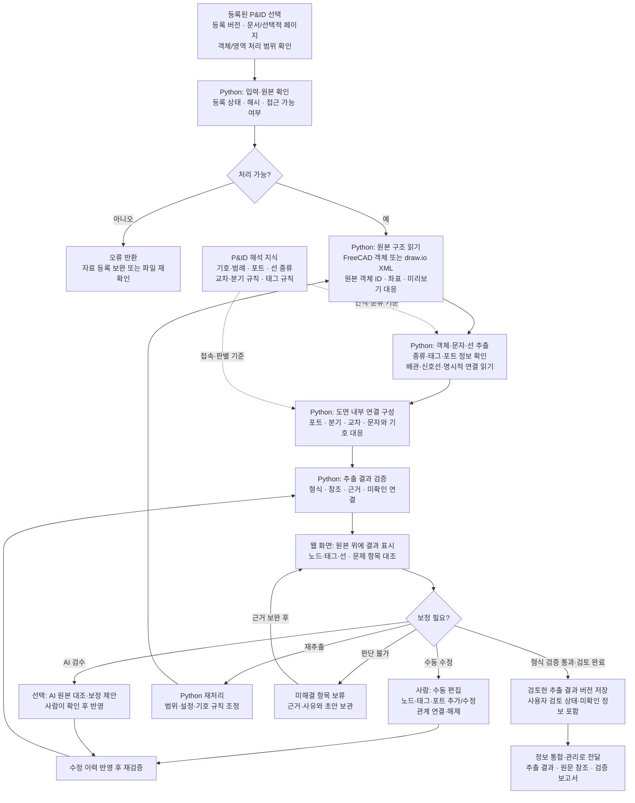

# 정보 추출 상세 플로우차트

[최상위 플로우차트](00-overview.md) · [정보 추출 기획서](../기획서/정보추출.md)

| 구분 | 내용 |
| --- | --- |
| 원본 근거 | 설계자료 10종 중 첫 대상은 P&ID. 표·보고서 추출은 이후 확장 |
| 직접 입력 | 등록 완료된 FreeCAD(.FCStd)·draw.io(.drawio)의 자료 ID·등록 버전·원본 참조·객체/페이지 정보 |
| 처리 주체 | Python 자동 추출, 사람의 원본 대조·수정, 선택적인 AI 검수·보정 제안 |
| 출력 | 도면 내부 임시 노드·포트·관계·문자·속성, 원본 좌표, 검토 상태, 검증 보고서 |

이 단계는 전체 문서/페이지 추출과 선택 객체/영역 재처리를 지원합니다. 페이지가 없는 원본에 페이지를 강제하지 않습니다. 도면 내부의 연결 초안을 만들며, 여러 도면·문서의 동일 대상을 합치는 작업은 정보 통합·관리 단계에서 수행합니다.

미인식 기호나 불명확한 방향은 미확인으로 남길 수 있습니다. 유효하지 않은 참조나 확정할 수 없는 연결을 정상 관계로 전달하지 않습니다. 구조 검증 통과와 원본 대조 결과는 별도로 기록합니다.

독립 검증은 샘플 원본·등록정보와 사람이 표시한 정답을 이용합니다. 실제 등록 시스템·통합 저장소·HAZOP 코드·AI 없이도 실행 가능해야 합니다. 검증 범위와 기준은 [기획서](../기획서/정보추출.md)에 정의합니다.

원본 참조·좌표계와 전달 예시는 [전체 기획의 데이터 규격](../기획서/전체기획.md#data-contract)을 따릅니다. 첫 경로는 객체·속성·커넥터 읽기이며, OCR·이미지 탐지 실험은 후속 지원 범위입니다.
