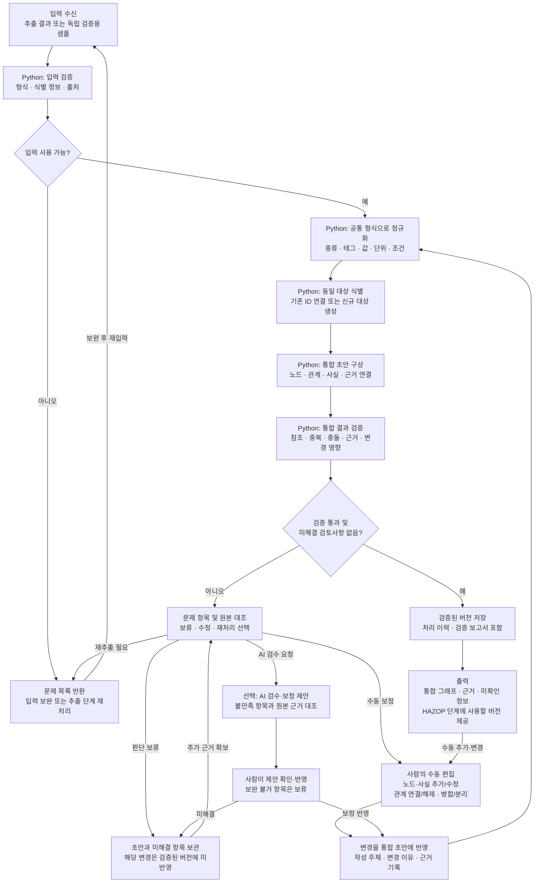

# 정보 통합·관리 상세 플로우차트

[최상위 플로우차트](00-overview.md) · [상세 기획서](../기획서/정보통합관리.md)

Python 스크립트로 자동 통합하며, 사람의 수동 입력과 선택적인 AI 검수·보정을 같은 검증 경로로 처리합니다. 이 단계는 자료를 직접 추출하거나 HAZOP 원인·영향을 추론하지 않습니다.

수동 입력은 원본에 없는 신규 노드도 허용합니다. 이 경우 작성자와 사유, 근거 유무를 기록합니다. 검증된 버전이라도 설계정보의 완전성이나 HAZOP 적합성이 자동으로 보장되는 것은 아니며, 미확인 정보는 출력에 함께 남깁니다.

## 독립 검증의 경계

- 입력: 샘플 추출 결과, 선택적인 기존 그래프 버전, 수동 변경 내역
- 처리: 정규화 → 대상 식별 → 통합 → 검증 → 버전 저장
- 출력: 통합 그래프, 입력별 대상 매핑, 검증 보고서, 보류 항목, 변경 이력
- 자료 등록·추출 시스템이나 AI 없이도 샘플 입력만으로 검증할 수 있어야 합니다.
- 구체적인 통과 기준과 독립 검증 사례는 [기획서](../기획서/정보통합관리.md)에 정의합니다.
