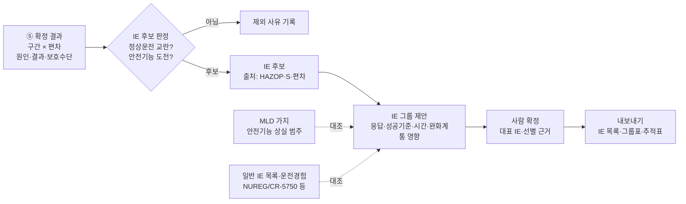

# HAZOP 결과로 원자력발전소 초기사건(IE)을 도출하는 방법 조사

> **범위 변경(2026-11-08).** 사용자가 PSA 초기사건 도출을 최종 목표로 정했습니다. 2026-11-03 결정로그와 README의 "범위 밖" 기재는 이 결정으로 대체됩니다. 이번 단계는 조사만 하며, 구현 범위는 아직 정하지 않았습니다.

[전체 기획](overview.md) · [HAZOP 분석](hazop-analysis.md) · [지식그래프 스키마 설계안](kg-schema.md) · [재사용 지식: 위험도분석 결합방법론](../methodology/combined-risk-methods.md)

- 작성일: 2026-11-08. 모든 웹 자료의 확인일도 2026-11-08입니다.
- 이 문서는 조사 결과이며 결정이 아닙니다. 앱 코드는 바꾸지 않았습니다.

## 0. 읽기 범위와 표기

조사는 네 갈래(규제·표준, 미국 인허가 사례, 국립연구소·학회·경수로 실무, 결합 방법론·AI)로 나눠 진행했습니다. 갈래마다 하위 조사 담당이 원문을 찾아 읽고 메모를 남겼고, 이 문서는 그 메모를 종합한 것입니다.

| 표기 | 뜻 |
| --- | --- |
| **원문** | PDF·웹 원문을 열어 해당 절을 직접 읽음. 대부분 **키워드(initiating event, HAZOP, FMEA, master logic 등) 주변 절만** 읽었고 문서 전체를 통독하지는 않았습니다 |
| **초록** | 초록만 읽음 |
| **2차** | 검색 요약, 제3자 자료, 다른 문서에 인용된 내용만 봄 |
| **미확인** | 존재는 알지만 내용을 확인하지 못함, 또는 찾지 못함 |
| [추론] | 조사자의 해석 |
| [일반지식] | 출처를 열지 않고 일반 PRA 지식에 기댄 서술 |

누락 가능성: 키워드 검색으로 해당 절만 읽었으므로, 다른 용어로 쓰인 관련 서술은 빠졌을 수 있습니다. ASME/ANS 표준 원문(유료), EPRI 보고서 다수, 일부 학술지 본문(유료·접속 차단)은 읽지 못했습니다. nrc.gov는 자동 접근을 막아 같은 PDF를 브라우저나 Internet Archive 사본으로 받아 읽었습니다.

## 1. 요약

### 1.1 주요 발견

1. **미국 규제지침이 HAZOP을 IE 탐색 기법으로 이름까지 들어 인정합니다.** RG 1.254 Rev 0(2026-03, ML25232A005)은 IE 탐색에 귀납 기법(HAZOP, FMEA 등)과 연역 기법(MLD)을 함께 쓰도록 권고합니다. 동시에 HAZOP의 한계 두 가지를 적었습니다. 계통 간 상호작용은 ET/FT로 따로 분석해야 하고, 숙련된 진행자가 필요하다는 점입니다(원문).
2. **국제 기준도 같은 방향입니다.** IAEA SSG-3 Rev.1(2024) para 5.13은 IE 식별을 여러 접근의 조합으로 하라고 하며, 그 하나로 HAZOP·FMEA를 듭니다. para 5.40은 IE마다 어떤 방법으로 찾았는지 문서에 남기라고 요구합니다(원문). 1993년 TECDOC-719는 HAZOP을 언급하지 않았습니다. 30년 사이에 권고가 넓어졌다고 볼 수 있습니다 [추론].
3. **신형로 인허가 체계에서 HAZOP의 자리는 "초기 LBE 후보와 IE 정의의 입력"입니다.** NEI 18-04 Rev 1(RG 1.233이 승인)은 §3.2.2와 §3.2.3에서 FMEA, HAZOP, MLD를 그 입력으로 듭니다(원문). 10 CFR 53 최종규칙(2026-03)은 기법을 정하지 않고 RG 1.233과 RG 1.254를 수용 가능한 방법으로 듭니다(원문).
4. **HAZOP 워크시트를 PRA로 바꾸는 규칙이 공개 문헌에 있습니다.** EPRI·Vanderbilt의 PHA-to-PRA 연구(PSAM14, 2018)는 원인을 IE 후보로, 보호수단을 사건수목 표제(heading, pivotal event)로, 결과를 최종상태(end state)로 대응시킵니다. 이 연구는 비완화 결과를 빠짐없이 적고, 자동 대응과 운전원 조치를 나눠 적고, 구간 경계의 결과를 기록하라고 권고합니다(원문). 우리 앱 ⑤ 워크시트에 가장 직접 쓸 수 있는 근거입니다 [추론].
5. **실무에서 HAZOP 단독으로 IE를 확정한 원자로 사례는 찾지 못했습니다.** 공개 기록에 자주 보이는 구성은 "귀납(HAZOP 또는 FMEA) + 연역(MLD) + 문헌·운전경험 대조"의 3중 구조입니다 [추론]. NuScale과 GA FMR이 이 구조이고, MSRE·MSFR·ITER는 귀납+연역 2중입니다(원문·초록·2차 혼합).
6. **미국 인허가 문서에서 HAZOP을 IE 도출에 직접 쓴 공개 기록은 원자로가 아닌 시설에서 나왔습니다.** SHINE(Part 50 동위원소 생산시설)은 HAZOP·FMEA로 위험요인을 찾고, 사고 시퀀스마다 IE를 지정했으며, NRC가 이 방식을 수용했습니다. TRISO-X 연료시설(Part 70)은 HAZOP·What-if로 공정 node 19개를 검토했습니다(원문).
7. **동력로 인허가 사례에서는 FMEA가 주력입니다.** NuScale은 산업 경험 + FMEA + MLD로 IE 범주 5개와 initiator 11개를 만들었고, MLD는 새 IE를 찾지 못해 완전성 확인용이었다고 적었습니다. Natrium은 문헌·과거 PRA + 계통별 FMEA + 설계자 면담을 썼고 HAZOP 언급이 없습니다. Kairos는 방법론 보고서에 HAZOP을 넣었지만, Hermes 2 감사에서 한계사건 선정이 주로 공학적 판단에 기반했다고 진술했습니다(원문). BWRX-300은 영국 ONR 평가에서 HAZOP + FMEA로 IE 그룹 13개를 만든 것으로 기술됩니다(원문, 영국 문서).
8. **HAZOP과 FMEA는 대상 계통에 따라 나눠 씁니다.** MSRE 연구에서 기계 계통에는 HAZOP이 충분했지만, 전기·제어 계통에는 FMEA의 세부 수준이 더 나았습니다. HAZOP으로 이미 본 기기냉각 계통에서는 FMEA가 새 물리적 고장을 거의 더하지 못했습니다(원문). 디지털 계측제어는 STPA를 FT에 붙이는 방식(INL RESHA, EPRI HAZCADS)이 보완재가 될 수 있습니다 [추론, 근거는 원문·2차].
9. **HAZOP만 쓰면 놓치는 IE가 있습니다.** MSFR 연구에서 MLD로만 찾은 사건은 유체 간 화학반응과 다른 계통 부품이 날아드는 사건이었습니다(원문). 외부 요인, 계통 간 작용, 물리현상에서 시작하는 사건은 연역 기법으로 보완해야 합니다.
10. **HAZOP 편차를 그래프로 따라가 PRA IE까지 자동 추적한 원자력 구현은 찾지 못했습니다.** P&ID → 그래프 → 규칙 기반 HAZOP(preHAZOP), HAZOP 지식그래프(Tsinghua 2024), 운전경험에서 IE를 분류하는 LLM(INL 2024–2025) 같은 부품은 따로 있습니다(원문·초록). LLM이 혼자 만든 HAZOP은 형식은 비슷해도 의미가 타당한 시나리오 비율이 낮았다는 보고가 있습니다(2차, 수치 원문 미확인).

11. **(보완 조사) 구현에 바로 쓸 공개 미국 자료를 더 찾았습니다.** 경수로 일반 IE 목록(INL SPAR IE 49개), 원인 분류 체계(RADS 첫 고장 범주), 워크시트에서 PRA 요소까지 이어진 무료 EPRI 사례, DOE 위험성 평가 양식, PRA 도구 교환 형식(Open-PSA MEF)입니다. 자세한 내용은 [§13](#13-보완-조사-구현에-쓸-공개-미국-자료)에 있습니다.

### 1.2 우리 앱에 주는 시사점 [추론]

- ⑤ 결과에서 IE 후보를 뽑을 때는 PHA-to-PRA 대응(원인 → IE 후보, 보호수단 → 사건수목 표제, 결과 → 최종상태)을 그대로 데이터 규칙으로 쓰면 됩니다. 그러려면 워크시트에 "비완화 결과", "보호수단의 자동/운전원 구분", "구간 간 결과 연결" 정보가 필요합니다. 스키마 설계안의 `safeguards[].role`과 `consequence_refs`가 이 정보를 담을 필드입니다.
- HAZOP 원인 하나가 곧 PRA IE 하나는 아닙니다. 원인을 "플랜트 응답·성공기준·시간·완화계통 영향이 비슷한 것"끼리 묶는 **그룹화 단계**가 필요합니다. 대상 범위(MSRE 대 일반 액체연료 MSR)와 IE 정의 수준이 다른 두 문헌에서 IE 수가 약 26개와 약 140개로 달랐습니다(둘 다 KNS 22A-311 재인용, 2차). 묶는 단위를 먼저 고정해야 합니다 [추론].
- 앱이 혼자 IE 목록의 완전성을 주장하면 안 됩니다. HAZOP에서 온 후보 옆에 MLD 가지 대응과 일반 IE 목록·운전경험 대조 결과를 함께 보여 주고, 어느 가지에 후보가 하나도 없는지 보여 주는 편이 문헌 관행에 가깝습니다.
- IE 후보마다 "식별 기법 = HAZOP, 구간 S, 편차 ID"를 남기면 SSG-3 para 5.40의 문서화 요구를 그대로 채울 수 있습니다.
- AI가 만든 IE 후보와 그룹은 언제나 초안입니다. "결정적 규칙과 지식그래프로 후보 생성 → AI 서술 → 전문가 확정" 순서로 가는 것이 문헌 결과에 맞습니다.

## 2. 용어와 정의 출처

| 용어 | 정의 요지(의역) | 출처 | 확인 |
| --- | --- | --- | --- |
| Initiating event (IE), 경수로 | 정상운전을 교란해 제어·안전계통에 도전하고, 그 실패 시 노심손상이나 방사성 물질 방출로 이어질 수 있는 사건. 인적 교란과 내부·외부 원인으로 생긴 기기 고장 포함 | ASME/ANS PRA 표준 정의를 NUREG-2122(2013) 용어집이 인용 | 원문(NUREG-2122). 표준 자체는 2차 |
| Initiating event, RG 1.200 | 위와 같은 취지. 제어·안전계통 자체 고장으로 생긴 교란도 포함 | RG 1.200 Rev 3, §C.1.1 부근 | 원문 |
| Initiating event, 비경수로 | 특정 plant operating state(POS)에서 제어·안전계통에 도전하는 교란으로, 대응·완화가 필요한 플랜트 상태 변화 | ASME/ANS RA-S-1.4-2021 정의를 RG 1.254 p.9가 인용 | 원문(RG 1.254). 표준 자체는 2차 |
| Initiating event, IAEA | 정상운전을 교란하고 노심손상 방지를 위해 성공적 완화가 필요하거나, 직접 노심손상으로 이어질 수 있는 사건 | IAEA SSG-3 Rev.1 para 5.11 | 원문 |
| Initiating event analysis | IE를 체계적 방법(예: MLD)으로 식별하고, 완화 요구조건별로 묶고, 그룹 빈도를 정량화하는 과정 | NUREG-2122 용어집 | 원문 |
| Support system initiating event (SSIE) | 정상운전을 교란하면서 동시에 완화계통도 무력화할 수 있는 지원계통 고장. 예: 기기냉각수 상실 | NUREG-2122 용어집. EPRI 1016741 §2는 "안전기능 도전 + 원자로 정지 + 대응 계통 트레인 상실" 세 조건으로 정의 | 원문 |
| Licensing basis event (LBE) | 설계·인허가에서 고려하는 사건 시퀀스 전체. AOO, DBE, BDBE, DBA를 포함 | NEI 18-04 Rev 1 Table 3-1 | 원문 |
| Anticipated operational occurrence (AOO) | 수명 중 1회 이상 예상되는 사건 시퀀스. 평균빈도 1×10⁻²/plant-year 이상 | NEI 18-04 Rev 1 Table 3-1 | 원문 |
| Design basis event (DBE) | 수명 중 예상되지 않으나 AOO보다 덜 드문 사건 시퀀스. 1×10⁻⁴~1×10⁻²/plant-year | NEI 18-04 Rev 1 Table 3-1 | 원문 |
| Beyond design basis event (BDBE) | DBE보다 드문 사건 시퀀스. 5×10⁻⁷~1×10⁻⁴/plant-year. 하한은 1×10⁻⁶이 아니라 5×10⁻⁷ | NEI 18-04 Rev 1 Table 3-1 | 원문 |
| Design basis accident (DBA), LMP | DBE에서 도출하며, 안전관련 SSC만 완화에 쓴다고 보수적으로 가정한 가상 사건 시퀀스 | NEI 18-04 Rev 1 Table 3-1 | 원문 |
| Design basis accident, NRC 일반 | 공중 보건·안전에 필요한 SSC를 잃지 않고 견디도록 설계해야 하는 가상 사고 | NRC 웹 용어집 | 원문 |
| 사건수목 표제 (event tree heading) | 사건수목에서 IE 뒤에 성공·실패로 갈리는 계통 기능이나 운전원 조치. 이 문서는 PHA-to-PRA 문헌의 pivotal event를 이 용어로 씀. MEF는 functional event라 부름 | Open-PSA MEF 2.0 7장(functional-event). 국내 용어 "표제"는 [일반지식], 국내 문헌 원문 미확인 | 원문(MEF) / 국내 용어 미확인 |
| Event sequence (비경수로) | POS의 초기조건에서 IE 후 계통·안전기능·운전원의 성공/실패를 거쳐 end state로 끝나는 시나리오 | RA-S-1.4-2021 정의를 RG 1.254가 인용. 10 CFR 53.020에도 유사 정의 | 원문(RG 1.254, Part 53) |
| Anticipated / unlikely / very unlikely event sequence | Part 53이 LMP의 AOO/DBE/BDBE에 대응해 새로 쓴 용어. 규칙 본문 정의에는 빈도 수치가 없고 서문이 LMP 기준 경계를 설명 | 10 CFR 53.020, 91 FR 15696 | 원문 |

NRC 웹 용어집에는 "initiating event" 단독 항목이 없습니다. 따라서 IE 정의는 NUREG-2122를 기준으로 쓰는 것이 적절합니다 [추론].

## 3. 규제·표준 체계

| 문서 | 연도·번호 | IE 식별에 대해 정한 것 | HAZOP 언급 | 확인 |
| --- | --- | --- | --- | --- |
| RG 1.254 Rev 0 | 2026-03, ML25232A005 | 인허가 사건 식별 5원칙 중 하나가 IE의 체계적·포괄적 탐색. 기존 목록에 기대지 말고 백지에서 시작. 귀납(HAZOP, FMEA)과 연역(MLD)을 조합하고, HRA로 인적 유발 IE를 보완하고, 일반 목록·운전경험과 비교. 부록 A §A-1.3에 HAZOP 설명과 한계 | 있음 | 원문 |
| RG 1.200 Rev 3 | 2020-12, ML20238B871 | ASME/ANS RA-Sb-2013 승인. IE-A5 명확화: 지원계통을 포함해 subsystem/train 수준까지 탐색. Capability Category III는 "FMEA 또는 다른 체계적 과정" | 없음 | 원문 |
| RG 1.247 (시험 사용) | 2022-03, ML21235A008 | RA-S-1.4-2021의 IE 요건(HLR-IE-A~D, SR IE-A1~A18, IE-B1~B6, IE-C1~C19, IE-D1~D3)을 모두 이의 없이 승인. IE-C9에만 명확화 | 본문에 없음 | 원문 |
| RG 1.247 Rev 1 (시험 사용) | 2026-08 | 변경이 작다는 서술만 확인. ML 번호 미확인 | 미확인 | 2차 |
| RG 1.233 Rev 0 | 2020-06, ML20091L698 | NEI 18-04 Rev 1 승인. 사건군은 유사 IE·안전기능 도전·플랜트 응답·최종상태·선원항으로 묶음 | 본문에 없음 | 원문 |
| NEI 18-04 Rev 1 | 2019-08, ML19241A472 | §3.2.2 Task 1: 초기 LBE 후보 선정에 FMEA, HAZOP, MLD를 쓸 수 있음. §3.2.3: FMEA·HAZOP 같은 PHA가 PRA의 IE 정의를 지원 | 있음 | 원문 |
| 10 CFR Part 53 최종규칙 | 2026-03-30, 91 FR 15696 | LBE를 PRA나 다른 체계적 위험평가로 식별. 수용 가능한 방법으로 RG 1.233, RG 1.254 | 없음 | 원문 |
| ASME/ANS RA-S-1.4-2021 | 2021 | 비경수로 PRA 표준. IE 요건 구조는 RG 1.247에서 확인. 개별 SR이 MLD·FMEA·HAZOP을 명시하는지는 확인하지 못함 | 미확인 | 2차 |
| ASME/ANS RA-S-1.1-2024 | 2024-03 | 경수로 Level 1/LERF 표준. 2022판 대비 편집 수정이라는 공지만 확인 | 미확인 | 2차 |
| EPRI 1016741 | 2008-12 | SSIE 식별의 주 방법은 정상 운전 중인 모든 계통의 train/subsystem 수준 FMEA. 기존 PRA 중요도 상위 지원계통 기본사건 검토로 교차 확인 | 없음 | 원문 |
| IAEA SSG-3 Rev.1 | 2024 | para 5.13 조합 접근: (a) 결정론적 해석·SAR 검토, (b) 운전경험, (c) 유사 플랜트 PSA·표준 목록 비교, (d) HAZOP·FMEA 등 분석, (e) MLD 같은 연역 분석. para 5.27 지원계통·I&C 고장 포함. para 5.40 IE별 식별 방법 문서화 | 있음 | 원문 |
| IAEA TECDOC-719 | 1993-09 | 공학적 평가, 기존 PSA, 일반 목록, MLD·에너지 균형·방벽 분석, 에너지 균형 FT, 운전경험, FMEA를 열거. FMEA는 노동집약적이라 흔히 쓰이지 않는다고 서술 | 없음 | 원문 |
| NUREG/CR-5750과 INL IE 빈도 갱신 | 1999~, 최신 "Initiating Event 2023 Summary" | IE 빈도 근거. 식별 기법 문서는 아님 | 해당 없음 | 원문(NRCOE 웹페이지) |
| 한국(원안위 고시·KINS 지침), STUK YVL A.7, WENRA | — | IE 식별 조항을 확인하지 못함 | 미확인 | 미확인 |

## 4. IE 식별 방법 비교

| 방법 | 방향 | 무엇을 잘 찾나 | 한계 | 주요 근거 |
| --- | --- | --- | --- | --- |
| HAZOP | 귀납(편차 → 원인·결과) | 공정 변수(유량·압력·온도·수위)가 설계 의도에서 벗어나는 경우. 기계·공정 계통. 설계 의도가 분명한 P&ID 구간 | 구간 단위라 계통 간 상호작용을 따로 분석해야 함. 숙련 진행자 필요. 외부 요인과 물리현상 기인 사건을 놓칠 수 있음. 전기·제어 계통은 세부 수준이 부족 | RG 1.254 부록 A(원문), MSRE PSAM14 383(원문), MSFR(원문) |
| FMEA / FMECA / 계통 수준 FMEA | 귀납(기기·트레인 고장 → 영향) | 지원계통 IE, 전기·제어 계통, 부분 고장과 회복 시간 | 기기 수준이면 작업량이 큼. 상호작용·다중 고장은 약함 | EPRI 1016741(원문), NuScale(원문), Natrium(원문), TECDOC-719(원문) |
| 기능 FMEA(FFMEA) | 귀납(기능 상실 → 영향) | 설계 정보가 부족한 개념설계 단계. 탐지·예방·완화 수단 정보를 함께 기록 | 기능 분해 품질에 결과가 좌우됨 | MSFR(원문), EU DEMO(원문 프리프린트) |
| Master Logic Diagram (MLD) | 연역(방출 → 방벽 → 안전기능 → 기여 사상) | 완전성 논증. 외부 요인, 계통 간 작용, 물리현상 기인 사건 | 최하단 정의가 분석자 판단에 의존. 계통 세부 원인은 약함. 새 IE를 찾지 못하고 확인용으로 끝나는 경우도 있음 | RG 1.254(원문), MSFR(원문), NuScale(원문), KNS 22A-311(원문) |
| 운전경험·일반 IE 목록 | 경험 | 실제 발생한 IE, 빈도 근거, 완전성 대조 | 운전 이력이 없는 신형로에는 직접 적용이 어려움. 익숙한 경수로형 시나리오로 쏠릴 위험 [추론. SiD 발표는 같은 경고를 비공식 브레인스토밍에 대해 함] | SSG-3 para 5.13(b)(c)(원문), EPRI 1016741 §3.1(원문), EPRI SiD 발표(원문) |
| 기존 PRA·문헌 비교 | 경험 | 같은 노형의 IE family 골격 | 설계 차이를 반영하지 못하면 누락이나 과잉이 생김 | Natrium(원문), INL SFR 일반 PRA 틀(원문), GA FMR 문헌검토 549개 PIE(원문 발표자료) |
| 공학적 판단 | 경험 | 범주 단위의 한계사건 선정 | 재현성과 완전성 논증이 약함 | Kairos Hermes 2 감사(원문) |
| 열균형 고장수목·에너지 균형 | 연역 | 열 생성·제거 불균형에서 출발하는 사건 | 이번 조사에서 상세 원문을 보지 못함 | TECDOC-719(원문), Xe-100 연구(초록), KNS 논문(2차) |
| STPA | 제어 구조 기반 | 디지털 I&C의 안전하지 않은 제어 행위, 제어 상호작용 | 소프트웨어 고장확률 정량화에 합의된 방법이 없음 | INL/RPT-22-68656(원문), NRC STPA 조사 보고서(2차) |
| What-if / PHA 체크리스트 | 귀납(질문) | 설계 정보가 적은 초기 단계 | 체계성이 HAZOP보다 낮음 | PSAM14 382(원문), TRISO-X(원문) |
| 안전기능 기반 분류 | 기능 | IE 그룹의 상위 범주(NuScale MLD의 RCS 열제거·노심 열제거·반응도 제어·RCS 압력 제어·RCS 재고량 제어 등) | 안전기능을 IE 식별 방법 자체로 다룬 문서는 이번에 따로 찾지 않음. 안전기능의 NRC 단일 정의도 확인하지 못함 | NuScale MLD 결과 분류(원문), INL MARVEL(원문 발표자료) |

## 5. HAZOP 편차가 IE 후보가 되는 논리

### 5.1 대응 규칙

EPRI·Vanderbilt PHA-to-PRA(PSAM14 382·383, 원문)의 규칙을 정리하면 다음과 같습니다.

| HAZOP 워크시트 칸 | PRA 요소 | 조건과 주의 |
| --- | --- | --- |
| 원인(cause) | IE 후보 | PSAM14 382는 "일부 원인"이 IE가 된다고 씀. 남길 기준은 IE 정의(NUREG-2122, SSG-3)의 "정상운전 교란 + 안전기능 도전"을 적용 [추론] |
| 보호수단(safeguard) | 사건수목 표제(heading, pivotal event) | 자동 대응과 운전원 조치를 나눠 기록해야 HRA로 연결됨 |
| 결과(consequence) | 최종상태(end state) | 보호수단이 모두 실패했다고 본 **비완화 결과**를 적어야 함 |
| 구간 경계의 결과 | 여러 구간에 걸친 사건 시퀀스 | 구간 interface에서 결과를 기록해야 시퀀스를 조립할 수 있음 |
| FMEA 고장모드(보조) | 고장수목 기본사건 | 표제 실패확률은 FT로 산출 |

공정산업 HAZOP+LOPA 실무(IChemE Hazards 26, 원문)에서 IE 도출을 오염시키는 기록 오류 두 가지가 보고됐습니다. 하나는 보호설비 고장(예: 릴리프 막힘)을 원인으로 적는 오류이고, 다른 하나는 "원인은 이 구간, 결과는 어디든" 방식에서 같은 시나리오가 두 구간에 중복되거나 어긋나는 문제입니다.

### 5.2 그룹화(범주화)

공통 규칙은 "영향이 비슷한 것끼리 묶는다"입니다. "family별로 가장 심한 사건을 대표로 둔다"는 MSFR·DEMO·ITER 문헌에서 확인됩니다. 문헌마다 묶는 기준은 조금씩 다릅니다.

| 출처 | 그룹화 기준 | 결과 |
| --- | --- | --- |
| NuScale DCA·SDAA(원문) | 모듈 응답, 성공기준, 시간, 방출 가능성, 완화계통·운전원 영향 | 범주 5개, initiator 11개 |
| Natrium(원문) | 플랜트 응답, 성공기준, 시간, 운전원·완화계통 영향. 그룹 빈도는 개별 빈도의 합 | 7 Types, IE family 33개 |
| BWRX-300 ONR 평가(원문) | 플랜트 응답, 성공기준, 사고진행 시간, 운전원·완화계통 영향 | IE 그룹 13개 |
| MSFR(원문) | 영향이 비슷한 기본 IE를 family로 묶고 가장 심한 사건을 PIE로. 판단이 어려우면 여러 PIE로 남김 | family 13개 |
| EU DEMO(원문 프리프린트) | 같은 방식을 반복해 최소 기준 집합으로 축소 | 기준 PIE 21개 |
| EPRI 1016741(원문) | 다른 IE 경계에 이미 포함되고 한 계통에만 영향을 주는 후보 제거 → 그룹·경계 정의 → 중요도로 점검 | SSIE 목록 |

### 5.3 선별(screening) 기준의 예

| 기준 | 출처 | 확인 |
| --- | --- | --- |
| 24시간 안에 원자로 정지로 이어지지 않는 SSIE 후보는 근거를 남기고 제외 | EPRI 1016741 | 원문 |
| 외부재해: 비경수로 표준 SR HS-B5 기준 정성 선별 후, 정량 선별(1×10⁻⁷/plant-year 미만이고 누적 위험의 1% 미만) | Natrium NAT-8294(NRC 감사보고서 경유) | 원문(감사보고서) |
| LBE 빈도 하한 5×10⁻⁷/plant-year 미만은 BDBE 범위 밖 | NEI 18-04 Rev 1 Table 3-1 | 원문 |
| 10 CFR 70.61 결과기준 초과만 남김(연료시설) | TRISO-X SER | 원문 |
| 신형로처럼 CDF가 매우 낮으면 정량 선별값을 조정할 수 있음 | RG 1.200 Rev 3 Table 2 주석 | 원문 |

## 6. 실무 적용 사례

| 사업·연구 | 연도 | 문서번호 | IE 식별 방법 | 결과 | 출처 상태 |
| --- | --- | --- | --- | --- | --- |
| TerraPower Natrium, Kemmerer 1호기 CP | 2025 | NRC 감사보고서 ML25302A450, ACRS 발표 ML25280A087 (근거: NAT-7127, NAT-4767, NAT-8294) | 일반 IE 데이터 + 액체금속로 과거 PRA + 계통별 FMEA(없으면 설계자료 검토) + 설계자 면담. HAZOP 언급 없음 | 7 Types, IE family 33개, non-DBA LBE 85개, DBA 21개. 외부재해 후보 125개 중 98개 정성 제외, 8개 정량 제외. 초기·통합 IE 수는 비공개 | 원문 |
| NuScale DCA | 2018 FSAR, 2019 SE | ML18086A192, NRC SE ML19143A106 | 산업 경험 + FMEA + MLD(RPV 연결 배관 기준) | 범주 5개, initiator 11개. MLD는 새 IE를 찾지 못함 | 원문 |
| NuScale US460 SDAA | 2025 | ML25099A277 | DCA와 같은 3중 방법 | 범주 5개, initiator 11개 | 원문 |
| SHINE (Part 50 동위원소 생산시설) | 2022 SER | ML22136A302 | NUREG-1520 ISA 기반. HAZOP + FMEA → PHA → 사고 시퀀스마다 IE 지정 | 사고 범주 12개. 가능성 3등급 × 결과 등급 위험지수. NRC가 방법 수용 | 원문 |
| TRISO-X 연료제조시설 (Part 70) | 2025 SER | ML25289A022 | HAZOP + What-if, 공정을 node로 분할 | process node 19개. 70.61 기준으로 선별 후 IROFS 지정 | 원문 |
| GE Vernova BWRX-300 (영국 GDA) | 2025-12 | ONR AR-01349 | HAZOP + FMEA + 계통설명서 + 유사 원전 IE 목록 | IE 그룹 13개. 미국 Clinch River 문서에도 같은 분석을 썼는지는 미확인 | 원문(영국 문서) |
| Kairos KP-FHR 방법론 TR | 2020 | KP-TR-009-NP-A, ML20328A231 | 초기 LBE 선정을 PHA, FMEA, HAZOP, MLD가 지원한다고 명시 | 방법론 문서(수행 기록 아님) | 원문 |
| Kairos Hermes 1·2 CP | 2021~2024 | 감사요약 ML24193A214, ACRS 서한 ML24197A152 | NUREG-1537 범주 방식. 한계사건 선정은 주로 공학적 판단. HAZOP·FMEA 수행 기록은 찾지 못함 | postulated event 범주 13.1.1~13.1.10 | 원문 |
| MSRE 회고 적용 (Vanderbilt·EPRI) | 2018 | PSAM14 paper 383 | HAZOP(off-gas·기기냉각) + FMEA(동결밸브) → ET/FT | 구간 20개 이상 정의. off-gas 이탈 35개, 기기냉각 38개 검토. 동결밸브 고장모드 170개 이상. 기존 문헌에 없던 HF 생성 시나리오 발견 | 원문 |
| MSRE MLD + HAZOP | 2020 | Prog. Nucl. Energy 129, 103507 | MLD(연역) + HAZOP(귀납), 여러 POS·인벤토리 | PIE 약 26개(KNS 논문 인용 기준) | 초록·2차 |
| MSR 일반 IE 워크숍 (ORNL) | 2019 | ORNL/TM-2019/1246 | 다기관 워크숍 | IE 약 140개(KNS 논문 인용 기준) | 2차 |
| MSFR (유럽 SAMOFAR) | 2019 | Nucl. Eng. Technol. 51(4) | 기능 FMEA와 MLD를 따로 수행해 비교 | PIE family 13개. 대부분 공통, 일부는 한 방법에서만 발견 | 원문 |
| EU DEMO 핵융합 | 2017 | Fusion Eng. Des. 124 | 기능 FMEA | 기준 PIE 21개 | 원문(프리프린트) |
| GA FMR 가스냉각 고속로 (EPRI SiD) | 2024 발표 | EPRI 발표자료(근거 보고서 본문 미확인) | 문헌 106건에서 PIE 수집 → MLD → 기능·부품 FMEA(진행 중) | 고유 PIE 549개 수집 | 원문(발표자료) |
| MCRE 용융염화물 실험로 | 2022 | PSAM16 JG277 | 문헌 + 자체 MLD. 체계적 PHA는 예비설계 단계로 미룸 | hazard group 8개 | 원문 |
| INL MARVEL 마이크로로 | 2025 발표 | 근거 ECAR-6440 | DOE-STD-3009 IE 범주 체크리스트 + 정성 빈도 bin. PRA 미수행 | 내부 범주 10개, 외부 범주 6개 | 원문(발표자료) |
| INL 풀형 SFR 일반 PRA 틀 | 2026 | PSAM18 TA224 | 기존 PRA(EBR-II, PRISM) IE 비교 + 설계 특성 매핑 | 일반 IE family 표 | 원문 |
| 태국 TRR-1/M1 연구로 | 2021 | Prog. Nucl. Energy 138, 103838 | HAZOP + Human-HAZOP → IE → FT/ET | 주요 IE 3개. 간과된 운전 관행 오류 발견 | 초록 |
| Xe-100 학술 연구 | 2024 | RESS 242, 109688 | MLD + 열균형 FT + FMEA + 기존 자료 | IE 수 미확인 | 초록 |
| 경수로 SSIE (EPRI) | 2008 | EPRI 1016741 | 운전 계통 전체 FMEA → 후보 → 제거·그룹화 → 중요도 점검 → 일반 목록·정지 경험·절차서와 비교 | 5단계 절차 | 원문 |
| 경수로 내부침수 (EPRI) | 2009 | EPRI 1019194 | 침수구역 정의 → 침수원·메커니즘·SSC → walkdown → 정성 선별 | 11개 task, 4단계 상세도 | 원문(목차·§2.1) |
| 경수로 화재 | 2005/2016 | NUREG/CR-6850, NUREG-2169 | 구획 분할 → 부품 선정 → 정성 선별 → 발화 빈도 | 세부 미확인 | 2차 |
| 한국 MSRE LBE 사례 연구 (BEES) | 2022 | KNS 22A-311 | 문헌 정리: MLD 9단계 이상, HAZOP+MLD, LMP LBE 선정 | 연구별 IE 수 차이 지적 | 원문 |
| 한국 PGSFR, KSNP 저출력·정지 PSA (KAERI) | 2001~2017 | KNS 발표집, KAERI 보고서 | MLD 중심. 저출력·정지 PSA는 MLD + 운전경험 + 공학분석 | KSNP 저출력·정지 IE 22개 | 2차 |

확인하지 못한 사례: Xe-100 Long Mott CP의 IE 식별 방법, TVA Clinch River BWRX-300 SE(ML26168A505, 내려받기 실패), ACU MSRR과 Oklo의 식별 방법 서술, Westinghouse eVinci와 Holtec SMR-300(검색하지 않음), i-SMR·SMART의 HAZOP 기반 IE 연구(찾지 못함).

## 7. 결합 방법론

방법론별 상세 카드는 [재사용 지식 문서](../methodology/combined-risk-methods.md)에 있습니다. 여기서는 결합 논리만 요약합니다.

| 결합 | 메우는 빈틈 | 대표 근거 |
| --- | --- | --- |
| HAZOP → ET/FT (PHA-to-PRA) | 정성 위험분석과 PRA 모델을 같은 기록으로 연결 | PSAM14 382·383(원문) |
| 귀납(HAZOP 또는 FMEA) + 연역(MLD) | 귀납은 계통 세부 원인, 연역은 누락 기능 손실과 외부·물리 요인 | RG 1.254(원문), MSFR(원문), MSRE(초록), NuScale(원문) |
| 위 두 가지 + 일반 목록·운전경험 대조 | 이미 알려진 IE의 누락 확인과 빈도 근거 | SSG-3 para 5.13(원문), EPRI 1016741(원문), KAERI(2차) |
| 문헌 PIE 수집 → MLD → FMEA | 운전 이력이 없는 노형에서 문헌을 시작점으로 씀 | EPRI SiD GA FMR(원문 발표자료), MCRE(원문) |
| HAZOP + FMEA 분담 | 기계·공정 계통은 HAZOP, 전기·제어 계통은 FMEA | MSRE PSAM14 383(원문) |
| HAZOP + Human-HAZOP | 운전원 행위에서 시작하는 IE | 태국 TRR-1/M1(초록) |
| STPA + FTA | 디지털 I&C 제어 행위 오류를 PRA 구조에 넣음 | INL/RPT-22-68656(원문), EPRI HAZCADS(2차) |
| HAZOP + LOPA | 시나리오별 빈도 정량화(공정산업) | IChemE Hazards 26(원문) |

LOPA의 initiating event와 PRA의 IE는 다릅니다. LOPA의 IE는 원인-결과 한 쌍의 원인이고, PRA의 IE는 여러 원인을 묶은 그룹이 사건수목 하나를 공유합니다 [일반지식]. 따라서 HAZOP 원인을 PRA IE로 쓰려면 그룹화 단계가 꼭 필요합니다.

## 8. 자동화·AI·지식그래프

| 연구 | 내용 | 시사점 [추론] | 확인 |
| --- | --- | --- | --- |
| preHAZOP (TU Dortmund, 2023) | DEXPI P&ID를 그래프로 만들고 시뮬레이션 값을 붙인 뒤 시나리오 패턴 15개를 그래프에서 탐지 | 우리 앱 ①~④ 흐름과 가장 가까운 공개 구현. 결정적 규칙으로 1차 후보를 만드는 방식의 참고 | 원문(README), 논문 2차 |
| HAZOP 지식그래프 (Tsinghua, ESCAPE-34, 2024) | HAZOP 보고서와 공정 정보로 KG 구축(엔티티 2,988개, 관계 72종). 누락 원인-결과 링크 예측에서 정답 약 67%가 상위 10개 안에 듦 | 계장·제어 정보가 빠졌다는 한계를 저자가 적음. 우리 앱은 P&ID에서 계기·밸브를 이미 추출하므로 이 공백을 메울 수 있음 | 원문(초록·결론) |
| HAZOP 자동화 리뷰 (ITcon, 2024) | 83편 분류. HAZOP 보고서 기반 모델에는 P&ID 기술 세부가 빠져 있다고 결론 | 같은 공백 지적 | 원문(요약·결론) |
| LLM 단독 HAZOP (Safety Science 194, 2026) | 여러 LLM이 같은 P&ID로 워크시트 생성. 형식 유사도는 높았으나 의미 타당 시나리오 비율이 낮았다고 보고 | AI 결과를 초안으로만 두는 앱 원칙과 맞음. 수치는 원문 확인 전 인용 금지 | 2차 |
| ChatP&ID (arXiv, 2026) | DEXPI P&ID를 KG로 바꾸고 GraphRAG로 질의 | HAZOP은 향후 과제로만 언급 | 초록 |
| INL 정지 IE 분류 LLM (arXiv 2024, 저널 2025) | 사건 기록에서 정지 IE를 걸러내고 4개 유형으로 분류 | IE를 "식별"하는 연구가 아니라 운전경험에서 IE를 "분류·계수"하는 연구. 빈도 근거 쪽 자동화. 정확도 수치가 판마다 다르고 데이터가 LER인지 미확인 | 초록 |
| INL RESHA (2022) | STPA 결과를 하드웨어 FT에 넣고 SAPHIRE PRA 모델에 연결. RTS/ESFAS 고장을 IE나 중요 기본사건으로 취급 | 계측제어가 많은 구간의 보완 경로 | 원문(요약·일부 장) |
| 모델 기반 ET/FT 자동 생성 (INL, PSA 2021) | 계통 모델과 동적 PRA에서 ET/FT 생성 | 앱의 P&ID 그래프가 "계통 모델" 역할을 할 수 있음 | 2차 |

공개 문헌에서 "HAZOP 편차 → 그래프 → PRA IE"를 자동으로 추적한 원자력 구현은 찾지 못했습니다. 이 공백을 앱이 메울 수 있다는 판단은 [추론]이며, 신규성을 주장하려면 추가 검색이 필요합니다.

## 9. 우리 앱에 주는 시사점 [추론]

이 절 전체는 조사 결과를 바탕으로 한 추론입니다. 구현 범위는 사용자 결정 전까지 정해지지 않았습니다.

### 9.1 ⑤ 결과에서 IE 후보·그룹으로 가는 흐름

1. **IE 후보 판정.** ⑤에서 사람이 확정한 결과만 입력으로 씁니다. 각 원인이 정상운전을 교란하고 안전기능에 도전하는지 판정합니다. 아니면 제외 사유를 남깁니다.
2. **후보 기록.** 후보마다 식별 기법(HAZOP), 검토구간 S, 편차, 원인 위치 노드를 남깁니다(SSG-3 para 5.40).
3. **그룹 제안.** 플랜트 응답, 성공기준, 시간, 완화계통 영향이 비슷한 후보를 묶어 제안합니다. 같은 보호수단 집합을 공유하는 원인끼리 묶는 그래프 규칙이 출발점이 될 수 있습니다.
4. **완전성 대조.** MLD 가지와 일반 IE 목록에 후보를 대응시켜, 후보가 없는 가지를 "공백"으로 보여 줍니다. 공백은 HAZOP이 놓쳤을 수 있는 영역이며, 앱이 IE를 자동으로 만들지 않습니다.
5. **사람 확정.** 대표 IE, 선별 근거, 빈도 근거 자료를 사람이 확정합니다. AI 제안은 초안 상태로만 남습니다.

### 9.2 데이터 품질 검사 후보

| 검사 | 근거 |
| --- | --- |
| 보호설비 고장이 원인 칸에 들어가 있으면 경고 | IChemE Hazards 26 실무 교훈(원문) |
| 같은 원인이 두 구간에 중복되거나 구간 경계에서 결과가 끊기면 경고 | IChemE Hazards 26, PSAM14 383(원문) |
| 결과가 보호수단 작동을 가정한 완화 결과로 적혔으면 경고 | PSAM14 382·383의 비완화 결과 권고(원문) |
| 보호수단에 자동/운전원 구분이 없으면 경고 | PSAM14 383(원문) |
| 전기·제어 구간인데 HAZOP만 있고 FMEA가 없으면 안내 | PSAM14 383(원문) |

### 9.3 지식그래프에 필요한 노드와 관계

| 노드(제안) | 뜻 | 주요 속성 |
| --- | --- | --- |
| IE 후보 (`ie_candidate`) | HAZOP 원인 하나에서 나온 후보 | 식별 기법, 출처(S·편차·원인), 판정 상태, 제외 사유 |
| IE 그룹 (`ie_group`) | 사건수목을 공유하는 IE 묶음 | 그룹 기준(응답·성공기준·시간·완화계통), 대표 IE, 상태 |
| 안전기능 (`safety_function`) | 반응도 제어, 노심 열제거, 재고량 제어, 압력 제어, 격납 등 상위 기능 | 기능 체계(어느 출처의 분류인지) |
| MLD 가지 (`mld_branch`) | 방출 → 방벽 → 안전기능 → 기여 사상의 가지 | 단계, 상위 가지 |
| 일반 IE 목록 항목 (`reference_ie`) | NUREG/CR-5750 등 일반 목록의 IE | 출처 문서, 판 |
| 빈도 근거 (`frequency_basis`) | IE 빈도 자료 | 출처(NUREG/CR-6928, INL 갱신판 등), 값, 단위, 판 |
| 최종상태 (`end_state`) | 비완화 결과의 상위 범주 | 정의 출처 |

| 관계(제안) | 방향 |
| --- | --- |
| `derived_from` | IE 후보 → ⑤ 결과의 원인 항목 |
| `member_of` | IE 후보 → IE 그룹 |
| `challenges` | IE 후보·그룹 → 안전기능 |
| `maps_to_branch` | IE 후보 → MLD 가지 |
| `corresponds_to` | IE 그룹 → 일반 IE 목록 항목 |
| `frequency_from` | IE 그룹 → 빈도 근거 |
| `pivotal` | IE 그룹 → 보호수단(사건수목 표제 후보) |
| `leads_to` | IE 그룹 → 최종상태 |

### 9.4 지식그래프 스키마 설계안과 연결할 지점

[지식그래프 스키마 설계안](kg-schema.md)을 읽고 연결점만 정리했습니다. 그 파일은 수정하지 않았습니다. 설계안은 다른 세션이 작성 중이라, 2026-11-08 작업 시점의 판(결정 ID KD1~KD8)을 기준으로 했습니다.

| 설계안 항목 | 연결 방식 |
| --- | --- |
| KD1 층 구분(P&ID·지식·기대·검토) | IE 후보와 IE 그룹은 ⑤ 결과에서 파생되므로 검토 층의 다음에 두는 **별도 층(가칭 "PRA 연계 층")**이 맞아 보입니다. 원본은 결과 파일로 두고 그래프에는 투영만 하는 KD7 원칙을 그대로 따를 수 있습니다 |
| KD5 `origin`과 `ai_draft` | AI가 제안한 IE 판정과 그룹은 `origin: ai_draft`, 상태 `hypothesis`로 시작합니다. 사람 확인 없이 `confirmed`가 될 수 없다는 검사 규칙을 그대로 적용합니다 |
| KD6 잠재 후보(`expectation`) | "MLD 가지마다 IE 후보가 하나 이상 기대됨"을 기대 규칙으로 표현할 수 있습니다. 부재 확정은 "HAZOP이 놓쳤을 수 있는 가지"를 뜻합니다 |
| §7.1 워크시트 칸별 근거 경로 | 원인 `cause_at`은 IE 후보의 원인 위치가 되고, 보호수단 `safeguard_by`는 사건수목 표제 후보가 됩니다 |
| §7.2 `safeguards[].role`(예방·완화) | PHA-to-PRA에서 표제를 나눌 때 그대로 씁니다. 여기에 자동/운전원 구분 속성을 더해야 합니다 |
| §7.2 `consequence_refs`(다른 구간 대상 허용) | 구간 경계 결과 연결에 씁니다. 여러 구간에 걸친 시퀀스 조립의 근거가 됩니다 |
| 지식 층의 "해석 사례·운전경험", "고장 모드" | 일반 IE 목록 항목, 빈도 근거와 같은 계열로 둘 수 있습니다 |
| 지식 층의 "도면 밖 대상(전원·공기·냉각수 공급)" | 지원계통 IE(SSIE) 후보의 출발점입니다. EPRI 1016741 방식의 지원계통 FMEA와 연결됩니다 |
| §10 용어표 "안전기능: 정의 출처 없음" | 안전기능 노드를 만들려면 정의 출처를 먼저 정해야 합니다. 이번 조사에서도 NRC 단일 정의를 확인하지 못했습니다 |

## 10. 사용자가 결정할 항목

2026-11-08 사용자가 D1~D7을 모두 아래 "채택" 열대로 정했습니다([결정로그](../records/decision-log.md)).

| # | 결정 | 선택지 | 채택 | 참고 |
| --- | --- | --- | --- | --- |
| D1 | IE 도출을 이 앱의 구현 범위에 넣을지 | (a) ⑥ 단계 신설, (b) HAZOP 결과 내보내기에 IE 후보 열만 추가, (c) 조사로 마침 | 단계적 도입: ⑤ 화면과 Excel에 IE 후보·그룹 열을 먼저 넣고, 그다음 ⑥ 단계 | — |
| D2 | 대상 원전 유형 | 경수로, 비경수로·SMR, 둘 다 | 경수로 기본 | 적용 표준이 다름(RG 1.200·RA-S-1.1 대 RG 1.247·RA-S-1.4) |
| D3 | IE 단위의 정의 | PRA IE 그룹 단위, 원인 단위 후보, 두 단계 모두 | 원인 단위 후보 → PRA IE 그룹의 두 단계 | 범위와 정의 수준이 다른 MSR 문헌에서 IE 수가 약 26개와 약 140개로 달랐음(2차) |
| D4 | 완전성 대조 방법 | MLD 템플릿 내장, 일반 IE 목록 대조만, 둘 다 | 일반 IE 목록 대조 먼저 | MLD는 노형별로 다름 |
| D5 | 결합할 기법 범위 | HAZOP만, HAZOP+FMEA, HAZOP+FMEA+STPA | HAZOP+FMEA | 전기·제어 계통은 FMEA가 낫다는 근거 있음 |
| D6 | 빈도 근거 자료를 앱이 다룰지 | 다룸, 다루지 않음 | 다루지 않음 | 사용자 결정 |
| D7 | README 범위 문구 수정 | 수정, 유지 | 수정(적용함) | README 5행 |

README 5행은 "최종 목표는 HAZOP 결과를 PSA 초기사건(IE) 도출에 활용하는 것입니다(2026-11-08 사용자 결정). 현재 구현 범위는 HAZOP 결과까지이며, IE 도출은 조사 단계입니다."로 고쳤습니다. 이 결정들을 구현에 옮길 때 쓸 공개 자료는 [§13](#13-보완-조사-구현에-쓸-공개-미국-자료)에 정리했습니다.

## 11. 확인하지 못한 것과 직접 검증할 부분

### 11.1 확인하지 못한 것

- ASME/ANS RA-S-1.4-2021과 RA-S-1.1-2022/2024의 IE-A 요건 원문(유료). 특히 HAZOP을 이름으로 언급하는지.
- RG 1.247 Rev 1(2026-08)의 ML 번호와 IE 요건 변경 여부.
- 한국 원안위 고시·KINS 지침, STUK YVL A.7, WENRA의 IE 식별 조항.
- IAEA SSG-4, SMR용 IE 식별 IAEA TECDOC, EPRI 신형로 IE 지침.
- Chisholm·Krahn·Fleming 2020 본문(MLD와 HAZOP의 실제 결합 방식, PIE 약 26개 목록).
- ORNL/TM-2019/1246의 IE 약 140개 수치(2차 인용).
- EPRI SiD 보고서 가운데 3002011801 본문. 3002015752와 3002018340은 무료 공개본을 §13 보완 조사에서 일부 읽었습니다.
- Xe-100 Long Mott, TVA Clinch River, ACU MSRR, Oklo의 IE 식별 방법.
- Safety Science 2026 LLM HAZOP 논문의 수치, INL 정지 IE 분류 LLM의 데이터 출처.
- HAZCADS 보고서 번호(문헌마다 3002016698과 3002012755로 다름).
- 2021년 이후 INL IE 빈도 보고서의 정확한 번호(NRCOE 페이지에는 2023 Summary가 최신으로 게시됨).

### 11.2 업무에 쓰기 전에 직접 검증할 부분

1. NEI 18-04 Table 3-1의 BDBE 하한 5×10⁻⁷/plant-year. 흔히 1×10⁻⁶으로 잘못 인용됩니다.
2. RG 1.254 부록 A §A-1.3의 HAZOP 한계 서술과 §C 항목 20의 기법 목록.
3. SSG-3 Rev.1 para 5.13과 5.40의 문구.
4. NuScale Table 19.1-8 같은 세부 IE 목록 표. 이번 조사에서는 표 내용을 옮기지 않았습니다.
5. Natrium의 33 IE families는 ACRS 발표 슬라이드 수치입니다. PSAR 본문 수치와 대조해야 합니다.
6. BWRX-300의 HAZOP 사용은 영국 ONR 기록입니다. 미국 신청서에 같은 분석이 들어갔는지 확인해야 합니다.
7. 이 문서의 원문 확인은 대부분 키워드 주변 절만 읽은 결과입니다. 규정 인용은 해당 절을 직접 다시 읽고 쓰십시오.

## 12. 참고문헌

모든 확인일은 2026-11-08입니다.

### 규제·표준

1. US NRC, RG 1.254 Rev 0, "Technology-Inclusive Identification of Licensing Events for Commercial Nuclear Plants," 2026-03. ML25232A005. https://www.nrc.gov/docs/ML2523/ML25232A005.pdf. 원문.
2. US NRC, RG 1.200 Rev 3, "Acceptability of PRA Results for Risk-Informed Activities," 2020-12. ML20238B871. https://www.nrc.gov/docs/ML2023/ML20238B871.pdf. 원문.
3. US NRC, RG 1.247 (trial use), "Acceptability of PRA Results for Non-LWR Risk-Informed Activities," 2022-03. ML21235A008. https://www.nrc.gov/docs/ML2123/ML21235A008.pdf. 원문.
4. US NRC, RG 1.247 Rev 1 (trial use) Federal Register 공지, 2026-08. FR Doc 2026-17013. ML 번호 미확인. 2차.
5. US NRC, RG 1.233 Rev 0, 2020-06. ML20091L698. https://www.nrc.gov/docs/ML2009/ML20091L698.pdf. 원문.
6. NEI, NEI 18-04 Rev 1, "Risk-Informed Performance-Based Technology Inclusive Guidance for Non-LWR Licensing Basis Development," 2019-08. ML19241A472. https://www.nrc.gov/docs/ML1924/ML19241A472.pdf. 원문.
7. US NRC, 10 CFR Part 53 최종규칙, 91 FR 15696, 2026-03-30. FR Doc 2026-06048. https://www.govinfo.gov/content/pkg/FR-2026-03-30/pdf/2026-06048.pdf. 원문.
8. US NRC, NUREG-2122, "Glossary of Risk-Related Terms in Support of Risk-Informed Decisionmaking," 2013-11. ML13311A353. https://www.nrc.gov/docs/ML1331/ML13311A353.pdf. 원문.
9. US NRC 웹 용어집. https://www.nrc.gov/reading-rm/basic-ref/glossary/full-text.html. 원문.
10. NRC/INL, NRCOE Initiating Events 페이지(NUREG/CR-5750, Initiating Event 2023 Summary). https://nrcoe.inl.gov/InitEvent. 원문(웹페이지).
11. INL, "Industry-Average Performance for Components and Initiating Events: 2020 Update," INL/EXT-21-65055. https://www.osti.gov/biblio/1847110. 2차.
12. EPRI, 1016741, "Support System Initiating Events: Identification and Quantification Guideline," 2008-12. https://restservice.epri.com/publicdownload/000000000001016741/0/Product. 원문.
13. EPRI, 1019194, "Guidelines for Performance of Internal Flooding PRA," 2009 (2020 정오표). https://restservice.epri.com/publicdownload/000000000001019194/0/Product. 원문(목차·§2.1).
14. NRC/EPRI, NUREG/CR-6850 (EPRI 1011989), NUREG-2169 (EPRI 3002002936). 2차.
15. IAEA, SSG-3 (Rev. 1), "Development and Application of Level 1 PSA for Nuclear Power Plants," 2024. STI/PUB/2056. https://www.iaea.org/node/154768. 원문(GRS 미러 PDF).
16. IAEA, TECDOC-719, "Defining Initiating Events for Purposes of PSA," 1993-09. https://www-pub.iaea.org/MTCD/Publications/PDF/te_719_web.pdf. 원문.
17. ASME/ANS RA-S-1.4-2021, ASME/ANS RA-S-1.1-2024. 2차(RG 1.247·1.254 인용, 출간 공지).

### 인허가 문서

18. US NRC, "US SFR Owner – Summary Report for the General Regulatory Audit of the KU1 CP Application: PRA," 2025. ML25302A450. 원문(IE 분석 절).
19. US NRC NRR/DANU, Kemmerer Unit 1 CPA LBE Identification and Scope, ACRS 소위 발표, 2025-10. ML25280A087. 원문.
20. NuScale Power, DCA FSAR Chapter 19 Rev 1, 2018. ML18086A192. 원문(§19.1.4.1.1.2).
21. NuScale Power, US460 SDAA Chapter 19 Rev 2, 2025. ML25099A277. 원문(§19.1.4.1.1.2).
22. US NRC, NuScale DCA SE Chapter 19, 2019. ML19143A106. 원문(IE 절).
23. US NRC, SHINE OL SER Chapter 13 (Redacted), 2022. ML22136A302. 원문(SSA 방법론 절).
24. US NRC, Safety Evaluation Report for the TRISO-X Fuel Fabrication Facility, 2025. ML25289A022. 원문(§3.3.6.2 등).
25. UK ONR, "Generic Design Assessment of the BWRX-300 – Step 2 Assessment Report – PSA," AR-01349, 2025-12. https://www.onr.org.uk/media/mtxbvvr1/bwrx-300-gda-step-2-assessment-report-probabilistic-safety-analysis.pdf. 원문(§4.7).
26. Kairos Power, KP-TR-009-NP-A 및 NRC SE, 2020. ML20328A231. 원문(Task 1~3 절).
27. US NRC, Kairos Hermes 2 CP PSAR 감사요약, 2024. ML24193A214. 원문(Ch.13 질의).
28. ACRS, Hermes 2 CPA SE 서한, 2024-07-17. ML24197A152. 원문(해당 단락).
29. US NRC, Preliminary Chapter 13 of Hermes 2 SE, 2024-05. ML24138A207. 원문(§13.1 서두).
30. US NRC, ACU CP Application 감사보고서, 2024-09. ML24250A134. 원문(Ch.13 질의만).
31. Oklo, Principal Design Criteria for the Aurora Powerhouse, 2025-08. ML25220A128. 원문(관련 키워드 없음).
32. US NRC, TVA Clinch River CP SE, 2026. ML26168A505. 미확인(내려받기 실패).

### 연구 보고서·논문

33. Chisholm, Flanagan, Krahn, Mays, "A New Look at Licensing Basis Events for the MSRE," ORNL/TM-2018/788, 2018. https://info.ornl.gov/sites/publications/Files/Pub108669.pdf. 원문.
34. Chisholm, Krahn, Afzali, Harvey, "Application of a Method to Estimate Risk in Advanced Nuclear Reactors: A Case Study on the MSRE," PSAM14, 2018, paper 383. https://www.iapsam.org/psam14/proceedings/paper/paper_383_1.pdf. 원문.
35. Krahn, Chisholm, Sowder, "A Project to Encourage the Early Integration of Safety Assessment into the Design, License, and Build Process of Nuclear Power Plants – Status Report," PSAM14, 2018, paper 382. https://iapsam.org/PSAM14/proceedings/paper/paper_382_1.pdf. 원문.
36. Chisholm, Krahn, Fleming, "A systematic approach to identify initiating events and its relationship to PRA: Demonstrated on the MSRE," Prog. Nucl. Energy 129 (2020) 103507. DOI 10.1016/j.pnucene.2020.103507. 초록.
37. Holcomb 외, "Molten Salt Reactor Initiating Event and Licensing Basis Event Workshop Summary," ORNL/TM-2019/1246. DOI 10.2172/1561637. 2차.
38. Krahn, Harkema, Chisholm, "The Safety-in-Design (SiD) Methodology," EPRI 발표, ANS RIPB CoP, 2024-10. https://ans.org/file/17963/SiD+Presentation+for+RIPB+CoP+2024-10-23+24+FINAL.pdf. 원문(발표자료).
39. 김태운, 지계광, 박윤원, "A Case Study of LBE Selection based on the New Concept of TI-RIPB Methodology for MSRE," KNS 추계학술대회, 2022, 22A-311. 원문.
40. Gérardin 외, "A methodology for the identification of the postulated initiating events of the Molten Salt Fast Reactor," Nucl. Eng. Technol. 51(4) (2019) 1024–1031. DOI 10.1016/j.net.2019.01.009. https://zenodo.org/records/3258267. 원문.
41. Pinna 외, "Identification of accident sequences for the DEMO plant," Fusion Eng. Des. 124 (2017) 1277–1280. DOI 10.1016/j.fusengdes.2017.02.026. 원문(프리프린트).
42. Taylor 외, "Identification of Postulated Accident Sequences in ITER," SOFE 1997. 초록.
43. Liu, Kim, Cheng, Lawrence, "Toward a Generic PRA Framework for Sodium Fast Reactors," PSAM18, 2026, TA224. 원문.
44. Gerstner, "Application of a Qualitative RIPB Approach for the MARVEL Microreactor at INL," ANS CoP, 2025-08. 원문(발표자료).
45. Grobbelaar 외, "Probabilistic Risk Assessment of the Molten Chloride Reactor Experiment Conceptual Design," PSAM16, 2022, JG277. 원문(§4.2).
46. Vechgama 외, "Application of HAZOP Technique to Level 1 PSA of TRR-1/M1," Prog. Nucl. Energy 138 (2021) 103838. DOI 10.1016/j.pnucene.2021.103838. 초록.
47. Hamza 외, "Identifying and quantifying a complete set of full-power initiating events during early design stages of HTGRs," RESS 242 (2024) 109688. DOI 10.1016/j.ress.2023.109688. 초록.
48. Ibrahim 외, "Literature Review of Preliminary Initiating Events for a Gas-Cooled Fast Reactor Conceptual Design," Nucl. Technol. 212(2) (2026). DOI 10.1080/00295450.2025.2472573. 2차.
49. KAERI, KSNP 저출력·정지 PSA IE 분석 개선, 2005, OSTI ETDEWEB 20823242. 2차.
50. Bao 외, "An Integrated Framework for Risk Assessment of High Safety-significant Safety-related DI&C Systems in NPPs," INL/RPT-22-68656, 2022. 원문(요약·일부 장).
51. Ellis, "Practical Experience of Retrospective HAZOP and LOPA studies for an Offshore Platform," IChemE Hazards 26, 2016. 원문(일부 절).

### 자동화·AI

52. Oeing, Holtermann 외, "preHAZOP: Graph-Based Safety Analysis for Early Integration into Automated Engineering Workflows," Chem. Ing. Tech., 2023. DOI 10.1002/cite.202200222. GitHub TUDoAD/preHAZOP. README 원문, 논문 2차.
53. Li, Zhao, "Constructing a Knowledge Graph for Automated HAZOP Analysis," ESCAPE-34/PSE24, 2024. 원문(초록·결론).
54. Elhosary, Moselhi, "Automation for HAZOP study: A state-of-the-art review and future research directions," ITcon 29 (2024) 750–777. DOI 10.36680/j.itcon.2024.033. 원문(요약·결론).
55. Lee, Park, Oh, Ma, "Can large language models automate the HAZOP process without human intervention?," Safety Science 194 (2026) 107039. 2차.
56. Alimin, Schweidtmann, "GraphRAG for Engineering Diagrams: ChatP&ID," arXiv 2603.22528, 2026. 초록.
57. Xian 외, "A Knowledge-Informed LLM Framework for U.S. NPP Shutdown Initiating Event Classification for PRA," arXiv 2410.00929 (2024); Proc. IMechE Part O 239(6) (2025). DOI 10.1177/1748006X251386900. 초록.
58. Mandelli, Alfonsi, Aldemir, "Automatic Generation of Event Trees and Fault Trees: A Model-Based Approach," PSA 2021, OSTI 1895108. 2차.

## 13. 보완 조사: 구현에 쓸 공개 미국 자료

2026-11-08 추가. 사용자는 유료 ASME/ANS 표준과 비공개 EPRI 보고서 대신, 구현에 바로 쓸 수 있는 공개 미국 보고서를 더 찾아 달라고 요청했습니다. 조사는 두 갈래(워크시트 → PRA 변환·DOE 서식, 일반 IE 목록·PRA 도구 형식)로 나눠 하위 담당이 진행했고, 아래는 그 메모를 종합한 것입니다.

읽기 범위: 앞 절과 같은 방식으로 키워드 주변 절과 표 머리를 골라 읽었습니다. 문서별 범위는 각 행의 "확인" 칸에 적었습니다. 열 이름과 범주 코드는 구조 정보로만 옮겼고, 표 본문은 옮기지 않았습니다.

### 13.1 요약

1. **HAZOP 워크시트에서 사건수목·고장수목·기본사건 표까지 한 사례로 이어 볼 수 있는 무료 공개 보고서가 있습니다.** EPRI 3002018340(2020, MSRE 종합)입니다. 같은 보고서 안에 워크시트, 사건 순서도(ESD), 고장수목, 기본사건 자료표, 사건수목 결과표가 모두 있습니다(원문).
2. **같은 변환 규칙을 무료 공개본 EPRI 3002015752(2019, Capstone, §2.3.6~2.3.7)에서 원문으로 확인했습니다.** 원인은 IE 또는 IE 묶음, 결과는 최종상태가 되고, 안전계통은 사건수목 표제 후보가 되며 표제 순서를 정하는 데도 쓰입니다. 고장수목은 HAZOP으로 정상사건과 상위 게이트를 잡고, 기본사건은 FMEA 고장모드로 채웁니다(원문). PSAM14 382·383과 같은 사업의 보고서입니다.
3. **DOE 문서는 HAZOP·What-if·고장수목 단절집합 양식을 "시나리오 번호" 하나로 잇습니다.** DOE-HDBK-1100의 세 양식에는 Scenario 열이 있고(FMEA 양식에는 없음), HAZOP 보호 열은 고장수목에서 IE와 AND 게이트로 만나는 보호계통 입력이 된다고 적었습니다(원문).
4. **경수로 일반 IE 목록은 INL/EXT-21-65055(2020 Update) 표 4를 쓰면 됩니다.** NRC SPAR 모델용 IE 49개가 대분류 → 소분류 → IE 코드의 3단으로 정리돼 있고, PWR/BWR 구분과 정의(부록 C)가 있습니다(원문).
5. **원인 단위 분류에는 RADS "Initiating Events Coding Guidance"가 맞습니다.** 원자로 정지를 일으킨 첫 고장(Initial Plant Fault, IPF)을 48개 범주로 나눕니다(원문). HAZOP 원인도 "첫 고장"이므로 IPF 범주를 원인 단위 후보층, SPAR IE를 PRA 그룹층으로 둘 수 있습니다 [추론]. 두 표를 잇는 공개 대응표는 없어서 직접 만들어야 합니다.
6. **PRA 도구로 넘길 형식은 Open-PSA MEF 2.0(XML)이 가장 현실적입니다.** IE와 IE 그룹을 따로 정의하는 요소가 있습니다(원문). SAPHIRE MAR-D는 IE를 기본사건의 플래그로만 표시합니다(원문). 그래서 그룹을 담을 자리가 없습니다 [추론].
7. **HAZOP 결과를 PRA 도구 파일로 자동 내보낸 공개 사례는 찾지 못했습니다.** 경수로 P&ID HAZOP에서 PRA IE까지 간 미국 공개 사례도 찾지 못했습니다. 찾은 사례는 대부분 용융염로와 DOE 비원자로 시설입니다.

### 13.2 HAZOP 워크시트 → PRA 요소 변환 자료

| 자료 | 연도·번호 | 형식·규칙 | 앱 활용 | 확인 |
| --- | --- | --- | --- | --- |
| EPRI, MSRE 종합 보고서(Compilation of MSRE Technical, Hazard, and Risk Analyses) | 2020, EPRI 3002018340, 무료 | 워크시트 머리: NODE, ITEM(계통), 참고 설계문서. 열: 행 번호, DEVIATION, CAUSE, CONSEQUENCE, SAFETY SYSTEMS, ACTION, NOTE. **PRA 모델에 쓴 행을 굵게 표시.** HAZOP 변수 7개(온도, 압력, 유량, 수위·무게, 반응도, 방사성물질 재고량, 화학·물리 성질). 흐름: HAZOP → ESD → IE 1개와 표제 2개 → 고장수목 → 사건수목 정량화(CAFTA) → NEI 18-04 빈도 구간 분류. 기본사건 표 열: Event Name, Component Type, Failure Mode, Failure Rate, Units, Error Factor, Source, Source Identifier, Notes | 높음. 변환 전후 데이터 구조를 한 사례로 맞춰 볼 수 있음. 저작권 문서라 구조만 참고 | 원문(목차, §2.2~2.7, 부록 A.1 앞부분, A.3 앞부분) |
| EPRI, SiD Capstone 보고서(Early Integration of Safety Assessment into Advanced Reactor Design) | 2019, EPRI 3002015752, 무료 | 변환 규칙(§2.3.6~2.3.7): 원인 → IE 또는 IE 묶음, 결과 → 최종상태(방벽 위협), 안전계통 → 표제 후보와 순서. 한 행의 결과가 다른 행의 원인일 수 있으니 관련 행을 함께 봄. 작성 지침: 노드당 주요 기능 하나, 노드 경계 문서화, 비완화 결과, 노드 경계마다 결과 기록, 기각한 편차의 사유 기록. Kairos FCL-2 HAZOP(2019): 약 9.5시간, 편차 40개, 조치항목 34개. 조치항목 분류 6종(새 위험, 취약 기기, 관리상 약점, 시험 필요, 설계문서 부족, 운전 범위 정의) | 높음. 권고 분류 코드로 바로 쓸 수 있음 | 원문(§2.3.3~2.3.9, §4, 부록 A 앞부분). FCL-2 워크시트 원본은 비공개 |
| NUREG-1513, Integrated Safety Analysis Guidance Document | 2001, ML031340285 | 사고경위 = IE + 전파 요인 + 위험 감소 요인. HAZOP 표만으로는 사고경위가 되지 않아 정리 단계를 더 거쳐야 함. IE 4범주(공정 이상, 관리체계 실패, 인적오류, 외부사건). 부록 HAZOP 예시 열: Number, Deviation, Causes, Consequences, Safeguards | 중간. 별도 변환 단계가 필요하다는 규제 문서 근거. 연료주기시설 기준 | 원문(§2.6.5, §2.6.6.6, 표 B-1 첫 행) |
| INL MARVEL 위험성 평가(ECAR-6440) | 2023, INL/MIS-23-75407 | 사고진행 분석표(표 8) 열: SBE 번호·IE, 사건 시퀀스, 사고진행 요약, 최종상태, 시퀀스 가능성, 수신자별 결과, 위험도 구간, 후보 안전 SSC·조치. IE는 기존 IE 목록 검토와 고유 계통 FMEA로 식별(HAZOP 미사용) | 높음(형식). "IE → 시퀀스 → 결과 → 위험도 → 후보 안전 SSC"를 한 행에 담는 출력표 견본 | 원문(목차, §2.3 앞부분, 표 8 머리) |
| ORNL MSR IE·LBE 워크숍 요약 | 2019, ORNL/TM-2019/1246 | 계통별로 "무엇이 잘못될 수 있나"를 묻는 전문가 도출. IE 표 열: IE ID(3자리), 방출 IE, 토의 메모 | 중간. MSR 일반 IE 체크리스트. 경수로 기본이면 우선순위 낮음 | 원문(§1~2, IE 표 첫 쪽, §4) |
| ORNL/TM-2018/788, ORNL/TM-2020/1719 | 2018, 2020 | LMP PRA 초기모델 흐름도(입력에 HAZOP·FMEA). PHA와 PRA의 차이를 정량화 여부로 정리 | 낮음. 문헌 지도 | 원문(해당 그림·절) |

숫자 차이: MSRE off-gas·기기냉각 계통의 편차 수가 PSAM14 383에는 35개·38개, EPRI 3002018340에는 36개·40개로 나옵니다. 어느 쪽이 최종인지는 확인하지 못했습니다.

### 13.3 DOE 시설의 위험성 평가 서식

DOE 비원자로 핵시설은 DOE-STD-3009로 위험성 분석을 하고, 그 결과에서 설계기준사고(DBA)를 고릅니다. 원자력발전소 PRA와 빈도 경계가 다르므로 수치를 섞어 쓰면 안 됩니다 [추론].

| 자료 | 내용 | 확인 |
| --- | --- | --- |
| DOE-STD-3009-2014 | 위험성 분석 = 위험 식별 + 등급분류 + 위험성 평가. IE마다 예방·완화 조치가 없다고 본 비완화 시나리오를 평가하고, 수신자 셋(시설 작업자, 인접 작업자, 공중)별로 결과를 매김. 결과 기준(표 1: High·Moderate·Low), 정성 발생가능성 구간(표 2: Anticipated 10⁻²/yr 초과, Unlikely 10⁻²~10⁻⁴, Extremely Unlikely 10⁻⁴~10⁻⁶, Beyond Extremely Unlikely 10⁻⁶ 미만), 위험도 구간(표 A-1: I~IV). 10⁻⁶/yr를 운전사고 기각의 절대 기준으로 쓰지 말 것. DBA 후보는 시나리오 전체에서 대표 사고와 고유 사고를 뽑고, 평가지침을 위협할 수 있는 사고 유형(화재, 폭발, 누출 등)마다 bounding 사고를 최소 하나 고름. 2014판은 표의 고정 열 구성보다 담을 정보를 규정하는 것으로 보임 [추론] | 본문 미열람. DOE 공식 설명회 자료(2015)와 요구사항표(2015)로 확인 |
| DOE-STD-3009-94 CN3 표 3-1 | 공정 위험분석 워크시트 예시 열: Hazard, Cause, Protection and mitigative systems, Consequence, Frequency, Ranking, Action item/Comment. 원인·결과·빈도에 같은 괄호 번호를 붙여 시나리오를 묶음 | 2차(제3자 전사본). DOE 공식 PDF와 대조 필요 |
| DOE-HDBK-1100-2004 (2022 재확인) | HAZOP 양식 열: Guide Word, Deviation, Cause, Consequence, Safety Levels, Scenario, Comments/Actions. What-if 양식(표 4.7)과 고장수목 단절집합 양식(표 4.25)에도 Scenario 열이 있어 서로 참조. FMEA 양식(표 4.20)에는 Scenario 열이 없음. 사고 시나리오 = IE(원인) → 공정 이탈 → 보호계층 실패 → 사고. HAZOP 보호 열은 고장수목에서 IE와 AND 게이트로 만나는 보호계통 입력 | 원문(목차, §3.2.2~3.2.4, 양식 표 일부) |
| DOE-STD-1189-2016 | 설계 단계 안전 통합. 양식은 3009를 따르라고 함 | 원문(키워드 부분) |
| DOE-STD-1628-2013 | DOE 시설에서 PRA를 쓸 때 따르는 표준. 위험성 평가에서 PRA로 넘어가는 공식 연결 문서로 보임 [추론] | 미확인(내려받기 실패) |

### 13.4 일반 IE 목록과 그룹표

**(1) SPAR IE 목록: INL/EXT-21-65055 표 4 (원문).** 출력운전 중 IE를 다루고, 정지 중은 LOOP만 포함합니다. 대분류와 IE 코드는 다음과 같습니다.

| 대분류 | 소분류 | IE 코드 |
| --- | --- | --- |
| Primary/Secondary Inventory Control | High Energy Line Breaks | FWLB, SLBIC(PWR), SLBOC |
| 〃 | Steam Generator Tube Rupture | SGTR(PWR) |
| 〃 | Loss of Coolant Accidents | LLOCA, MLOCA, SLOCA, VSLOCA, SORV1, SORV2, ISLOCA, RCPLOCA(PWR), XLOCA |
| Transients | General Transient / Loss of Condenser Heat Sink / Loss of Feedwater | TRANS, LOCHS, LOMFW |
| Loss of Support Systems | 안전관련 냉각수 상실 / 계기용 공기 상실 | LOSWS, PLOSWS, LOCCW, PLOCCW, LOIA |
| Loss of Offsite Power | 출력운전 / 정지 | PO.LOOP(-GR, -PC, -SC, -WR), SD.LOOP(같은 구분) |
| Electrical Power | 교류 모선 상실 / 직류 모선 상실 | LOAC(4160V, 저전압, 2개 모선), LODC(2개 모선) |

- 절반가량의 코드는 PWR·BWR 변형이 따로 있고, 표 전체 IE는 49개입니다. 부록 C는 크기 경계도 정의합니다. 예를 들어 LLOCA는 6인치 초과, MLOCA는 2~6인치, SLOCA는 0.5~2인치입니다.
- 2010판 자료표(참고문헌 80)는 같은 IE에 `IE-` 접두어를 붙입니다(예: IE-LOOP, IE-TRANS). 실제 SPAR 모델의 이름 규칙은 확인하지 못했습니다.
- 판단: 경수로 기본의 일반 IE 목록(D4)과 PRA 그룹층(D3)으로 바로 쓸 수 있습니다. 다만 발전소마다 실제 모델링하는 IE 집합이 다르므로 "일반 목록"으로만 써야 합니다 [추론].

**(2) 원인 분류: RADS Initiating Events Coding Guidance (원문).** 원자로 정지 사건을 두 축으로 코딩합니다. IPF는 정지를 일으킨 첫 사건이고, 기능 영향(Functional Impact, FI)은 붕괴열 제거 능력에 영향을 줄 수 있는 사건입니다. IPF 48개 범주는 위험 중요 대분류 12개(소외전원 상실 B, 안전관련 모선 상실 C, 계기용 공기 D, 안전관련 냉각수 E, SGTR F, LOCA·누설 G, 화재 H, 침수 J, 고에너지 배관 파단 K, 복수기 열제거원 상실 L, ISLOCA N, 급수 전량 상실 P)의 26개 범주와 일반과도 Q 범주로 이뤄집니다.

- Q 범주는 문서 본문이 22개라 적었지만 추출한 코드는 23개입니다(QC4, QC5, QG9, QG10, QK4, QL4~QL7, QP2~QP5, QR0~QR9). 원문 대조가 필요합니다.
- 판단: HAZOP 원인 → IPF 범주 → SPAR IE 그룹의 2단 대응표 뼈대로 쓸 수 있습니다. 대응 예: G(3) → SLOCA, L(1)~L(3) → LOCHS, Q 범주 → TRANS [추론]. 기기냉각수(CCW) 상실은 코딩 지침에 별도 범주로 보이지 않지만 SPAR 표에는 LOCCW가 따로 있으므로 사람이 대응을 정해야 합니다.

**(3) 추세용 16개 그룹: INL/RPT-24-79433 (2023 Update, 2024-06, 원문).** NRCOE 페이지의 "Initiating Event 2023 Summary"가 이 보고서입니다. LOOP, 교류·직류 모선 상실, 극소 LOCA, 급수 상실 등 16개 그룹(일부는 PWR·BWR 공통, 일부는 노형별)의 추세를 봅니다. 운전경험이 거의 없는 대LOCA·ISLOCA는 빠져 있어 그룹표 원본으로는 (1)보다 못합니다.

### 13.5 PRA 도구 입력·교환 형식

| 형식·도구 | 공개 정보 | 앱 활용 | 확인 |
| --- | --- | --- | --- |
| Open-PSA Model Exchange Format 2.0 (XML) | 사건수목 계층 요소: `define-initiating-event`, `define-initiating-event-group`(하위 그룹 허용), `define-event-tree`, `define-functional-event`(표제), `define-sequence`, `fork`, `path`. 고장수목 계층: `define-fault-tree`, `define-gate`, `define-basic-event` | 높음. 후보와 그룹을 손실 없이 담음. 앱은 IE와 IE 그룹만 내보내고 사건수목·고장수목은 PRA 도구에서 만드는 최소안 [추론] | 원문(7장 사건수목 계층). 고장수목 계층은 2차 |
| SAPHIRE MAR-D (INL/NRC) | ASCII 텍스트 파일 묶음. IE는 별도 객체가 아니라 `.BEI` 파일의 Init 플래그가 붙은 기본사건. 사건수목 논리 파일 `.ETL`은 표제 목록, 분기, 시퀀스 블록으로 구성. 매뉴얼은 IE 이름에 `IE-` 접두어를 권함 | 중간. 만들기는 쉽지만 그룹을 담을 자리가 없음 | 원문(SAPHIRE Data Loading Manual, INL/EXT-05-00643 Rev.1, 2008, 해당 장). SAPHIRE 8 매뉴얼(NUREG/CR-7039 Vol.7)은 서문만 |
| CAFTA (EPRI) | 파일 형식 사양 비공개. 제3자 도구 문서에 가져오기 설명만 있음 | 낮음 | 2차 |
| RiskSpectrum | 2010년 Open-PSA 검증 사업에서 MEF로 내보내고 다시 들여온 기록. 현재 판의 MEF 지원은 확인하지 못함 | 낮음 | 2차 |
| AIMS-PSA / FTREX (KAERI) | 사건수목과 고장수목을 합친 "One Top" 고장수목을 FTREX로 풂. 외부 연계는 텍스트 스크립트 SIMA로 하고, 고장수목 `.kft`·사건수목 `.ket` 파일을 씀. MEF 언급은 찾지 못함 | 중간. 국내 실무 도구지만 파일 구조가 공개되지 않아 KAERI에 형식 문서를 요청해야 함 [추론] | 원문(PSAM13 논문 1~5장) |
| SAPHIRE → OpenPSA 변환기(NCSU·INL) | PSA 2025 발표. SAPHIRE 모델을 MEF로 변환 | 중간. MEF와 SAPHIRE를 잇는 공개 경로가 생기는 중 [추론] | 서지만 |
| OpenPRA IE 분석 스키마 | MEF를 확장한 스키마. IE 그룹에 구성원 목록, 묶은 근거, 대표 IE, 공유 완화 요건, 도전받는 안전기능 필드 | 중간. 그룹 행 속성 설계의 참고. 개발 초기 프로젝트라 의존은 피함 [추론] | 원문(문서 페이지) |
| SCRAM (오픈소스 MEF 해석기) | MEF XML 예제와 해석기 | 중간. 앱이 낸 XML의 구문 검증 후보 [추론] | 2차 |

### 13.6 채택한 결정에 맞춘 구현 제안 [추론]

이 절은 위 자료를 합친 제안입니다. 한 문서가 이 구조를 정한 것은 아닙니다.

**(1) ⑤ 결과와 Excel에 먼저 넣을 열 (D1 첫 단계)**

| 열 | 내용 | 근거 |
| --- | --- | --- |
| 시나리오 ID | 원인·결과·보호수단을 묶는 번호. 한 편차 행 안의 여러 원인을 나누고 행끼리 참조 | DOE-HDBK-1100 Scenario 열, DOE-STD-3009-94 표 3-1 |
| IE 후보 여부 | 후보 / 아님 / 보류와 사유 | EPRI 3002015752(기각 사유 기록) |
| 원인 분류(IPF 범주) | RADS 코딩 지침의 범주 코드 | RADS 코딩 지침 |
| IE 그룹 | SPAR IE 코드(경수로 기본) | INL/EXT-21-65055 표 4 |
| 묶은 근거 | 같은 플랜트 응답·성공기준·완화계통 | 본문 §5.2 |
| 보호수단 구분 | 자동 / 운전원, 예방 / 완화 | PSAM14 383, 스키마 설계안 §7.2 |
| 비완화 결과 | 보호수단이 모두 실패했다고 본 결과 | EPRI 3002015752, DOE-STD-3009-2014 |
| PRA 반영 표시 | PRA 모델로 넘긴 행 | EPRI 3002018340(굵은 글씨 행) |
| 권고 분류 | 조치항목 6종 분류 | EPRI 3002015752 부록 A |

빈도 열은 두지 않습니다(D6). 대신 그룹 행에 근거 문서의 판(예: "INL/EXT-21-65055 표 4")을 남겨 PRA 담당자가 빈도를 찾아갈 수 있게 합니다.

**(2) 그룹표 행 속성 (D3 두 번째 단계):** 그룹 코드, 영문·한글 이름, 대분류·소분류, 노형(PWR/BWR/공통), 운전상태(출력/정지), 정의와 크기 경계, 이 그룹으로 모이는 IPF 범주, 도전받는 안전기능, 묶은 근거, 출처 문서와 판.

**(3) 내보내기:** 1차는 Excel 열입니다. 2차로 MEF 2.0의 IE·IE 그룹 요소만 XML로 내보내고, SCRAM 같은 해석기로 구문을 확인합니다. SAPHIRE용 `.BEI`는 선택 사항입니다.

**(4) FMEA 결합 (D5):** 전기·제어 구간은 HAZOP 대신 FMEA 양식(DOE-HDBK-1100 표 4.20 열: Failure Mode, Cause, Operational Mode, Failure Effect, Failure Detection Method, Compensating Provisions, Severity Class, Remark/Action)을 씁니다. 이 양식에는 Scenario 열이 없으므로 앱이 시나리오 ID 열을 더해 HAZOP 행과 잇습니다.

### 13.7 확인하지 못한 것과 직접 검증할 부분

- DOE-STD-3009-2014 본문(표 1·2·A-1 수치와 예시 표 존재 여부). 설명회 자료로만 확인했습니다.
- DOE-STD-3009-94 CN3 표 3-1의 열 이름. 제3자 전사본으로만 읽었습니다.
- DOE-STD-1628-2013, NRC 문서 ML19249B632(EPRI MSRE 사례연구).
- NUREG/CR-5750(스캔본이라 본문 추출 실패), NUREG/CR-6928, NUREG/CR-6890 원문.
- SAPHIRE 8의 파일 형식 변경 여부와 MEF 가져오기 기능.
- SPAR 모델의 실제 IE 이름 규칙(`IE-` 접두어).
- RADS 코딩 지침의 Q 범주 수(22개 대 23개).
- CAFTA, RiskSpectrum, AIMS-PSA 현재 판의 MEF 지원과 AIMS-PSA 파일 구조.
- 업무에 쓰기 전에 SPAR 표 4의 코드·부록 C 정의, IPF 범주 정의, MEF 요소 이름을 원문과 대조해야 합니다.

### 13.8 보완 참고문헌

확인일은 모두 2026-11-08입니다. 번호는 §12에 이어 붙였습니다.

59. EPRI, "Compilation of Molten Salt Reactor Experiment (MSRE) Technical, Hazard, and Risk Analyses: A Retrospective Application of Safety-in-Design Methods," 3002018340, 2020. https://restservice.epri.com/publicdownload/000000003002018340/0/Product. 원문(일부).
60. EPRI, "Program on Technology Innovation: Early Integration of Safety Assessment into Advanced Reactor Design, Project Capstone Report," 3002015752, 2019. https://restservice.epri.com/publicdownload/000000003002015752/0/Product. 원문(일부).
61. US NRC, NUREG-1513, "Integrated Safety Analysis Guidance Document," 2001. ML031340285. 원문(일부).
62. INL, MARVEL Hazard Evaluation ECAR-6440, INL/MIS-23-75407, 2023. https://inldigitallibrary.inl.gov/sites/STI/STI/Sort_74691.pdf. 원문(일부).
63. ORNL/TM-2019/1246(37번과 같은 문서). https://info.ornl.gov/sites/publications/Files/Pub129039.pdf. 이번에 원문(§1~2, §4)으로 확인.
64. Holcomb 외, "Early Phase Molten Salt Reactor Safety Evaluation Considerations," ORNL/TM-2020/1719, 2020. 원문(일부).
65. DOE, "STD-3009 Roll-out Session II, Hazard Analysis," 2015-03-02. https://www.energy.gov/sites/default/files/2015/03/f20/STD-3009%20Roll-out%20-%20II%20-%20ABQ%20-%203-2-2015.pdf. 원문.
66. DOE, "DOE-STD-3009-2014 Requirements Table," 2015-01-08. https://www.energy.gov/sites/default/files/2015/02/f19/STD-3009-2014%20Requirements%20Table%20-%201-8-2015.pdf. 원문(1~8쪽).
67. DOE, DOE-STD-3009-94 CN3 표 3-1. 제3자 전사본 https://nuclearpowerradiation.tpub.com/doe-std-3009-94_cn3_3-30-06/Table-3-1-Example-Process-Hazard-Analysis-Worksheet-60.htm. 2차(공식 PDF 미대조).
68. DOE, DOE-HDBK-1100-2004 (2022 재확인), "Chemical Process Hazards Analysis." https://www.energy.gov/documents/doe-hdbk-1100-2004-reaffoct2022pdf. 원문(일부).
69. DOE, DOE-STD-1189-2016, "Integration of Safety into the Design Process." https://www.wbdg.org/FFC/DOE/DOESTD/DOE-STD-1189-2016.pdf. 원문(키워드 부분).
70. Ma, Wierman, Kvarfordt, "Industry-Average Performance for Components and Initiating Events at U.S. Commercial Nuclear Power Plants: 2020 Update," INL/EXT-21-65055, 2021. https://nrcoe.inl.gov/publicdocs/AvgPerf/AvgPara2020.pdf. 원문(5장, 표 4, 부록 C). 11번(2차)을 이번에 원문으로 확인.
71. INL/NRC, "Initiating Events Coding Guidance"(RADS). https://nrcoe.inl.gov/publicdocs/InitEvent/Initiating%20Events%20Coding%20Guidance.pdf. 원문(범주 정의).
72. Johnson, Ma, "Initiating Event Rates at U.S. Nuclear Power Plants: 2023 Update," INL/RPT-24-79433, 2024-06. https://nrcoe.inl.gov/publicdocs/InitEvent/initiating-event-frequencies-and-trends-2023.pdf. 원문(초록, 표 목록).
73. Johnson, Ma, "Initiating Event Rates at U.S. Nuclear Power Plants: 2022 Update," INL/RPT-23-72818, 2023-06. https://inldigitallibrary.inl.gov/sites/STI/STI/Sort_66266.pdf. 원문(1~5쪽).
74. Open-PSA Initiative, "The Open-PSA Model Exchange Format," 2.0. https://open-psa.github.io/mef/. 원문(7장).
75. Kvarfordt, Wood, Smith, "SAPHIRE Data Loading Manual," INL/EXT-05-00643 Rev.1, 2008. https://inldigitallibrary.inl.gov/sites/sti/sti/4096540.pdf. 원문(해당 장).
76. Kvarfordt 외, "SAPHIRE Version 8, Volume 7 Data Loading," NUREG/CR-7039 Vol.7, 2011. ML11195A131. 초록·서문만.
77. Han, Lim, Jang, Yang, "AIMS-PSA: A Software for Integrated PSA," PSAM13, 2016. https://www.iapsam.org/PSAM13/program/Abstract/Oral/A-358.pdf. 원문(1~5장).
78. Aras 외, "Facilitating PRA Model Accessibility: Model Converter Utility from SAPHIRE to OpenPSA," PSA 2025. https://www.ans.org/pubs/proceedings/article-58364/. 서지만.
79. OpenPRA, Initiating Event Analysis 스키마 문서. https://openpra-org.github.io/openpra-monorepo/mef-elements/initiating-event-analysis/initiating-event-analysis-documentation.html. 원문(문서 페이지).
80. NRC/INL, "SPAR Initiating Event Data and Results, 2010 Parameter Estimation Update," 2012. https://nrcoe.inl.gov/publicdocs/AvgPerf/InitiatingEvents2010.pdf. 원문(1쪽).
