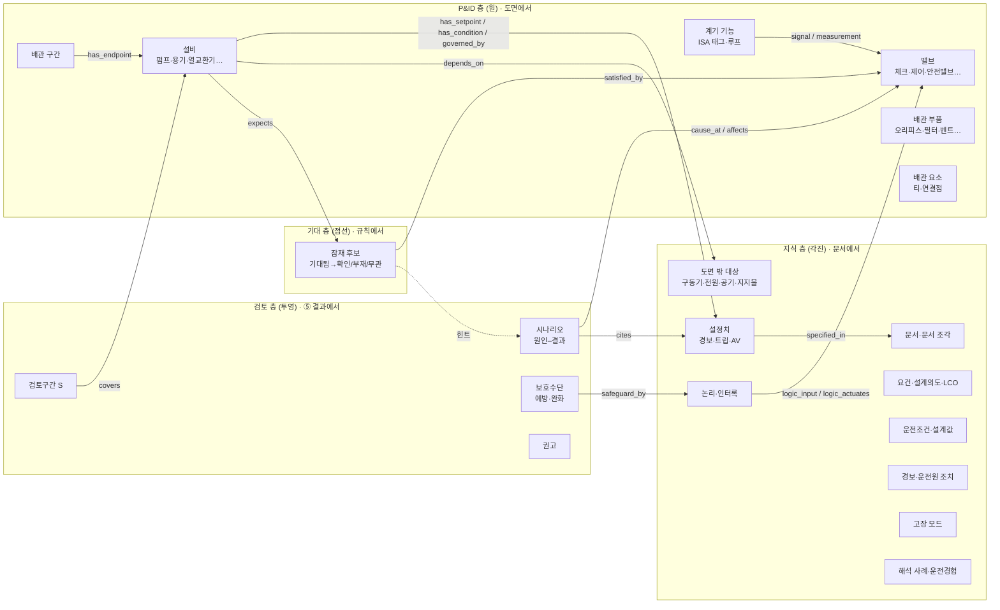
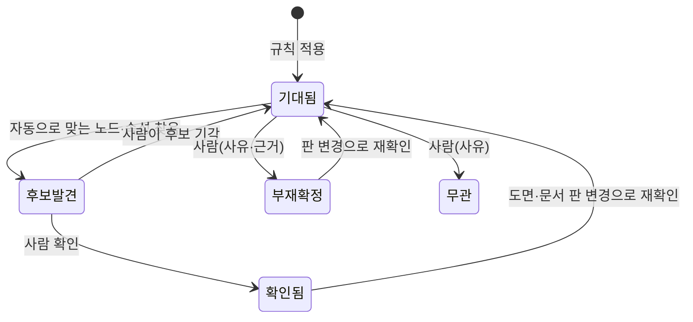

# 지식그래프 스키마 설계안

[전체 기획](overview.md) · [그래프 활용](graph-usage.md) · [정보 통합·관리](integration.md) · [정보 추출](extraction.md) · [HAZOP 기법 지침](hazop-method-guide.md) · 부속: [노드·관계 사전](kg-schema-dictionary.md) · [입력 문서·잠재 후보·추출 갭](kg-schema-input.md)

작성일 2026-11-08. 사용자가 2026-11-08에 §9의 결정 항목 U1~U10을 모두 권장안대로 채택했습니다. M0~M5는 구현했고, M6은 실제 표본 문서를 받은 뒤 진행합니다. 구현하면서 설계안과 달라진 점은 §8.4에 적었습니다.

## 0. 요청 해석과 읽기 범위

### 0.1 요청 해석

| 사용자 표현 | 이 문서의 해석 | 확인 필요 |
| --- | --- | --- |
| "노드종류, I&ID 속성 등 사진에 있는 부분" | ③ 화면 왼쪽 범례(노드 종류·관계 종류·계산 제외·A2)와, P&ID 도면 객체의 속성(밸브 정상 위치·계기 설정치 등)을 뜻한다고 봄. "I&ID"는 P&ID(배관·계장도)와 그 안의 계장(I&C) 정보로 해석 | **예**(§9 U1) |
| "지금 P&ID에 없는 부품" | 두 가지로 나눔. (가) 지금 추출기가 종류로 갖고 있지 않은 부품 클래스(지지물, 구동기, 필터 세부 등) (나) 도면에 그려지지 않지만 HAZOP에 필요한 대상(인터록 논리, 전원·공기 공급, 경보, 운전원 조치) | — |
| "있어야 하는데 없어도 잠재적 후보" | 규칙으로 "있을 것으로 기대되는 것"을 만들고, 사람이 확인·부재 확정·무관으로 닫는 '잠재 후보'(§4, 부속 문서) | — |
| "나중에 분석하는데 활용하는 문서" | 원전 설계·운영 문서(FSAR, 기술지침서, 설정치 목록, 절차서 등) 중 그래프 입력이 될 것(부속 문서 §1) | — |

### 0.2 읽기 범위

| 자료 | 범위 |
| --- | --- |
| 저장소 코드 `hazop/kg/`, `hazop/graph/`, `hazop/study/`, `hazop/extract/rules.py`, `corrections.py` | 하위 조사 담당이 전부 읽고 파일:행 목록으로 정리(총괄은 정리본을 읽음). `drawio.py`·`pdf_vector.py`는 노드·관계 생성부만, `hazop/analysis/*`·`hazop/app/*`는 읽지 않음 |
| 기획서 `graph-usage.md` | §1–§6.4.2, §8, §9 읽음. §6.4.3–§7(WP5 세부·검사 목록)은 제목만 |
| 기획서 `integration.md`·`extraction.md`·`hazop-method-guide.md` | 정의 초안·작성 규칙·DEXPI 대응·용어 절만 |
| `records/decision-log.md`, `records/backlog.md`, `docs/2026-11-05-knowledge-graph/decisions.md` | 지식그래프 관련 행만(검색) |
| 참고 사진 4장 | 2장은 직접 봄, 범례 수치는 기존 [데모 분석](../design/output-screen-ax-demo.md) 54–56행을 씀 |
| 웹 자료 | 표준(DEXPI 2.0.1 등), HAZOP(IEC 61882, KOSHA C-C-37-2026 등), NRC 문서 체계. 출처와 확인 수준은 부속 문서 §5 |

누락 가능성: ④ 탐색 코드(`hazop/analysis/explore.py`)를 읽지 않았으므로 A1 전파가 쓰는 속성 목록은 기획서 기준입니다. 웹 자료 중 유료 표준(IEC 61882 본문, ISA-5.1, KKS, ISO 14224 등)은 원문을 읽지 못했습니다.

## 1. 요약

### 1.1 권장 스키마 한 장 그림

### 1.2 핵심 결정 (권장안)

| # | 결정 | 이유 | 근거 수준 |
| --- | --- | --- | --- |
| KD1 | **층을 넷으로 나눕니다**: P&ID 층, 지식 층, 기대 층(잠재 후보), 검토 층(HAZOP 결과 투영). 원본 파일은 층마다 따로 두고, 합친 그래프는 계산·화면 시점에만 만듭니다(기존 [그래프활용 §2.1](graph-usage.md#21-레이어-분리-원칙) 원칙 유지) | 잠재 후보와 결과가 원본 사실과 섞이면 "도면에 있다"와 "있을 것 같다"와 "AI가 그렇게 썼다"가 구분되지 않음 | [추론] |
| KD2 | **타입 레지스트리 파일 하나**로 노드 클래스·속성·관계를 정의합니다. 지금 약 20곳에 흩어진 고정 목록을 대체합니다 | 같은 '설비 적용 관계' 목록이 세 곳에 중복되고 `algo.py:31–32`만 `analyzed_in`을 더해 4종임(`auto.py:26`, `context.py:16`은 3종). 종류를 늘릴 때마다 여러 파일을 고쳐야 함 | 코드 확인 |
| KD3 | **저장 형식은 필드를 더하기만 하고, 클래스는 `kind`로 해석**합니다. `node_type`(`drawing_object`·`pipe_segment`) 두 값과 `graph.json`의 기존 필드는 바꾸지 않고, 레지스트리가 `kind` → 클래스(상위 클래스 포함)를 정합니다. DEXPI 2.0.1 클래스 이름은 대응 속성(`dexpi_class`)으로만 둡니다 | 기존 검사·④⑤ 함수가 그대로 돌아감. 단 필드가 늘면 `graph_version`은 바뀌므로 판 이전 규칙이 필요함(§8.2). DEXPI 전체 체계(100개가 넘는 클래스, 다중 상속)는 이 앱에 과함(기존 [A13 결정](extraction.md#dexpi-terms) 유지, 이번에 DEXPI 원문으로 이름 확인) | DEXPI 2.0.1 확인, 판단은 [추론] |
| KD4 | **속성 값마다 출처를 답니다**(속성 주장, property claim). 도면 속성·데이터시트 값·문서 값이 같은 형식(값·단위·기준·출처·방법·상태)이 되고, 서로 다르면 충돌로 보존합니다 | 지금 P&ID 속성은 출처 없이 문자열 사전으로 복사되고(drawio) PDF는 속성이 없음. 사람 수정 표시(`human_edit`)는 그래프 생성 때 버려짐 | 코드 확인 |
| KD5 | **상태를 두 축 + 생성 주체로 정리**합니다. 내용 상태(`knowledge_status`)와 연결 상태(`link_status`)는 유지하고, 생성 주체 `origin`(도면 추출·문서 규칙·사람·AI 초안·기대 규칙)을 추가합니다. AI 초안은 사람이 확인하기 전까지 `confirmed`가 될 수 없습니다 | 사용자 요구(추출됨/사람 확인/AI 제안/가설)를 기존 값과 충돌 없이 표현 | [추론] |
| KD6 | **잠재 후보는 별도 노드(`expectation`)와 상태 기계**로 둡니다. 상태는 기대됨 → 후보 발견 → 확인됨 / 부재 확정 / 무관. 규칙 ID·버전·근거를 남기고, 계산 뷰(V4·V5)에는 넣지 않습니다 | 부재 확정은 HAZOP의 '보호수단 없음'·'원인 후보' 단서가 되지만, 확인 전 기대를 사실처럼 계산하면 안 됨 | [추론] |
| KD7 | **HAZOP 결과의 원본은 결과 파일**로 유지하고, 그래프에는 검토 층으로 읽기 전용 투영합니다. 대신 결과 항목(원인·결과·보호수단·권고)에 그래프 대상 참조(`refs`)를 더해 근거 경로를 끝까지 잇습니다 | 지금 원인·결과·보호수단은 자유 문장이고 장비와 연결되지 않음(`results.py`). 결과를 그래프에 원본으로 저장하면 ⑤ 편집·이력 규칙과 두 원본이 생김 | 코드 확인, 판단 [추론] |
| KD8 | **도면 출현과 기능 태그 정체성을 나눕니다**. 같은 태그가 여러 도면에 있으면 사람이 확인한 `same_as`로만 묶습니다(자동 병합 금지 원칙 유지). 계통 코드(`system_code`)·식별 체계(`id_scheme`: KKS·EIIS·사업자 고유)는 선택 속성으로 둡니다 | CFIHOS·ISO 15926의 '태그(기능)와 설치 기기(물리)' 구분. 실제 도면의 식별 체계가 확인되지 않음 | 표준 2차 출처, [추론] |

## 2. 층과 클래스 개요

자세한 속성·허용값은 [노드·관계 사전](kg-schema-dictionary.md)에 있습니다. 여기서는 무엇이 새로 생기고 무엇이 그대로인지만 보입니다.

| 층 | 범례 모양 | 클래스(상위 → 하위) | 지금과 비교 |
| --- | --- | --- | --- |
| P&ID | 원 | 설비(압력용기·탱크·펌프·열교환기·터빈·복수기·탈염기·필터) / 밸브(수동·전동·공기구동·전자·제어·체크·격리·안전방출·파열판) / **배관 부품(오리피스·스트레이너·벤트·드레인·리듀서·유량요소)** / 계기 기능(전송기·제어기·지시계·온도소자·스위치) / 배관 요소(티·끝막음·도면 연결점·노즐) / 배관 구간 | 배관 부품 분류 신설. 오리피스·벤트가 지금은 '설비'로 묶임(`rules.py:10–20`), 필터는 설비 유지(U9). 새 `kind`는 공기구동·전자·방출밸브·파열판·스트레이너·드레인·리듀서·유량요소·맹플랜지·스위치·기록계·노즐·압축기·송풍기·축압기(사전 §2.1) |
| 지식 | 각진 도형 | 문서·문서 조각 / 요건(설계의도·설계기준) / **LCO** / **감시요건** / 설정치 / 운전조건·설계값 / **논리·인터록** / **경보** / **운전원 조치(절차 단계)** / **고장 모드** / 해석 사례(사고해석·과거 HAZOP·운전경험) / **도면 밖 대상(구동기·전원·공기·냉각수 공급·지지물·계통·루프)** | 굵게 쓴 클래스 신설. 요건·해석 사례는 하위 종류(`item`·`case_type`)로 세분 |
| 기대 | 점선 테두리 | 잠재 후보(`expectation`) | 신설 |
| 검토 | 마름모(제안) | 검토구간 / 편차 / 시나리오 / 원인 / 결과 / 보호수단 / 권고 | 신설(투영, 원본은 ⑤ 결과 파일) |

"도면 밖 대상"을 지식 층에 두는 이유: 도면에 그려지지 않은 대상(인터록 논리, 공기 공급 등)을 P&ID 층에 넣으면 "도면에 있다"는 P&ID 층의 의미가 깨집니다. 이 대상은 문서나 사람 입력에서 오고, `on_drawing: false`를 가집니다. 나중에 도면이 개정되어 그려지면 `same_as`로 도면 노드와 잇습니다 [추론].

## 3. 출처·신뢰 상태 모델

| 사용자 표현 | `origin` | `knowledge_status` 시작값 | 확인 후 | 계산 뷰(V4·V5) |
| --- | --- | --- | --- | --- |
| 도면에서 추출됨 | `pid_extract` | `confirmed`(도면 원본 그대로) | — | 포함 |
| 도면 사람 수정 | `human_edit` | `confirmed` | — | 포함, 수정 표시 |
| 문서에서 규칙으로 추출됨 | `doc_rule` | `unknown` | 사람이 `confirmed` | 확인 후 포함 |
| 사람 입력(CSV·화면) | `human` | 입력값 | — | `confirmed`면 포함 |
| AI 제안 | `ai_draft` | `hypothesis` | 사람이 `confirmed` | 확인 후 포함 |
| 기대 규칙(잠재 후보) | `expectation_rule` | 해당 없음(상태 기계 따로) | §4 상태 | **항상 제외** |

- 기존 `method`(`manual`·`regex`·`exact_norm`·`fuzzy`·`extractor`)는 "어떻게 찾았나"로 그대로 둡니다. `origin`은 "누가 만들었나"입니다. 둘을 합치지 않습니다.
- P&ID 노드의 개별 속성 값은 노드와 별도로 주장(claim) 단위 상태를 가집니다(KD4). 예: 도면 노드는 `confirmed`이지만, 그 노드의 `design_pressure` 주장은 문서 규칙 추출이라 `unknown`일 수 있습니다.
- PDF 추출에서 태그를 추정한 경우(`tag_basis`가 [추론])는 노드는 `confirmed`로 두되 그 `tag` 주장만 `hypothesis`로 둡니다. 지금 ③ 자동 연결 문구에 [추론]을 붙이는 결정(2026-11-07)을 주장 단위로 옮긴 것입니다.
- AI 결과는 언제나 초안입니다. `origin: ai_draft`인 항목을 사람 확인 없이 `confirmed`로 올리는 경로는 두지 않습니다(검사 규칙으로 차단).

## 4. 잠재 후보(기대 패턴) 요약

규칙 목록과 상태 전이 표는 [부속 문서 §2](kg-schema-input.md#2-잠재-후보기대-패턴-규칙과-상태-모델)에 있습니다.

- 예: "펌프 출구에는 역류 방지 체크밸브가 기대됨", "압력용기에는 과압 보호수단이 기대됨", "트립 기능 문자가 있는 계기 태그에는 설정치가 기대됨".
- **부재 확정**이 HAZOP으로 이어지는 방식: ⑤ AI 맥락에 "보호수단 미확인·부재 확정 항목"으로 넣고, 검토 화면에서 원인·보호수단 후보 힌트로 보입니다. 권고를 자동으로 만들지 않습니다(기존 원칙).
- **A2와의 관계**: 지금 A2는 "지식이 연결되지 않은 것"만 셉니다. 잠재 후보는 "있어야 할 것이 확인되지 않은 것"을 셉니다. ③ 범례의 A2 묶음에 '기대 공백'을 추가합니다(§8.3).

## 5. 입력 문서와 P&ID 속성 추출 (요약)

자세한 표는 [부속 문서 §1, §3](kg-schema-input.md)입니다.

| 우선 | 문서 | 그래프에 들어가는 것 | 추출 방식 |
| --- | --- | --- | --- |
| P1 | 설정치 목록·계기 목록(표) | 계기 태그·측정변수·범위·경보/트립 설정치·방향 | 규칙(표) |
| P1 | 기기 데이터시트 | 설계압력·온도, 고장 위치, 안전 등급 | 규칙(표) |
| P1 | 계통 설계 기술서(SDD) | 설계의도, 정상·최소·최대 운전조건, 계통 경계 | AI 보조 + 사람 확인 |
| P2 | 기술지침서(TS)·Bases | LCO, 적용 모드, 조치·완료시간, 감시요건, LSSS·허용값 | 규칙(LCO 표 형식) + Bases는 AI 보조 |
| P2 | 논리도·제어루프도 | 인터록 입력·논리·동작, 신호 상실 거동 | AI 보조 + **사람 확인 필수** |
| P2 | 경보대응절차(ARP)·비정상운전절차(AOP) | 경보 → 원인 → 운전원 조치 | 규칙(표) + AI 보조 |
| P3 | FSAR/DCD 5·6·7·9·10·15장 | 계통 기능, 사고해석 가정·해석한계 | AI 보조 + 사람 확인 |
| P3 | 운전경험(LER, NRC Information Notice), 과거 HAZOP | 고장 모드·원인 사례 | 규칙(양식 필드) + AI 보조 |

**P&ID 속성 추출 갭의 핵심**: drawio 추출기는 사용자 속성을 출처 없이 모두 복사하고 정상 위치·고장 위치만 검사합니다. PDF 추출기는 속성을 하나도 남기지 않습니다(`pdf_vector.py`). 사람 수정 연산에는 정상 위치·고장 위치를 고치는 연산이 없습니다(`corrections.py:358–377`). 정상 위치·고장 위치·안전밸브 설정압력은 HAZOP 탐색에 직접 쓰이므로 가장 먼저 메워야 합니다 [추론].

## 6. 확장성

| 요구 | 설계 |
| --- | --- |
| 노드·관계 타입 레지스트리 | `hazop/kg/schema/registry.json`(제안 위치) 하나. 클래스: `id`, `parent`, `layer`, 한국어·영어 이름, 범례 모양·색 토큰, `dexpi_class`. 관계: 도메인·레인지(상위 클래스 허용), 방향, 계산 뷰 포함 여부, A2 역할(설비 적용 여부). 형식은 [사전 §4](kg-schema-dictionary.md#4-타입-레지스트리-형식) |
| 상속 | 단일 상속만. 관계의 허용 쌍은 상위 클래스로 적으면 하위 클래스에 모두 적용 |
| 사용자 확장 | 프로젝트별 `데이터/스키마/<project_id>.json`. 새 클래스는 기존 클래스를 상속해야 하고 ID는 `x_` 접두. 기존 클래스 삭제·의미 변경은 허용하지 않음 |
| 속성 스키마 버전 | 레지스트리에 `registry_version`. 지식그래프 결과에 사용한 레지스트리 버전과 해시를 기록하고 `kg_version` 계산에 넣음(기존 `kg_version` 규칙과 같은 방식) |
| 개정 이력 | 원본 파일은 판마다 새로 쓰고 덮지 않음(기존 원칙). 판이 바뀌면 사람 판단(연결 확인·잠재 후보 상태)을 키로 다시 맞추고, 키가 바뀐 것은 '재확인 필요'(그래프활용 §3.2 방식 재사용) |
| 여러 도면·계통 | 프로젝트 그래프(`project.py`)를 기준으로 함. 계통(`system`)은 지식 층의 '도면 밖 대상'으로 두고 `part_of_system`으로 묶음. 계통 코드가 확인되면 검토구간 제안 기준으로 쓸 수 있음 [추론] |
| 사용되지 않는 `schema_version` | 지금 모든 산출물이 `"0.1"`이고 읽는 코드가 없음. 레지스트리 도입 때 `0.2`로 올리고 읽기 시 판정(옛 판은 변환 함수 하나로 읽음) |

## 7. HAZOP 결과와의 연결

### 7.1 결과 항목별 근거 경로

| 워크시트 칸 | 그래프에서 가리키는 대상 | 대표 경로 | 지금 |
| --- | --- | --- | --- |
| 검토구간(노드) | 구간 구성요소(P&ID 노드) | `S` –covers→ P&ID 노드 | 구성요소는 entity_id 목록(`nodes.py`) |
| 설계의도 | 요건(`item=설계 의도`)·운전조건 | 구성요소 –governed_by / has_condition→ 요건·운전조건 –specified_in→ 문서 조각 | 구간 파일 값만 사용 |
| 변수·가이드워드·편차 | 편차 카탈로그(KOSHA 별표3 기반) | 데이터 파일(그래프 밖) | 그대로 |
| 원인 | 원인 위치 P&ID 노드, 선택적으로 고장 모드·운전원 조치·상류 편차 | 원인 –cause_at→ 밸브 / –cause_mode→ 고장 모드(FTC 등) | 자유 문장 |
| 결과 | 영향을 받는 P&ID 노드(다른 구간일 수 있음), 관련 해석 사례 | 결과 –affects→ 용기, 경로는 A1 물리 전파 | 자유 문장 |
| 보호수단 | 구현 대상(안전밸브·인터록 논리·경보+운전원 조치)과 역할(예방·완화) | 보호수단 –safeguard_by→ PSV –has_setpoint→ 설정압력 –specified_in→ 문서 | 자유 문장 목록 |
| 위험도 | 빈도(기존 보호수단 고려)·강도(보호수단 미고려) | 결과 파일 값 | KOSHA 행렬 값 |
| 권고 | 대상 시나리오, 관련 잠재 후보(부재 확정) | 권고 –addresses→ 시나리오, 시나리오 –raised_from→ 잠재 후보 | 자유 문장 |
| 근거 | 위 경로의 노드·관계 ID와 출처 문서 | `ai_basis.kg_paths`(이미 있음) | 경로 검증 있음(`ai_cells.py`) |

- 지침 관계: 앱의 편차 목록과 위험도 행렬은 회분식 지침 KOSHA P-86-2017(지금은 C-C-41-2026 계열, 발췌)을 씁니다([HAZOP 기법 지침](hazop-method-guide.md)). 이 문서가 인용하는 C-C-37-2026은 연속공정 지침(옛 P-82)이며, 기법지침 §2에서 "연속식 지침 번호 미확인"이던 부분이 이번 조사로 확인되었습니다. 편차 카탈로그를 연속식으로 바꿀지는 이 설계의 범위가 아닙니다.
- 위험도 규칙: KOSHA C-C-37-2026 6.5(3)는 빈도는 현재 안전조치를 고려하고 강도는 고려하지 않는다고 정합니다(하위 조사에서 원문 확인). 보호수단을 예방·완화로 나누면 이 규칙을 적용할 근거가 그래프에 남습니다 [추론].
- 보호수단의 IPL 여부는 시나리오마다 다릅니다(CCPS LOPA 기준, PT Note 171로 확인). 그래서 `ipl` 표시는 보호수단 노드가 아니라 **시나리오–보호수단 관계의 속성**으로 둡니다. LOPA 자체는 후속입니다.
- 원전 안전계통 계측은 IEC 61511(SIF·SIL)이 아니라 원자력 기준(IEEE 603, Class 1E 등)의 적용을 받는다고 봅니다 [일반지식]. 따라서 SIL 속성은 넣지 않습니다.

### 7.2 결과 파일에 더할 참조 (단계 간 규격 변경)

결과 항목(`entries[]`)에 다음 선택 필드를 더합니다. 없으면 지금처럼 자유 문장만 씁니다(하위 호환).

| 필드 | 형식 | 예 |
| --- | --- | --- |
| `cause_refs` | 대상 참조 목록 + 선택적 `failure_mode` | `[{ref: "graph-SNP-M-102#<source_object_id>", failure_mode: "FTC"}]` |
| `consequence_refs` | 대상 참조 목록 | 다른 구간 대상 허용 |
| `safeguards[]` | 문자열 대신 `{text, role: preventive\|mitigative\|unknown, refs, ipl: null}` 허용 | 문자열이면 `role: unknown`으로 읽음 |
| `expectation_refs` | 관련 잠재 후보 ID | 부재 확정 과압 보호 |

대상 참조는 프로젝트 그래프 ID(`<graph_id>/<entity_id>`)가 아니라 안정 참조(`graph_id#source_object_id`)로 저장합니다. 지금 `members`와 `kg_paths`는 재추출 때 바뀌는 entity_id를 저장해 판 변경 표시에만 기대고 있습니다(하위 조사 §10.2). 이 문제는 결과 파일 참조를 새로 만들 때 같은 실수를 반복하지 않는 것으로 막습니다 [추론].

## 8. 현재 구현에서 옮겨 가는 경로

### 8.1 유지하는 것

- `graph.json` 형식(`node_type` 두 값, `has_endpoint` 구간 노드 방식)의 기존 필드. 필드는 더하기만 합니다. 다만 M1·M2·M3은 그래프 빌더나 추출 결과를 바꾸므로 `graph_version`이 바뀝니다(아래 '판 이전').
- 프로젝트 그래프 결합 규칙, `kg_version`·포인터·불변 결과 폴더.
- 지식 노드 6종과 관계 8종의 이름·의미. 새 클래스는 기존 것을 대체하지 않고 더합니다.
- 계산 포함 규칙(V4: 확인된 것만), 후보 키·재확인 규칙, 검사 K1~K8(그래프활용 §7.2).
- 관계 이름 소문자 snake_case(기존 D4).

### 8.2 단계별 구현 계획

규모는 [CLAUDE.md](../CLAUDE.md)의 소·중·대 기준입니다. 순서는 "기존 동작을 안 바꾸는 정리 → 데이터 보강 → 새 기능"입니다.

| 단계 | 내용 | 바뀌는 곳 | 규모 | 완료 기준 |
| --- | --- | --- | --- | --- |
| M0 | 레지스트리 파일 도입, 흩어진 고정 목록 약 20곳을 레지스트리 조회로 교체. **동작 불변** | `kg/build.py`, `auto.py`, `algo.py`, `context.py`, `screen.py`·템플릿, `extract/rules.py` 읽기부 | 대 | 기존 검사·테스트 전부 통과, `kg_version` 변화는 레지스트리 해시 추가분만 |
| M1 | `origin` 필드, 사람 수정 표시를 그래프까지 전달, `docextract` 문서 조각에 `mentions` 후보 생성(지금은 자동 지식그래프에서 모든 조각이 A2 고아로 잡힘, 코드 경로 추론이며 실행 미확인) | `graph/build.py`, `kg/auto.py`, `link.py` | 중 | 샘플 자동 지식그래프의 조각 고아 수가 후보 확인 후 줄어듦 |
| M2 | P&ID 클래스 확장(새 `kind`, 배관 부품 분류), ISA 태그 파싱(측정변수·기능 문자·루프 번호), 속성 사전 검사(경고만), 정상 위치·고장 위치 수정 연산 추가 | `extract/rules.py`, `drawio.py`, `pdf_vector.py`, `corrections.py` | 대 | 샘플 6세트에서 분류 변경 목록과 미확인 수 보고 |
| M3 | 속성 주장(claim) 형식과 충돌 일반화(충돌 검사 K7 확장) | `kg/build.py`, `graph/build.py` | 중 | 도면값·문서값 충돌 샘플 1건이 화면에 충돌로 보임 |
| M4 | 잠재 후보 규칙 엔진(초기 규칙 E01~E08), 상태 저장 파일, ③ 범례 '잠재 후보' | 새 `kg/expect.py`, `screen.py` | 대 | 샘플에서 규칙별 기대·후보 발견·미발견 수 보고, 상태 키 재실행 시 유지 |
| M5 | 결과 파일 참조(§7.2), 검토 층 투영, 보호수단 역할 | `study/results.py`, `ai_cells.py`, `export/study_xlsx.py` | 대 | 옛 결과 파일이 그대로 읽힘, 새 필드가 Excel 근거 열에 나옴 |
| M6 | 새 문서 종류 추출: 설정치 목록·계기 목록(CSV·Excel 표), 기술지침서 LCO 표 | 새 추출기 | 대 | 표본 문서로 정확도 측정(실제 문서 필요) |

M0이 먼저인 이유: 레지스트리 없이 M2·M4를 하면 새 종류마다 같은 목록을 여러 파일에서 고쳐야 하고, 이미 세 곳에 중복된 목록 중 하나는 내용이 다릅니다.

**판 이전 (M1·M2·M3 공통 완료 기준).** `graph_version`은 빌더 버전과 추출 내용의 해시입니다(`graph/build.py:56–59`). 이 단계들이 빌더나 추출을 바꾸면 모든 도면의 판이 바뀝니다. 그러면 확정된 검토구간이 판 변경 상태가 되고(`study/nodes.py`의 판 비교), ⑤는 다른 판으로 확정된 구간을 쓰지 않습니다(결정로그 2026-11-07). 사용자가 확정한 작업을 못 쓰게 되는 경로입니다 [추론, 코드 경로 기준·실행 미확인]. 각 단계는 다음을 완료 기준에 포함합니다.

1. 확정 구간과 ⑤ 결과의 구성요소를 `source_object_id`로 새 판 entity_id에 다시 대응시킵니다. 모두 대응되고 구성요소 집합이 같으면 구간 확정을 유지하고 이력에 '판 이전'을 남깁니다.
2. 대응되지 않는 구성요소가 하나라도 있으면 지금처럼 '재확인 필요'로 두고 사람이 판단합니다.
3. 샘플 확정 구간·결과로 이전 결과(유지 수·재확인 수)를 보고합니다.

판 이전 규칙 자체가 단계 간 규격 변경이므로 M1 착수 전에 별도 작업 단위로 정합니다(§9 U10).

### 8.3 범례·필터 UI 영향

| 왼쪽 패널 묶음 | 지금 | 바뀜 |
| --- | --- | --- |
| 노드 종류 | P&ID 층 5, 지식 층 6 | P&ID 층에 '배관 부품' 추가(6). 지식 층은 상위 클래스 단위로 접어서 보임(문서·요건·값·논리·운전·고장·사례·도면 밖 대상, 8). 하위 클래스는 펼침 |
| 기대 층 | 없음 | '잠재 후보' 묶음 신설: 기대됨·후보 발견·부재 확정(무관은 기본 숨김) |
| 검토 층 | 없음 | 기본 꺼짐. 켜면 선택 구간의 시나리오·보호수단만 보임(전역 표시는 노드 수 폭증) |
| 관계 종류 | 7묶음 | '보호·제어'(protects, logic_input, logic_actuates, in_loop, actuated_by), '운전'(alarm_on, responded_by, acts_on), '기대'(expects, satisfied_by), '정체성'(same_as), '검토'(검토 층 관계) 추가 |
| 계산 제외 항목 표시 | 후보 링크·미확인·재확인 | 'AI 초안'을 따로 추가(`origin: ai_draft`) |
| A2 고아·근거 공백 | 고아·근거 공백·지식 입력 없음 | '기대 공백'(부재 확정 + 아직 기대됨) 추가 |

색은 2026-11-08 옵시디언식 결정(채도 낮은 계열, 계열 안 명도 차)을 따릅니다. 새 묶음 색 토큰은 디자인 담당이 정합니다.

### 8.4 구현하며 달라진 점 (2026-11-09)

| 단계 | 설계안 | 구현 | 이유 |
| --- | --- | --- | --- |
| U10 | 구성요소 집합이 같으면 확정 유지 | 집합에 더해 종류·태그·배관 번호·흐름 방향·연결·정상 위치·고장 위치가 같아야 유지 | ② 도면 수정 시 ④·⑤를 재확인한다는 결정(2026-11-07). 정상·고장 위치는 ⑤ 원인·결과 판단이 기댐 |
| U10 | 판 이전 대상 | 옛 도면별 확정본도 이전(쓰기 전 `데이터/백업/`에 사본) | 실제 확정본이 도면별 저장본뿐이라 제외하면 확정 작업을 잃음 |
| M1·M2 | 빌더·추출이 바뀌면 판이 바뀜 | 빌더·규칙 판 번호는 올리지 않음. 내용이 바뀐 도면만 판이 바뀜 | 수정 없는 도면까지 재확인으로 보내지 않기 위함 |
| M1 | 자동 지식그래프에서 문서 조각이 모두 A2 고아 | 조각은 미확인이라 A2 판정 대상이 아님(실행 확인) | 코드 경로 추론이 틀렸음 |
| M3 | `graph/build.py` 수정, 판 변경 | 지식그래프 빌드에서만 주장을 만들고 그래프 판은 그대로 | 확정 구간에 영향 없음 |
| M4 | §4 상태도에 무관→기대됨 없음 | 규칙 판·대상 내용이 바뀌면 무관도 재확인. 확인됨·부재 확정·무관에 '판단 되돌리기' 추가 | 부속 문서 §2.1을 따름. 잘못 누른 판단을 되돌릴 길이 없었음 |
| M5 | 결과 참조의 사람 확인 | 참조마다 확인하지 않고 항목 승인으로 대신 | ⑤의 승인 흐름과 같게. 사람이 고친 참조는 `human`, 항목은 다시 승인 |

## 9. 사용자가 결정할 항목

| # | 결정 | 선택지 | 권장안과 근거 |
| --- | --- | --- | --- |
| U1 | "I&ID"의 뜻 | (가) P&ID와 그 안의 계장 정보 (나) 별도 문서인 계장 루프도·I&C 도면 | **(가)로 진행.** (나)라면 부속 문서 §1의 논리도·루프도 우선순위를 P1으로 올림 |
| U2 | 검토 층(HAZOP 결과)을 그래프 원본으로 저장할지 | (가) 결과 파일이 원본, 그래프는 투영 (나) 그래프에 원본 저장 | **(가).** ⑤ 편집·승인·이력 규칙이 이미 결과 파일에 있음. 두 원본은 불일치를 만듦 [추론] |
| U3 | 잠재 후보 규칙의 근거 수준 | (가) [일반지식] 규칙도 허용하되 표시하고 후보로만 씀 (나) 표준·사업자 기준 원문이 확인된 규칙만 | **(가).** 규칙 결과는 확인 전까지 계산·근거에 들어가지 않으므로 위험이 낮음. 규칙마다 근거 수준을 표시 |
| U4 | 설비 식별 체계 | KKS / EIIS / 사업자 고유 / 아직 모름 | **아직 모름으로 두고 선택 속성만.** 국내 원전의 KKS 사용 여부를 이번 조사에서 확인하지 못함. 실제 도면 태그 규칙을 받으면 파서를 정함 |
| U5 | P&ID 속성 주장(claim) 형식 도입 | (가) 도입(M3) (나) 지금처럼 `attributes` 사전 유지 | **(가).** 데이터시트·문서 값이 들어오면 출처 없는 사전으로는 충돌을 가릴 수 없음 |
| U6 | 보호수단 범위 | (가) 예방·완화 역할만 (나) LOPA(IPL·PFD·빈도)까지 | **(가), LOPA는 후속.** 원전 신뢰도 자료(PFD 등)를 앱이 가질 경로가 없음(INPO 자료 비공개) |
| U7 | 첫 입력 문서 | 설정치 목록·계기 목록·데이터시트(표) / SDD / 기술지침서 | **표 문서 먼저.** 규칙 추출로 정확도를 잴 수 있고, 정상 위치·고장 위치·설정치 갭을 바로 메움. 실제(또는 공개) 표본 문서가 필요함 |
| U8 | 안전 등급 속성 체계 | (가) 국내 원안위 안전등급(1·2·3·비안전) (나) 미국 safety-related/non-safety-related + 품질군·내진범주 (다) 둘 다 선택 속성 | **(다).** 대상 발전소·문서가 정해지지 않음. '비안전' 등급 이름은 [추론]이며 원문 확인 전. 값 목록은 원문 확인 후 확정(원안위 고시는 2026-06 개정 의결 후 행정절차 중이라는 2차 정보만 있음) |
| U9 | 오리피스·벤트·필터의 분류 이동 | (가) '배관 부품'으로 옮김 (나) '설비' 유지 | **(가), 단 필터·탈염기는 설비 유지.** DEXPI도 오리피스를 배관 쪽(RestrictionOrifice)에 둠. 검토구간 제안 규칙(설비에서 끊음)이 바뀌므로 구간 재제안이 생김 — 영향 확인 후 결정 |
| U10 | 그래프 판이 바뀔 때 확정 구간·⑤ 결과 처리 | (가) `source_object_id`로 다시 대응되면 확정 유지, 안 되면 재확인 (나) 지금처럼 판이 바뀌면 모두 재확인 | **(가).** M1~M3은 사용자가 고친 것이 없어도 모든 도면의 판을 바꿈. (나)면 확정 작업 전체를 다시 확인해야 함. 대응 규칙은 보수적으로(구성요소 집합이 정확히 같을 때만 유지) |

## 10. 용어와 정의 출처

| 용어 | 이 문서에서의 뜻 | 정의 출처 | 확인 수준 |
| --- | --- | --- | --- |
| 검토구간 (node / part) | HAZOP에서 편차를 검토하는 확정된 설비 구간. IEC는 part라고 부름 | KOSHA C-C-37-2026 §3, IEC 61882:2016(Primatech 비교 백서) | KOSHA 원문 확인, IEC는 2차 출처 |
| 보호수단 (safeguard) | HAZOP의 현재 안전조치. NRC 문맥의 safeguards(핵물질 방호)와 다름 | KOSHA C-C-37-2026 §3; IEC 61882:2016은 control이라 부름 | 2차 출처(IEC) |
| 안전 관련 (safety-related SSC) | 설계기준사건 중·후에 기능을 유지해 원자로냉각재압력경계 건전성, 원자로 정지·안전정지 유지, 사고 방지·완화를 보장하는 SSC | 10 CFR 50.2 | LII 사본 확인, eCFR 원문 대조 필요 |
| 안전에 중요한 (important to safety) | 공중 안전에 과도한 위험 없이 운전할 수 있다는 합리적 보증을 주는 SSC. 규정상 독립 정의 조항은 없음 | 10 CFR 50 부록 A 서론 | LII 사본 확인 |
| 설계기준 (design bases) | SSC가 수행할 기능과 그 설계 기준값(제어변수의 값·범위) | 10 CFR 50.2 | LII 사본 확인 |
| 운전제한조건 (LCO) | 안전운전에 필요한 기기의 최저 기능·성능 수준 | 10 CFR 50.36(c)(2)(i) | LII 사본 확인 |
| 감시요건 (surveillance requirement) | 시험·교정·점검 요건 | 10 CFR 50.36(c)(3) | LII 사본 확인 |
| 안전계통 설정 한계 (LSSS) | 자동 보호장치의 설정 | 10 CFR 50.36(c)(1)(ii)(A) | LII 사본 확인 |
| 해석한계 / 허용값 (analytical limit / allowable value) | 사고해석이 보호동작 개시를 가정한 값 / 감시시험에서 as-found 설정의 한계 | NRC RIS 2006-17(ML051810077) 발췌. 원 정의는 ISA-67.04.01-2018(RG 1.105 Rev. 4가 승인)에 있음 | **검색 발췌만**, 문구 미검증, ISA 원문 미확인 |
| 단일 고장 (single failure) | 안전기능 상실을 일으키는 하나의 사건과 그 연쇄 고장 | 10 CFR 50 부록 A Definitions | LII 사본 확인 |
| 예상운전과도 (AOO) | 수명 중 한 번 이상 예상되는 정상운전 이탈 | 10 CFR 50 부록 A Definitions | LII 사본 확인 |
| 안전기능 (safety function), SSC | 10 CFR 50.2에 독립 정의 조항을 찾지 못함. 용례 기반으로 씀 | — | 정의 출처 없음 |

규정 문구를 판정에 쓸 때는 eCFR·원안위 원문을 다시 확인합니다. LII는 공식 판본이 아닙니다.

## 11. 직접 확인해야 할 부분

1. §9 결정 항목, 특히 U1(I&ID 해석)과 U4(식별 체계).
2. 잠재 후보 규칙(부속 문서 §2)의 근거 수준. 대부분 [일반지식]이며 실제 발전소 설계 기준과 다를 수 있습니다.
3. 입력 문서의 추출 방식 열은 공개 자료와 일반지식으로 정했고 실제 사업자 문서로 시험하지 않았습니다.
4. §10 용어 중 '검색 발췌만' 표시 항목(해석한계·허용값)과 IEC 61882 정의는 원문 확인이 필요합니다.
5. M1의 "자동 지식그래프에서 모든 조각이 고아" 판단은 코드를 읽어 추론한 것이며 실행으로 확인하지 않았습니다.
